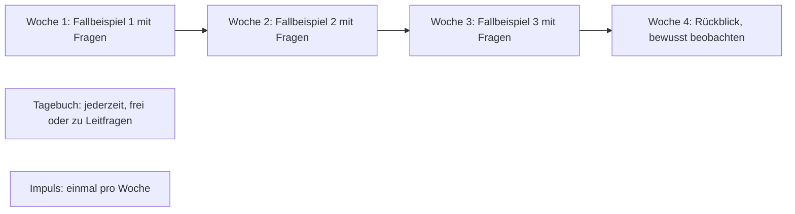

# Anforderungen an die Pilot-Version (#4)

Grundlage: Fragebogen der Auftraggeberin, Feedback zum Prototyp ([prototyp.md](prototyp.md)) und das Treffen vom 30.10.2026. Die Technik steht in [ADR-001](adr/ADR-001-technik-pilot.md).

Herkunft der Entscheidungen: **A** = Auftraggeberin, **K** = Koschi (Betreiber), **C** = Claude (eigene Entscheidung, begründet). Inhalte der Auftraggeberin stehen nicht in diesem Repo.

## Zweck

Das Instrument ist eine **Intervention**: Lehrpersonen sollen über einige Wochen ihre eigenen Haltungen im Unterricht reflektieren. Die Einträge dienen der Auftraggeberin als Grundlage für spätere Interviews mit den Lehrpersonen («Hat das Instrument geholfen?»), nicht für eine statistische Auswertung. Eine Überarbeitung nach dem Pilot ist nicht vorgesehen.

Erfolg heisst: Die Lehrpersonen nutzen es ohne Hilfe auf dem Gerät, das sie gerade zur Hand haben. Die Auftraggeberin kann alle Einträge lesen und anhören und hat am Schluss eine Tabelle für die Interviews.

## Rahmen

| Punkt | Festlegung | Herkunft |
|---|---|---|
| Teilnehmende | 4 Lehrpersonen, keine Reserve | A |
| Laufzeit | 4 Wochen, Start Mo 23.11.2026, Ende Fr 18.12.2026 (vor den Weihnachtsferien) | A: «Zeitplan einhalten» |
| Geräte | Handy, Tablet und Computer, alle müssen gehen | A |
| Einführung | Die Auftraggeberin führt jede Lehrperson persönlich ein; im Instrument erklärt der Infoblock | A |
| Erinnerungen | Die Auftraggeberin schickt sie selbst: per WhatsApp oder als Benachrichtigung aus der Verwaltung (#37). Die Lehrpersonen schalten Benachrichtigungen pro Gerät freiwillig ein. | A (Wunsch nach dem Treffen: «Push-Benachrichtigungen, die ich auslöse») |
| Testlauf | Die Auftraggeberin testet selbst mit Testkonten in allen Rollen, gern früher als geplant | A |
| Datenschutz und Hochschule | Einwilligung, Ethik und Vorgaben der Hochschule klärt die Auftraggeberin selbst | A |

## Rollen

| Rolle | Darf | Zugang |
|---|---|---|
| **Lehrperson** | eigene Runden beantworten, Tagebuch führen, eigene Einträge lesen, ändern und löschen. Sieht nichts von den anderen. | Benutzername und Passwort |
| **Auftraggeberin** | alle Inhalte erfassen und ändern, Konten der Lehrpersonen anlegen, alle Einträge lesen und anhören, exportieren | Benutzername und Passwort |
| **Gast** (Dozentin, Öffentlichkeit) | das Produkt mit den echten Inhalten durchklicken. Es wird nichts gespeichert, es sind keine Einträge sichtbar. | Knopf «Ansehen ohne Konto» auf der Login-Seite, ohne Passwort (K) |
| **Betreiber** (Koschi) | Hosting, Einrichtung des Kontos der Auftraggeberin, Löschung am Schluss | Server-Zugang, keine eigene Rolle in der App |

Die Adresse führt direkt auf die Login-Seite (A). Die Auftraggeberin sieht bei jedem Eintrag den Namen der Lehrperson (A) und liest schon während der Laufzeit mit (A). Die Lehrpersonen erfahren beides vorher, über ihre Einführung und einen Hinweistext.

## Ablauf für eine Lehrperson

- Pro Woche wird eine **Runde** freigeschaltet. In den Wochen 1–3 hat jede Runde ein Fallbeispiel, alle bekommen dasselbe (A). Woche 4 hat kein Fallbeispiel, sondern ruft zum bewussten Beobachten und zum Rückblick auf (A).
- Ein Rückblick auf die eigenen Antworten aus Runde 1 ist nicht nötig (A).
- Das **Tagebuch** steht jederzeit offen.
- Einmal pro Woche gibt es einen **Impuls** (A).

## Bausteine

**Muss**: ohne das kein Pilot. **Soll**: geplant, fällt nur bei Zeitnot weg. «Kann»-Punkte gibt es bewusst keine; was nicht Muss oder Soll ist, steht unter «Bewusst nicht gebaut».

### Anmeldung und Konten

| Prio | Anforderung | Herkunft |
|---|---|---|
| Muss | Eine Login-Seite mit Benutzername und Passwort. Jede Person hat ihr eigenes Konto, die Rolle hängt am Konto. | A |
| Muss | Eine Lehrperson sieht ausschliesslich ihre eigenen Einträge, auch nicht über direkte Adressen | A |
| Muss | Die Auftraggeberin legt Konten an (Anzeigename, Benutzername, Passwort), setzt Passwörter zurück und löscht Konten samt Einträgen | C: Sie verteilt die Zugänge bei der Einführung selbst. Löschen braucht es für die Testkonten. |
| Muss | «Angemeldet bleiben» (etwa 30 Tage) als Häkchen beim Login, standardmässig an. Abmelden ist jederzeit möglich. | C: Das Tagebuch lebt vom Moment. Das Häkchen lässt sich auf gemeinsam genutzten Schulcomputern abwählen. |
| Muss | Schutz gegen das Durchprobieren von Passwörtern | C |
| Muss | Passwort zurücksetzen oder Konto löschen beendet alle Sitzungen dieses Kontos, auf allen Geräten | C: für vergessene Anmeldungen auf gemeinsam genutzten Geräten |
| — | Kein «Passwort vergessen» per E-Mail. Die Auftraggeberin setzt es zurück. | C: Es werden keine E-Mail-Adressen gespeichert |

### Runden mit Fallbeispiel und Fragen

| Prio | Anforderung | Herkunft |
|---|---|---|
| Muss | Eine Runde hat einen Titel, einen optionalen Fallbeispiel-Text, eine Liste von Fragen und ein Freischaltdatum | C: Woche 4 ohne Fallbeispiel ist damit eine normale Runde. Die Auftraggeberin gestaltet sie selbst. |
| Muss | Fragetypen: Freitext und Skala | A: «Skala ist gut» |
| Muss | Eine Runde erscheint ab ihrem Freischaltdatum. Freigeschaltete Runden bleiben offen. | A: eine pro Woche. C: Datum statt Knopf, damit sie nicht daran denken muss |
| Muss | Antworten werden gespeichert, sobald die Lehrperson auf «Speichern» tippt, und lassen sich jederzeit ändern oder löschen. Es gibt kein endgültiges Abschicken. | A: «anpassbar/bearbeitbar sollen die Antworten immer sein» |
| Soll | Antworten auf Fragen auch als Sprachaufnahme | A: «wäre schön» |

### Tagebuch (Notizbüchlein)

| Prio | Anforderung | Herkunft |
|---|---|---|
| Muss | Beim Erstellen eines Eintrags wählen: frei schreiben, frei sprechen (Aufnahme) oder zu Leitfragen schreiben | A |
| Muss | Sprachaufnahme direkt im Browser, auf Handy und Computer | A: «Tagebuch soll einsprechbar sein» |
| Muss | Gut sichtbarer Hinweis: keine Namen, keine Orte, keine Klassenbezeichnungen, nichts, was Rückschlüsse auf Personen erlaubt | A |
| Muss | Einträge ändern und löschen | A |
| Muss | «Meine Einträge»: alle eigenen Einträge chronologisch, wie im Prototyp | A: «passt so» |

### Impulse

| Prio | Anforderung | Herkunft |
|---|---|---|
| Muss | Die Auftraggeberin erfasst Impulse (Text, sichtbar ab Datum) in der Eingabemaske | A |
| Muss | Der aktuelle Impuls steht auf der Startseite. Daraus entsteht mit einem Tipp ein Tagebucheintrag. | A: Startseite «gut» |

### Infoblock und Texte

| Prio | Anforderung | Herkunft |
|---|---|---|
| Muss | Infoblock aus kurzen, aufklappbaren Abschnitten, jederzeit erreichbar. Er enthält auch die Erklärung zur Bedienung. | A |
| Muss | Alle Texte (Titel, Begrüssung, Infoblock, Fallbeispiele, Fragen, Leitfragen, Impulse, Hinweistexte) sind Inhalt, kein Code. Die Auftraggeberin erfasst sie selbst. | A |
| Muss | Einfache Formatierung: Absätze, Aufzählungen, Hervorhebung | C |

### Eingabemaske der Auftraggeberin

| Prio | Anforderung | Herkunft |
|---|---|---|
| Muss | Formulare für alle Inhalte oben, inklusive Reihenfolge und Freischaltdaten | A: «Sie soll die Texte selbst bearbeiten und einfügen» |
| Muss | Vorschau: So sieht es eine Lehrperson, auch für noch nicht freigeschaltete Runden. Nur für die Auftraggeberin. | A |
| Muss | Projektstart festlegen (daraus ergibt sich die Woche jedes Eintrags) | C: wird für den Export gebraucht |

### Einträge lesen und Export

| Prio | Anforderung | Herkunft |
|---|---|---|
| Muss | Übersicht pro Lehrperson (Runden beantwortet, Anzahl Tagebucheinträge) | Prototyp |
| Muss | Alle Einträge lesen und Aufnahmen anhören, filtern nach Lehrperson | A |
| Muss | Export als Tabelle, die sich in Excel öffnen lässt: geordnet nach Woche, mit der Angabe angeleitet (Runde) oder freiwillig (Tagebuch, Impuls), Aufnahmen als Link | A |
| Muss | Gesamtexport als ZIP: Tabelle plus alle Aufnahmen als Dateien. In der Tabelle steht pro Aufnahme der Dateiname. | C: Sie hat so alles für die Interviews bei sich, und die App kann abgebaut werden, ohne dass sie auf die Links angewiesen ist |
| — | Kein Ausdruck pro Lehrperson | A: «momentan nicht» |

### Gast-Ansicht

| Prio | Anforderung | Herkunft |
|---|---|---|
| Muss | Knopf «Ansehen ohne Konto»: die Lehrpersonen-Ansicht mit den aktuellen Inhalten, deutlicher Hinweis «Ansicht ohne Speichern» | A, K |
| Muss | Die Gast-Ansicht zeigt nur Runden und Impulse, die schon freigeschaltet sind, also dieselbe Regel wie für die Lehrpersonen. Nach Woche 4 ist alles sichtbar. | C: Sonst könnten Lehrpersonen über den Gast-Knopf vorauslesen, und die wöchentliche Freischaltung wäre wirkungslos |
| — | Die Inhalte (Fallbeispiele, Fragen) sind über die Gast-Ansicht öffentlich. Die Auftraggeberin wird darauf hingewiesen. | K |
| Muss | Der Server speichert nichts, und es sind keine Einträge sichtbar | A |
| — | Online bis Projektende, danach mit allem anderen abgebaut | K |

### Gestaltung

| Prio | Anforderung | Herkunft |
|---|---|---|
| Muss | Ruhig und professionell, keine Emojis, kein Chatbot-Look. Umsetzung siehe [Design Gestaltung](superpowers/specs/2026-10-31-gestaltung-design.md) (#20). | A |
| Muss | Mobile-first, aber auch am Computer gut bedienbar | A |
| Soll | Bereiche (zum Beispiel Runden, Tagebuch, Impulse, Info) mit Farben kennzeichnen, um die Navigation zu erleichtern | A |
| Soll | Stil und Farben nach Vorgaben der Auftraggeberin anpassen | A: nennt eine Website als Vorlage, «eine Anlehnung, eine Tendenz reicht» |

## Bewusst nicht gebaut

| Was | Begründung |
|---|---|
| Benachrichtigungen per E-Mail oder SMS, automatische oder zeitgesteuerte Benachrichtigungen | Sie erinnert selbst (WhatsApp oder Benachrichtigung aus der Verwaltung, #37). So braucht es keine Kontaktdaten. |
| Automatische Transkription der Aufnahmen | A: «muss nicht sein». C: Sprachdaten müssten an einen Drittanbieter gehen oder auf einem viel grösseren Server laufen. Nicht im Pilot. |
| Versionsverlauf geänderter Antworten | Nicht verlangt. Gespeichert wird der aktuelle Stand mit Erstell- und Änderungsdatum. |
| Statistik oder Auswertung in der App | Die Auswertung macht sie mit den Interviews |
| Selbstregistrierung, mehrere Projekte, mehrere Sprachen | 4 bekannte Personen, ein Pilot |
| Rückblick auf die eigenen Antworten aus Runde 1 | A: «nicht nötig» |

## Datenschutz (technischer Teil)

Die rechtliche Seite (Einwilligung, Vorgaben der Hochschule) klärt die Auftraggeberin selbst (#3). Technisch gilt:
- Daten liegen in der EU (Region Frankfurt). Der Anbieter ist ein US-Unternehmen, das weiss die Auftraggeberin für ihre Abklärung.
- Gespeichert werden nur Anzeigename, Benutzername, Passwort-Hash, Einträge und Aufnahmen. Keine E-Mail-Adressen, kein Tracking, keine externen Schriften oder Skripte, keine IP-Adressen in den Logs. Einzelheiten und Hinweistexte: [datenschutz.md](datenschutz.md).
- Löschung nach Projektende samt Sicherungskopien, in zwei Stufen: zuerst die Forschungsdaten, danach die App mit der Gast-Ansicht. Daten von der Auftraggeberin, Ablauf im [Löschkonzept](loeschkonzept.md) (#8, #10).

## Zeitplan

Schätzung von Claude:

| Bis | Was | Wer |
|---|---|---|
| Mo 2.11. | Zusammenfassung dieser Anforderungen an die Auftraggeberin | Koschi |
| Fr 6.11. | Rückmeldung zur Zusammenfassung, Input zu Stil und Farben | Auftraggeberin |
| Mi 11.11. | Login, Konten und Eingabemaske online. Sie kann Inhalte erfassen. | Claude |
| Fr 13.11. | Lehrpersonen-Ansicht (noch ohne Aufnahmen) und Vorschau ihrer Inhalte. Sie öffnet den Link einmal im Schul-WLAN und auf einem Schulgerät. | Claude, Auftraggeberin |
| Mo 16.11. | Sprachaufnahmen, Ansicht der Einträge, Export fertig. Testlauf kann beginnen. | Claude |
| Fr 20.11. | Inhalte erfasst, Testlauf gemacht (inklusive Aufnahme auf einem Schulgerät), Testdaten gelöscht, Konten der Lehrpersonen angelegt | Auftraggeberin |
| Mo 23.11. | Start | alle |
| Fr 18.12. | Ende der Laufzeit | |

## Offen bei der Auftraggeberin

- Input zu Stil, Auftritt und Farbkonzept (sie schickt ihn)
- Funktionieren Adresse und Mikrofon im Schulnetz und auf Schulgeräten? Ein Webfilter könnte `fly.dev`-Adressen sperren, verwaltete Geräte das Mikrofon. Dann bräuchte es eine eigene Domain oder Tippen statt Sprechen.
- Bestätigung dieser Anforderungen (in einfacher Sprache zusammengefasst)
- Datum für die Löschung der Daten
- Einwilligung der Lehrpersonen und Vorgaben der Hochschule (sie kümmert sich selbst)
