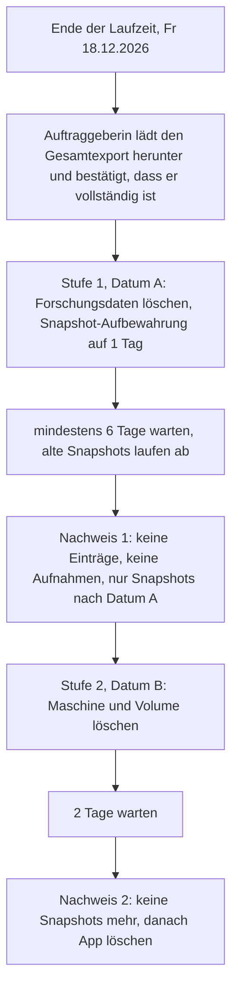

# Löschkonzept (#8)

Was nach dem Pilot gelöscht wird, wer es tut, wann, in welcher Reihenfolge und wie die Löschung belegt wird. Welche Daten überhaupt entstehen und welche Hinweistexte die Lehrpersonen sehen, steht in [datenschutz.md](datenschutz.md). Ausgeführt wird die Löschung in #10.

Die Entscheidungen hier hat Claude getroffen (Projektregel «Fragen selbst beantworten»). Offen ist nur das Datum, das legt die Auftraggeberin fest.

## Grundsatz

- **Forschungsdaten** (Einträge, Antworten, Aufnahmen, Konten der Lehrpersonen) werden gelöscht, sobald die Auftraggeberin sie als Gesamtexport bei sich hat. Für die Interviews braucht sie die App nicht mehr, dafür gibt es den ZIP-Export.
- **Die App mit der Gast-Ansicht** darf länger laufen, wenn die Auftraggeberin sie zum Beispiel für die Bewertung der Arbeit zeigen will. Sie enthält dann nur noch ihre eigenen Texte und ihr Konto.
- Daraus folgen **zwei Stufen**. Fallen beide Daten zusammen, laufen sie direkt nacheinander (siehe [Variante: ein Löschtag](#variante-ein-löschtag)).
- **Gelöscht ist erst, was auch aus den Sicherungskopien verschwunden ist.** Das bestimmt die Wartezeiten im Ablauf.

## Ablauf



| Datum | Was | Wer legt fest |
|---|---|---|
| A | Stufe 1: Forschungsdaten löschen | Auftraggeberin (Vorschlag: Fr 15.1.2027, also nach den Weihnachtsferien) |
| B | Stufe 2: App und Gast-Ansicht abbauen | Auftraggeberin (Vorschlag: nach Abgabe bzw. Bewertung der Arbeit; kann auch gleich A sein) |

Entwurf der Frage an die Auftraggeberin: `intern/frage-loeschdatum.md` (nicht im Repo). Steht das Datum, wird es auch in den Hinweistext `hinweis_datenspeicherung` übernommen ([datenschutz.md](datenschutz.md#hinweistexte)).

## Was wo liegt und wer es löscht

| Ort | Inhalt | Personenbezug | Wer | Wann | Wie |
|---|---|---|---|---|---|
| `reflexion.db` auf dem Volume `daten` | Konten, Antworten, Tagebucheinträge, Inhalte der Auftraggeberin | ja | Betreiber | A (Forschungsdaten), B (Rest) | Stufe 1 per SQL, Stufe 2 mit dem Volume |
| `/data/aufnahmen/` auf dem Volume | Sprachaufnahmen (Stimme) | ja, besonders | Betreiber | A | Stufe 1 |
| Volume `daten` | beides oben | ja | Betreiber | B | `fly volumes destroy`; fly.io hält es danach noch 24 Stunden als «pending_destroy» wiederherstellbar |
| Alte Kopie eines Volumes, das fly.io selbst auf einen anderen Server verschoben hat | Stand zum Zeitpunkt der Verschiebung | ja | niemand, ausserhalb unseres Einflusses | 1 Woche nach der Verschiebung | nur bei einer Verschiebung durch fly.io, sichtbar ist sie für uns nicht |
| Automatische Volume-Snapshots bei fly.io | tägliche Kopie des Volumes | ja | niemand direkt, laufen ab | A + 5 Tage bzw. B + 1 Tag | Aufbewahrung verkürzen, ablaufen lassen (siehe [Snapshots](#snapshots-bei-flyio)) |
| Maschine der App | keine Daten ausser im Arbeitsspeicher (z. B. Zähler für Fehlversuche, #14) | flüchtig | Betreiber | B | `fly machine destroy` |
| Secret `GEHEIMER_SCHLUESSEL` | Schlüssel für Sitzungs-Cookies | nein | Betreiber | B | mit der App; lokale Kopie beim Betreiber löschen |
| Logs bei fly.io | Start, Stopp, Fehler. Keine IP-Adressen, seit die App ohne Zugriffsprotokoll läuft ([datenschutz.md](datenschutz.md#logs)) | höchstens zufällig in Fehlermeldungen | niemand, laufen ab | 7 Tage nach Entstehung | nicht löschbar, siehe [Logs](#logs-bei-flyio) |
| Container-Images in der Registry von fly.io, Build-Cache | nur Code aus dem öffentlichen Repo | nein | Betreiber | B | mit der App bzw. der Organisation |
| Gast-Ansicht und Adresse `reflexionsinstrument.fly.dev` | Inhalte der Auftraggeberin, öffentlich | nein | Betreiber | B | mit der App |
| Organisation `reflexion` bei fly.io | Abrechnung | nein | Betreiber | nach der letzten Rechnung | `fly orgs delete reflexion` (freiwillig) |
| Betreiber lokal: `.daten/`, `tests/.e2e/` | nur erfundene Testdaten | nein | Betreiber | B | Ordner löschen |
| Betreiber lokal: Kopie aus Produktion | darf es nicht geben (Regel unten) | ja | Betreiber | sofort nach Gebrauch | löschen, im Löschprotokoll vermerken |
| Auftraggeberin: Gesamtexport (ZIP, Tabelle, Aufnahmen) | alle Forschungsdaten | ja | Auftraggeberin | nach den Vorgaben ihrer Hochschule | ihre Verantwortung, siehe unten |
| Browser der Lehrpersonen | Sitzungs-Cookie, keine Einträge | nein | niemand | wird mit der App wertlos | Abmelden genügt |
| GitHub-Repo, Prototyp auf GitHub Pages | nur Platzhalter | nein | – | – | nichts zu löschen |

**Regel für den Betreiber:** Keine Kopie der Produktionsdaten auf den eigenen Rechner. Ist sie für eine Fehlersuche unvermeidbar, wird sie danach gelöscht und das im Löschprotokoll (#10) vermerkt.

**Auftraggeberin:** Für den Export bei ihr gelten die Vorgaben ihrer Hochschule (#3, sie klärt das selbst). Beim Übergeben des Exports erhält sie den Hinweis, ihn nicht über private Cloud-Dienste zu teilen und nach Abschluss nach diesen Vorgaben zu löschen.

## Löschen während der Laufzeit

- **Einzelne Einträge und Aufnahmen**, die eine Lehrperson löscht, sind sofort weg aus der App. In `reflexion.db` überschreibt SQLite den Inhalt (`PRAGMA secure_delete = ON` in `app/db.py`, mit Test). Ältere Bereiche der Begleitdatei `reflexion.db-wal` können den Text noch enthalten, bis SQLite sie wiederverwendet. Die Datei der Aufnahme löscht die App (#17); ihre Blöcke auf dem Volume werden dabei nur freigegeben, nicht überschrieben. In den Snapshots stehen beide noch bis zu 5 Tage. Endgültig weg sind sie mit Stufe 2.
- **Testkonten** der Auftraggeberin (#9) löscht sie vor dem Start selbst. Das Löschen eines Kontos entfernt alle seine Einträge (Kaskade in der Datenbank) und Aufnahmen.

## Snapshots bei fly.io

Recherche in der Doku von fly.io, Stand 30.10.2026:

| Frage | Antwort laut Doku |
|---|---|
| Gibt es automatische Snapshots? | Ja, täglich, standardmässig eingeschaltet. |
| Wie lange bleiben sie? | Standard 5 Tage, einstellbar von 1 bis 60 Tagen. Eine neue Aufbewahrung gilt nur für **neue** Snapshots, bestehende behalten ihre bisherige. |
| Werden sie mit `fly volumes destroy` gelöscht? | **Nein.** Snapshots eines gelöschten Volumes bleiben bis zum Ende ihrer Aufbewahrung und lassen sich in dieser Zeit sogar zu einem neuen Volume wiederherstellen. Die ID des gelöschten Volumes zeigt `fly volumes list --all` nur noch 24 Stunden lang an. Das Volume selbst ist so lange «pending_destroy» (vorläufig gelöscht) und erst danach endgültig weg. |
| Werden sie mit `fly apps destroy` gelöscht? | Die Doku sagt dazu nichts. Annahme: auch nicht, sie laufen ab. Darum wird die App erst nach dem Nachweis gelöscht. |
| Lassen sie sich einzeln löschen? | **Nein.** Weder `flyctl` (v0.5.0 kennt nur `create` und `list`) noch die Doku bieten das an: «snapshots are only removed at the end of their retention periods». |
| Was bewirkt das Ausschalten? | `--scheduled-snapshots=false` verhindert neue Snapshots, bestehende bleiben bis zum Ablauf. |
| Kosten? | 0.08 USD pro GB und Monat, die ersten 10 GB pro Monat frei. Bei diesem Volume fällt nichts an. |

**Konsequenz:**
1. Während der Laufzeit bleibt die Aufbewahrung bei **5 Tagen** (`snapshot_retention = 5` in `fly.toml`). Die Snapshots sind die einzige Sicherung, falls auf dem Volume etwas schiefgeht. `fly.toml` wird nicht geändert.
2. In Stufe 1 setzt der Betreiber die Aufbewahrung auf **1 Tag**. Die Snapshots mit Forschungsdaten (älter als Datum A) laufen damit spätestens 5 Tage nach A ab, alle späteren nach 1 Tag.
3. Stufe 2 frühestens **6 Tage nach A**. Bis dahin sind alle Snapshots abgelaufen, die vor dem Löschen entstanden sind.
4. Annahme (in der fly-Doku nicht belegt, aber für ein Block-Volume üblich): Snapshots sichern das Volume blockweise. Gelöschte Dateien und das Aufräumen der Datenbank geben Blöcke nur frei, ohne sie zu überschreiben. Darum überschreibt Stufe 1 den freien Platz des Volumes mit Nullen (Schritt 1.4). Ohne diesen Schritt könnten auch die Snapshots nach Datum A noch Reste von Aufnahmen enthalten, die sich mit Spezialwerkzeug wiederherstellen liessen.
5. Die **Volume-ID** wird in Stufe 1 ins Löschprotokoll geschrieben. Ohne sie lassen sich die Snapshots eines gelöschten Volumes nach 24 Stunden nicht mehr auflisten und damit nicht nachweisen.
6. Ob ein späteres `fly deploy` den Wert aus `fly.toml` (5 Tage) wieder auf das bestehende Volume schreibt, sagt die Doku nicht. Darum nach Stufe 1 nicht mehr deployen, oder nach jedem Deploy mit `fly volumes show` prüfen.

## Logs bei fly.io

Laut Doku hält die Log-Suche von fly.io die Logs **7 Tage**. Löschen lassen sie sich nicht. Die App schreibt deshalb gar nicht erst personenbezogene Daten hinein: kein Zugriffsprotokoll (keine IP-Adressen, keine Pfade), keine Benutzernamen, keine Inhalte ([datenschutz.md](datenschutz.md#logs)). Für die Löschung ist nichts zu tun. Was der Proxy von fly.io selbst protokolliert, liegt ausserhalb unseres Einflusses und fällt unter die Abklärung der Auftraggeberin zum Anbieter.

## Schritt für Schritt

Alle Befehle vom Rechner des Betreibers aus, im Projektordner. `<VOLUME_ID>` und `<MASCHINEN_ID>` stammen aus Schritt 1.1. Das **Löschprotokoll** ist ein Kommentar in #10: Datum, Schritte, Ausgaben der Prüfbefehle, ohne Namen oder Inhalte.

### Stufe 1: Forschungsdaten löschen (Datum A)

Voraussetzung: Die Auftraggeberin hat den Gesamtexport heruntergeladen, geöffnet und bestätigt, dass Tabelle und Aufnahmen vollständig sind. Ohne diese Bestätigung kein Schritt 1.3.

1. Bestand festhalten:
   ```sh
   fly volumes list -a reflexionsinstrument          # Volume-ID notieren
   fly machine list -a reflexionsinstrument          # Maschinen-ID notieren
   fly volumes snapshots list <VOLUME_ID> -a reflexionsinstrument
   ```
2. Aufbewahrung der Snapshots auf 1 Tag:
   ```sh
   fly volumes update <VOLUME_ID> --snapshot-retention 1 -a reflexionsinstrument
   fly volumes show <VOLUME_ID> -a reflexionsinstrument   # erwartet: Snapshot retention: 1
   ```
3. Konten der Lehrpersonen samt Einträgen und Aufnahmen löschen. Als `appuser`, damit die Dateien der Datenbank ihm gehören bleiben, und über `app.db.verbinde`, damit Fremdschlüssel (Kaskade) und `secure_delete` aktiv sind:
   ```sh
   fly ssh console -a reflexionsinstrument
   # auf der Maschine:
   cd /srv
   setpriv --reuid=appuser --regid=appuser --init-groups /opt/venv/bin/python
   ```
   ```python
   from pathlib import Path
   from app.db import verbinde

   conn = verbinde(Path("/data/reflexion.db"))
   conn.execute("DELETE FROM konten WHERE rolle = 'lehrperson'")
   conn.execute("VACUUM")
   print(conn.execute("PRAGMA wal_checkpoint(TRUNCATE)").fetchone()[0])  # erwartet: 0
   for t in ("konten", "antworten", "tagebucheintraege", "aufnahmen"):
       print(t, conn.execute(f"SELECT count(*) FROM {t}").fetchone()[0])
   conn.close()
   ```
   ```sh
   # weiter auf der Maschine:
   find /data/aufnahmen -type f -delete
   ls -A /data/aufnahmen                              # erwartet: leer
   ```
   Erwartet: Checkpoint 0 (sonst kurz warten und wiederholen), `antworten`, `tagebucheintraege` und `aufnahmen` 0, `konten` nur noch die Konten der Auftraggeberin. Die Auftraggeberin selbst schreibt keine Einträge und macht keine Aufnahmen; darum dürfen alle Dateien in `/data/aufnahmen/` weg. Die Befehle sind lokal an einer Testdatenbank geprobt (30.10.2026): Kaskade greift, Inhalte und Fragen der Auftraggeberin bleiben, gelöschte Texte stehen nicht mehr in der Datei.
4. Freien Platz auf dem Volume überschreiben, damit gelöschte Aufnahmen und alte Datenbankblöcke auch in künftigen Snapshots nicht mehr stehen (dauert bei 1 GB Sekunden; die App kann währenddessen kurz nicht schreiben, nach der Laufzeit unkritisch):
   ```sh
   # weiter auf der Maschine:
   dd if=/dev/zero of=/data/nullen bs=1M; sync; rm /data/nullen; sync
   df -h /data                                        # erwartet: wieder fast alles frei
   ```
   Die Meldung «No space left on device» von `dd` ist dabei erwartet. Zeigt `df -h` danach ein volles Volume (Sitzung abgebrochen), die Datei mit `rm -f /data/nullen` entfernen und `df -h /data` wiederholen.
5. In der App als Auftraggeberin anmelden: Übersicht zeigt keine Lehrpersonen und keine Einträge. Gast-Ansicht funktioniert weiter.
6. Löschprotokoll in #10: Datum, Volume-ID, Ausgaben aus 2 bis 5.

### Nachweis 1 (frühestens A + 6 Tage)

```sh
fly volumes snapshots list <VOLUME_ID> -a reflexionsinstrument
```
Erwartet: nur Snapshots mit Erstelldatum nach Datum A (bzw. nach Schritt 1.4). Ausgabe ins Löschprotokoll. Restrisiko: Was fly.io auf seinen Servern mit freigegebenen Blöcken macht, lässt sich von aussen nicht prüfen. Mit Stufe 2 und dem Ablauf der letzten Snapshots ist auch das erledigt.

### Stufe 2: Abbau (Datum B)

1. Keine neuen Snapshots mehr, dann Maschine und Volume löschen (ein Volume an einer Maschine lässt sich nicht löschen):
   ```sh
   fly volumes update <VOLUME_ID> --scheduled-snapshots=false -a reflexionsinstrument
   fly machine destroy <MASCHINEN_ID> --force -a reflexionsinstrument
   fly volumes destroy <VOLUME_ID> -y -a reflexionsinstrument
   fly volumes list --all -a reflexionsinstrument     # erwartet: Volume «pending_destroy», nach 24 Stunden nicht mehr aufgeführt
   ```
2. Zwei Tage warten, dann:
   ```sh
   fly volumes snapshots list <VOLUME_ID> -a reflexionsinstrument   # erwartet: keine Snapshots
   ```
3. App löschen. Das entfernt Adresse, Gast-Ansicht, Secret, Zertifikat und Images:
   ```sh
   fly apps destroy reflexionsinstrument -y
   fly apps list                                      # erwartet: reflexionsinstrument fehlt
   curl -sI https://reflexionsinstrument.fly.dev      # erwartet: keine Antwort der App
   ```
4. Beim Betreiber lokal: `.daten/` und `tests/.e2e/` löschen, `GEHEIMER_SCHLUESSEL` aus einer allfälligen lokalen Ablage entfernen.
5. Nach der letzten Rechnung, freiwillig: `fly orgs delete reflexion`.
6. Löschprotokoll in #10 abschliessen und der Auftraggeberin in einem Satz bestätigen, dass alles gelöscht ist.

### Variante: ein Löschtag

Will die Auftraggeberin die Gast-Ansicht nicht länger behalten, fallen A und B zusammen. Damit am Löschtag keine Snapshots mit Forschungsdaten 5 Tage weiterleben, wird Schritt 1.2 (Aufbewahrung auf 1 Tag) **mindestens 5 Tage vorher** ausgeführt, sobald der Export bestätigt ist. Am Löschtag folgen 1.3 bis 1.5 und gleich danach Stufe 2. Vollständig gelöscht ist dann 2 Tage nach dem Löschtag. Schritt 1.4 (Nullen) entfällt in dieser Variante nicht, er kostet nichts.

## Quellen

- fly.io, Volume-Snapshots: https://docs.fly.io/volumes/snapshots (Aufbewahrung 1 bis 60 Tage, Standard 5; neue Aufbewahrung nur für neue Snapshots; Ausschalten entfernt bestehende nicht; «only removed at the end of their retention periods»)
- fly.io, Volumes verwalten: https://docs.fly.io/volumes/volume-manage (Löschen ist endgültig; angehängte Volumes lassen sich nicht löschen; gelöschte Volumes aus Snapshots wiederherstellen; Volume-ID 24 Stunden in `fly volumes list --all`)
- fly.io, Zustände eines Volumes: https://docs.fly.io/volumes/volume-states (vorläufig gelöscht «pending_destroy» 24 Stunden, nach einer Verschiebung durch fly.io 1 Woche)
- fly.io, Konfiguration `[mounts]`: https://docs.fly.io/reference/configuration (`snapshot_retention`, `scheduled_snapshots`)
- fly.io, Logs: https://docs.fly.io/metrics-and-logs/logs («retains logs for 7 days»)
- fly.io, Preise: https://docs.fly.io/about/pricing (Snapshots 0.08 USD pro GB und Monat, 10 GB frei)
- `flyctl` v0.5.0, Hilfe zu `fly volumes snapshots`, `fly volumes update`, `fly volumes destroy`, `fly apps destroy`
