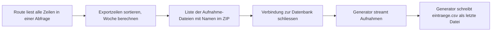

# Design: Ansicht der Auftraggeberin, Einträge lesen, anhören, exportieren (#18)

Grundlage: [Anforderungen](../../anforderungen.md) (Abschnitt «Einträge lesen und Export»), [ADR-001](../../adr/ADR-001-technik-pilot.md) (CSV im Excel-Format, Schutz vor Formel-Injection, keine Umwandlung der Aufnahmen), [Design Anmeldung](2026-10-30-anmeldung-design.md) (#14: `braucht_auftraggeberin`, Fehlerseiten, `Id`, `no-store`, Routen-Inventar), [Design Eingabemaske](2026-10-30-eingabemaske-design.md) (#15: `app/zeit.py`, `lies_projektstart`, Export zeigt den aktuellen Fragetext), [Design Lehrpersonen-Ansicht](2026-10-30-lehrpersonen-ansicht-design.md) (#16: `Zeile`, `alle_zeilen`, `gruppiere`, `rundenstand`, `_aufnahme.html`, reservierte Adresse für Aufnahmen, Datei-Überschneidungen), [Löschkonzept](../../loeschkonzept.md) (Gesamtexport als Voraussetzung für Stufe 1, Hinweis zur Aufbewahrung), Prototyp (`prototyp/js/app.js`, `ansichtAdmin`, `csvZelle`) als Vorbild. Die Entscheidungen hier hat Claude getroffen (Projektregel «Fragen selbst beantworten»); wo es eine Alternative gab, steht die Begründung dabei.

## Zweck

Die Auftraggeberin liest alle Einträge und hört die Aufnahmen an, schon während der Laufzeit. Sie sieht auf einen Blick, wer wie weit ist (für ihre Erinnerungen per WhatsApp). Am Schluss lädt sie eine Tabelle für Excel und einen Gesamtexport (Tabelle plus alle Aufnahmen als Dateien) herunter. Mit dem bestätigten Gesamtexport kann Stufe 1 des Löschkonzepts beginnen. Ziel: Mo 16.11. (Zeitplan der Anforderungen).

## Ziele

- Übersicht pro Lehrperson: Runden beantwortet, Anzahl Tagebucheinträge, letzter Eintrag.
- Alle Einträge lesen, Aufnahmen anhören, filtern nach Lehrperson, ohne JavaScript.
- Tabelle (CSV), die sich mit Doppelklick in Excel öffnet: Umlaute und Zeilenumbrüche korrekt, keine ausführbaren Formeln, geordnet nach Woche.
- Gesamtexport als ZIP mit Tabelle und allen Aufnahmen; in der Tabelle steht pro Aufnahme der Dateiname im ZIP.
- Der Export funktioniert auch bei voller Festplatte (1 GB Volume) auf der Maschine mit 256 MB Arbeitsspeicher.
- Links zu Aufnahmen in der Tabelle funktionieren nach Anmeldung der Auftraggeberin.

## Nicht-Ziele

- Abspielen, Upload, Ablage der Aufnahmen und die Adresse `/verwaltung/aufnahmen/{id}` (#17). #18 verlinkt nur darauf (Schnittstelle unten).
- Bearbeiten oder Löschen von Einträgen durch die Auftraggeberin (nicht verlangt; Löschen von Zugängen samt Einträgen gibt es seit #14).
- Statistik, Diagramme, Auswertung in der App (Anforderungen: «Bewusst nicht gebaut»).
- Ausdruck pro Lehrperson (Anforderung: «momentan nicht»).
- Export gefiltert nach Lehrperson oder Zeitraum. Sie filtert in Excel.
- Transkript (Anforderungen).
- Vorschau der Lehrpersonen-Ansicht (#19).

## Anti-Ziele

- Keine neue Dependency: CSV mit `csv`, ZIP mit `zipfile`, beides Standardbibliothek.
- Kein JavaScript, kein Inline-CSS. Filter und Downloads sind Links.
- Einträge werden nie formatiert (`formatiert` gilt nur für Texte der Auftraggeberin), immer escapt, Zeilenumbrüche erhalten (`white-space: pre-wrap`).
- Kein Export in eine Datei auf dem Server (Temporärdatei, Kopie im Volume). Forschungsdaten entstehen nur dort, wo sie schon liegen, und bei der Auftraggeberin.
- Keine Formeln in der Tabelle, auch nicht für Links (`=HYPERLINK`).
- Keine Namen von Lehrpersonen in den Dateinamen der Downloads selbst.

## Begriffe in der Oberfläche

| Im Code | In der Oberfläche |
|---|---|
| `Zeile.art = runde / tagebuch / impuls` | Marke «Runde», «Tagebuch», «Impuls» |
| `tagebuch_art = frei / leitfragen / impuls / aufnahme` | «Freier Eintrag», «Zur Leitfrage», «Zum Impuls», «Gesprochener Eintrag» (wie #16) |
| `Stand.beantwortet == Stand.fragen` | «beantwortet» |
| `0 < Stand.beantwortet < Stand.fragen` | «angefangen» |
| CSV | «Tabelle (Excel)» |
| ZIP | «Gesamtexport» |
| `angeleitet` | Spalte «Angeleitet oder freiwillig», Werte «angeleitet» / «freiwillig» |

## Adressen

Router `app/routen/verwaltung_eintraege.py` (von #16 leer angelegt und eingebunden) mit `prefix="/verwaltung/eintraege"` und `dependencies=[Depends(braucht_auftraggeberin)]` auf Router-Ebene. Nur GET, kein Formular, darum kein `pruefe_csrf`.

| Methode, Pfad | Was |
|---|---|
| `GET /verwaltung/eintraege` | Übersicht pro Lehrperson, Export-Karte, Liste aller Einträge (neueste zuerst) |
| `GET /verwaltung/eintraege?lehrperson={id}` | dieselbe Seite, Liste nur dieser Lehrperson |
| `GET /verwaltung/eintraege/tabelle.csv` | Tabelle als Download |
| `GET /verwaltung/eintraege/gesamtexport.zip` | ZIP als Download (gestreamt) |
| `GET /verwaltung/aufnahmen/{aufnahme_id}` | **baut #17**; #18 verlinkt in Liste und Tabelle darauf |

- `lehrperson` ist `Annotated[int | None, Query(ge=1, le=2**63 - 1)] = None`. `abc`, `0`, `-1`, `99999999999999999999` und `lehrperson=` (leer) ergeben über den bestehenden Handler für `RequestValidationError` die Fehlerseite 404. Eine unbekannte `id` oder die `id` eines Kontos der Auftraggeberin ergibt ebenfalls 404 (wie `_lehrperson_oder_404` in #14).
- Die Downloads tragen keinen Parameter. Die Adressen haben eine Endung, damit ein Browser, der `Content-Disposition` ignoriert, trotzdem einen sinnvollen Namen vorschlägt.

## Seite «Einträge»

Aufbau wie der Prototyp (`ansichtAdmin`), den die Auftraggeberin durchgeklickt hat, im Rahmen `verwaltung/rahmen.html`:

1. Überzeile «Woche N», sobald der erste Tag feststeht und erreicht ist (`zeit.woche(heute, projektstart)`).
2. `h1` «Einträge».
3. **Karten pro Lehrperson** (`.raster-personen`, zwei Spalten auch in 390 px, `karte karte--person`), sortiert wie `lehrpersonen(db)` (Anzeigename, dann `id`). Jede Karte ist ein Link auf `?lehrperson={id}#eintraege`; die gewählte trägt `ist-aktiv` und `aria-current="page"`. Inhalt:
   - **Anzeigename**
   - «Runden 2 von 3» (beantwortet von freigeschalteten Runden mit mindestens einer Frage), darunter «1 angefangen», falls es angefangene gibt. Ohne freigeschaltete Runde: «Noch keine Runde offen».
   - «5 Tagebucheinträge» (`anzahl_tagebucheintraege`, zählt alle Arten inklusive «Zum Impuls» und gesprochene)
   - gedämpft «zuletzt Di 24.11.» (spätester `geaendert` aller Zeilen dieser Lehrperson, Zürcher Datum) bzw. «noch nichts»
   - Ohne Zugänge: eine Karte «Noch keine Zugänge.» mit Link auf «Zugänge».
4. **Karte «Export»** (`karte`, `id="export"`):
   - Zeile mit dem Stand: «Jetzt: 54 Zeilen, 12 Aufnahmen (etwa 18 MB).» Damit kann sie nach dem Herunterladen prüfen, ob alles da ist (Voraussetzung für Stufe 1 im Löschkonzept).
   - Knopf-Link «Tabelle herunterladen (Excel)» (`knopf`) mit Satz «Eine Zeile pro Antwort bzw. Tagebucheintrag, geordnet nach Woche. Öffnet sich mit Doppelklick in Excel.»
   - Knopf-Link «Gesamtexport herunterladen (ZIP)» (`knopf knopf--zweit`) mit Satz «Tabelle und alle Aufnahmen als Dateien. Am besten am Computer herunterladen und vor dem Öffnen entpacken.»
   - `hinweis`: «Die Dateien enthalten alle Einträge mit Namen. Bitte nur auf deinem Gerät oder dort speichern, wo es deine Hochschule vorsieht, und nicht über private Cloud-Dienste teilen.» (Vorgabe aus dem Löschkonzept: «Beim Übergeben des Exports erhält sie den Hinweis …»)
5. `h2 id="eintraege"` «Einträge» und darunter **Filter** als Links (`nav.chips`, `aria-label="Nach Lehrperson filtern"`): «Alle» und je Lehrperson, aktiver Chip mit `ist-aktiv` und `aria-current="page"`. Ist gefiltert, steht über der Liste «Einträge von *Anzeigename*».
6. **Liste** `gruppiere(alle_zeilen(db))` bzw. `gruppiere(zeilen_von(db, id))`, neueste zuerst, jede Karte über das Teil-Template `verwaltung/eintraege/_eintrag.html`. Ohne Einträge: «Noch keine Einträge.»

### Karte eines Eintrags

Nicht verlinkt, voller Text direkt in der Liste (`karte karte--eintrag`, als `article`):

- Kopf (`eintrag__kopf`): Marke «Runde» / «Tagebuch» / «Impuls», gedämpft «*Anzeigename* · Woche 2 · Mo 30.11.2026, 18:40» und, falls `geaendert` ≠ `erstellt`, «· geändert Di 01.12.2026, 07:15». Im gefilterten Zustand ohne Anzeigename. Woche fehlt vor dem ersten Tag oder ohne ersten Tag.
- Titelzeile (`strong`): Runde: Titel der Runde und gedämpft «3 von 4 Fragen beantwortet» (`rundenstand`); Tagebuch: Bezeichnung nach `tagebuch_art`.
- Runde: pro Zeile in Fragenreihenfolge ein Block `.antwort` mit `.antwort__frage` (aktueller Fragetext, reiner Text) und darunter
  - Freitext: `.antwort__text` (pre-wrap),
  - Skala: «4 von 5»,
  - Aufnahme: `` mit `aufnahme=zeile`, `url="/verwaltung/aufnahmen/" ~ zeile.aufnahme_id`.
- Tagebuch: bei Leitfrage oder Impuls der mitgespeicherte Text (`Zeile.frage`) als `.antwort__frage`, dann Text bzw. Aufnahme wie oben.

**Entscheidung: voller Text in der Liste statt Liste mit Vorschau und eigener Seite pro Eintrag.** Begründung: Die Auftraggeberin liest mit, meist mehrere Einträge am Stück; auf dem Handy wäre jeder Eintrag ein Tipp hinein und einer zurück. Gefiltert nach einer Person liest sich die Liste wie ein Tagebuch, was zur Vorbereitung eines Interviews passt. Bei 4 Lehrpersonen und 4 Wochen bleiben es wenige Dutzend Karten (geschätzt unter 100 KB HTML), Aufnahmen laden erst beim Abspielen (`preload="none"` in `_aufnahme.html`). Weniger Routen, keine zusätzlichen 404-Fälle. **Verworfen:** Seite pro Eintrag (Prototyp), Seitenweise Anzeige (bei dieser Menge unnötig).

### Was «Runden beantwortet» heisst

- Gezählt werden nur Runden, die heute freigeschaltet sind (`sichtbare_runden(db, heute)` aus `app/sichtbar.py`, `heute` über `Depends(hole_heute)`) und mindestens eine Frage haben. Eine Runde ohne Fragen lässt sich nicht beantworten.
- «beantwortet»: jede Frage hat eine Zeile (`Stand.beantwortet == Stand.fragen`), dieselbe Bedeutung wie die Marke «Beantwortet» auf der Startseite der Lehrperson (#16). «angefangen»: mindestens eine, aber nicht alle.
- Antworten zu Runden, die nach einer Datumsänderung gerade nicht freigeschaltet sind, zählen in der Karte nicht, erscheinen aber in Liste und Export. Begründung: Die Karte beantwortet «wer ist mit dem Offenen wie weit»; die Daten selbst gehen nie verloren.

## Tabelle (CSV)

### Spalten

| Spalte | Inhalt | Quelle |
|---|---|---|
| Lehrperson | Anzeigename | `Zeile.anzeigename` |
| Woche | Zahl ab erstem Tag; leer vor dem ersten Tag oder ohne ersten Tag | `zeit.woche(zeit.lokal(z.erstellt).date(), projektstart)` |
| Datum | Erstellzeitpunkt `TT.MM.JJJJ HH:MM`, Zürcher Zeit | `zeit.lokal(z.erstellt)` |
| Geändert | Änderungszeitpunkt im selben Format; leer, wenn nie geändert | `z.geaendert` ≠ `z.erstellt` |
| Angeleitet oder freiwillig | «angeleitet» (Runde) / «freiwillig» (Tagebuch, Impuls) | `Zeile.angeleitet` |
| Art | «Runde», «Tagebuch», «Impuls» | `Zeile.art` |
| Runde | Titel der Runde, sonst leer | `Zeile.runde_titel` |
| Frage | aktueller Fragetext; bei Tagebuch der mitgespeicherte Leitfrage- bzw. Impulstext; bei freiem und gesprochenem Eintrag leer | `Zeile.frage` |
| Antwort | Text der Antwort bzw. des Eintrags | `Zeile.text` |
| Skalawert | 1 bis 5, sonst leer | `Zeile.skalawert` |
| Aufnahme | Tabelle allein: Link `https://…/verwaltung/aufnahmen/{id}`; im Gesamtexport: Dateiname `aufnahmen/…` bzw. «Datei fehlt»; ohne Aufnahme leer | siehe unten |

- Eine Zeile pro `Zeile` aus `alle_zeilen`: pro Antwort und pro Tagebucheintrag (Entscheidung #16). Eine Antwort, die nur aus einer Aufnahme besteht, hat leere Antwort und leeren Skalawert.
- **«Geändert» zusätzlich zu den Spalten im Issue.** Begründung: Die Anforderungen speichern bewusst «den aktuellen Stand mit Erstell- und Änderungsdatum»; für ein Interview ist es eine nützliche Information, ob jemand eine Antwort später überarbeitet hat. Eine Spalte, kein Zusatzaufwand.
- **Eine Spalte «Aufnahme», Inhalt je nach Export.** Die Tabelle allein dient während der Laufzeit, dort hilft der Link. Im Gesamtexport zählt die Datei daneben; die Links sind nach dem Abbau der App tot. Zwei Spalten, von denen je eine leer oder irreführend wäre, sind verworfen.
- **Link als reiner Text, keine Formel.** Excel macht aus einem Text in einer CSV-Zelle keinen anklickbaren Link; sie kopiert ihn in den Browser oder hört in der App bzw. im Gesamtexport. Dafür enthält die Tabelle nachweislich keine einzige Formel (einfach zu prüfen, gleiche Regel für alle Zellen), und sie öffnet sich auch in Numbers oder LibreOffice gleich. Die Adresse wird aus `request.base_url` gebaut (hinter dem fly-Proxy mit `--proxy-headers` also `https://reflexionsinstrument.fly.dev`). Ist sie nicht angemeldet, führt der Link auf die Login-Seite; nach der Anmeldung funktioniert er (Akzeptanzkriterium).

### Reihenfolge

Geordnet nach Woche (Anforderung), dann so, dass zusammengehörige Zeilen zusammen bleiben. Sortierschlüssel:

1. Woche aufsteigend; Zeilen ohne Woche (vor dem ersten Tag, z. B. aus dem Testlauf) zuerst.
2. Lehrperson (Anzeigename ohne Gross-/Kleinschreibung, dann `konto_id`).
3. Erstellzeitpunkt.
4. Bei gleichem Zeitpunkt: `runde_freischaltdatum`, `frage_reihenfolge`, dann `quelle`, `id`. Antworten, die mit einem «Speichern» entstanden sind, tragen denselben Zeitpunkt (#16) und erscheinen so in Fragenreihenfolge.

Die Woche hängt am **Erstellzeitpunkt** der Zeile, nicht an der Woche der Runde. Begründung: «Woche (ab Projektstart)» beschreibt, wann eine Lehrperson etwas festgehalten hat; wer Runde 1 erst in Woche 2 beantwortet, soll das in der Tabelle sehen. Die Runde selbst steht in der Spalte «Runde».

### Format

- `csv.writer(puffer, delimiter=";", quoting=csv.QUOTE_ALL, lineterminator="\r\n")`, Ergebnis mit vorangestelltem BOM als UTF-8 kodiert (`"" + text`, dann `.encode("utf-8")`). Alle Zellen in Anführungszeichen wie im Prototyp; innere `"` verdoppelt der `csv`-Writer.
- **Semikolon:** Trennzeichen von Excel mit deutschsprachigen bzw. Schweizer Ländereinstellungen. **BOM:** Daran erkennt Excel UTF-8; ohne BOM erscheinen Umlaute falsch.
- **Zeilenumbrüche:** Datensätze enden mit CRLF, Umbrüche innerhalb einer Zelle sind `\n` in Anführungszeichen. Excel zeigt sie als Umbruch in der Zelle. Jeder Wert wird vorher normalisiert (`\r\n` und einzelnes `\r` → `\n`); #16 speichert schon so, die Normalisierung sichert nur ab.
- **Verworfen:** Erste Zeile `sep=;`. Mit ihr ignoriert Excel den BOM, und die Umlaute sind kaputt.
- Längster Text 20 000 Zeichen (#16), unter der Grenze einer Excel-Zelle (32 767).
- Bekannte Grenze von Excel: Eine Antwort, die nur aus «3.5» oder «1/2» besteht, wandelt Excel in ein Datum um. Bei Reflexionstexten selten; ein Gegenmittel ohne sichtbare Nebenwirkung gibt es in CSV nicht.

### Schutz vor Formel-Injection

Funktion `zelle(wert)`: Beginnt ein Wert mit `=`, `+`, `-`, `@`, Tabulator oder Wagenrücklauf, wird ein `'` vorangestellt (OWASP-Empfehlung, gleiche Regel wie `csvZelle` im Prototyp). Gilt für **jede** Zelle, auch Anzeigename, Titel und Fragetext (die Auftraggeberin tippt sie zwar selbst, aber eine einzige Regel ist einfacher zu prüfen). Zahlen (Woche, Skalawert) sind nie negativ und bleiben unverändert. Folge: Eine Antwort, die mit «- » beginnt (Aufzählung), erscheint in Excel mit einem `'` davor. Das ist in Kauf genommen; der Text bleibt vollständig.

### Datei

- `Content-Type: text/csv; charset=utf-8`
- `Content-Disposition: attachment; filename="reflexion-tabelle-2026-12-18.csv"` (Datum = `heute` in Zürich). Nur ASCII, kein `filename*` nötig.
- `Cache-Control: no-store` setzt die bestehende `SicherheitsHeaderMiddleware` für alle Pfade ausser `/static/` (#14); ein Test sichert es für beide Downloads ab.
- Erzeugt im Speicher (`Response(content=bytes)`): auch bei vielen Einträgen unter 1 MB.

## Gesamtexport (ZIP)

### Inhalt

```
reflexion-gesamtexport-2026-12-18.zip
  aufnahmen/
    lehrperson-a_W02_2026-11-30_1840_tagebuch_17.webm
    lehrperson-b_W01_2026-11-24_0712_runde_9.m4a
  eintraege.csv
```

- `eintraege.csv`: dieselbe Tabelle wie oben, Spalte «Aufnahme» mit dem Pfad im ZIP.
- **Dateiname einer Aufnahme:** `{person}_W{woche:02d}_{JJJJ-MM-TT}_{HHMM}_{art}_{aufnahme_id}{endung}`
  - `person`: Anzeigename in ASCII (ä→ae, ö→oe, ü→ue, ß→ss, übrige Akzente über `unicodedata` NFKD entfernt), kleingeschrieben, alles ausser `a-z0-9` → `-`, mehrfache `-` zusammengefasst, höchstens 30 Zeichen; leer → `lehrperson-{konto_id}`.
  - `W{woche}` entfällt ohne Woche. Datum und Uhrzeit: Erstellzeitpunkt der Zeile, Zürcher Zeit. `art`: `runde`, `tagebuch` oder `impuls`.
  - `aufnahme_id` macht den Namen eindeutig, auch bei gleichen Anzeigenamen.
  - `endung`: `Path(aufnahmen.dateiname).suffix`, bei #17 aus einer festen Liste (`.webm`, `.m4a`, `.ogg`, Konvention #16).
  - Im ZIP trägt jede Datei als Zeitstempel den Erstellzeitpunkt (Zürich), so zeigt der Dateimanager das richtige Datum.
- **Begründung lesbare Namen statt der zufälligen Namen aus `aufnahmen.dateiname`:** Sie hört die Aufnahmen für die Interviews pro Person an; nach Namen sortiert stehen die Aufnahmen einer Lehrperson zusammen, nach Woche und Zeit geordnet. Der Anzeigename steht ohnehin in der Tabelle desselben ZIP. **Nur ASCII**, weil der in Windows eingebaute ZIP-Entpacker Umlaute in Dateinamen je nach Version falsch darstellt. Die Namen bestehen nur aus `[a-z0-9_.-]` plus dem festen Ordner `aufnahmen/`; ein Pfad wie `../` kann so nicht entstehen (Zip-Slip ausgeschlossen, Test mit einem Anzeigenamen wie `../../x`).
- Die Quelldatei wird nur über `aufnahmen.aufnahme_pfad(verzeichnis, dateiname)` (#16) bestimmt, nie aus dem Namen im ZIP.

### Grösse und Speicher

| Annahme | Wert |
|---|---|
| Arbeitsspeicher der Maschine | 256 MB (`fly.toml`) |
| Volume | 1 GB, obere Grenze für alle Aufnahmen zusammen |
| Bitrate einer Browser-Aufnahme | etwa 32–128 kbit/s, also 0,25–1 MB pro Minute (Obergrenze legt #17 fest) |
| Realistische Nutzung | 4 Lehrpersonen × 4 Wochen × bis 3 Aufnahmen × 3 Minuten ≈ 50 Aufnahmen, 40–150 MB |

**Entscheidung: gestreamt, nicht im Speicher.** Schon die realistische Menge kommt in die Nähe des Arbeitsspeichers; die obere Grenze (Volume) läge weit darüber. Eine Temporärdatei auf dem Volume bräuchte doppelten Platz und hinterliesse bei einem Absturz eine zusätzliche Kopie aller Forschungsdaten (Anti-Ziel).

Umsetzung mit der Standardbibliothek:
- `zipfile.ZipFile` schreibt in ein kleines Objekt, das nur `write` und `flush` kennt. Daran erkennt `zipfile` einen nicht suchbaren Strom und schreibt die Prüfsummen hinter jede Datei (Data Descriptor). Ein Generator kopiert jede Aufnahme in Stücken von 64 KiB (`zf.open(info, "w")`) und gibt nach jedem Stück die angefallenen Bytes weiter. `ZipInfo.file_size` wird vorher aus `stat()` gesetzt.
- `StreamingResponse(generator, media_type="application/zip")`; Starlette führt den synchronen Generator im Threadpool aus.
- **Aufnahmen unkomprimiert (`ZIP_STORED`)**, die Tabelle mit `ZIP_DEFLATED`. WebM/Opus und AAC sind schon komprimiert; Deflate brächte nichts und kostete auf `shared-cpu-1x` spürbar Rechenzeit.
- **Probe (30.10.2026, lokal, Python 3.15, `zipfile` unverändert seit 3.6):** 3 MB und 0,5 MB Zufallsdaten plus CSV: grösstes ausgegebenes Stück 65 624 Bytes, Spitze des zusätzlichen Speichers 0,5 MB. Das ZIP besteht `unzip -t`, wird von `ditto -x -k` (Entpacker von macOS) und `bsdtar` korrekt entpackt, Dateien bytegleich, Zeitstempel richtig. Windows war nicht verfügbar; der eingebaute Entpacker liest das zentrale Verzeichnis am Ende und kommt mit Data Descriptors zurecht (Prüfung im Testlauf, siehe unten).
- Kein `Content-Length` (die Grösse steht erst am Ende fest); der Browser zeigt den Fortschritt ohne Gesamtgrösse. Die Seite nennt die ungefähre Grösse vorher.
- Grösse über 4 GB (ZIP64) kann wegen des Volumes nicht vorkommen; `zipfile` schaltet es sonst selbst ein.

### Ablauf und Konsistenz



- **Alle Daten werden gelesen, bevor die Antwort beginnt.** Der Generator kennt nur fertige Python-Daten und Pfade, nie die Datenbankverbindung. Begründung: Die Verbindung aus `hole_db` darf nicht davon abhängen, wann FastAPI die Abhängigkeit schliesst; und `alle_zeilen` ist eine einzige Abfrage, also ein in sich stimmiger Stand.
- **Die Tabelle kommt als letzte Datei ins ZIP.** Löscht eine Lehrperson während des Downloads einen Eintrag samt Aufnahme, fehlt die Datei beim Kopieren. Der Generator überspringt sie (`FileNotFoundError`) und merkt sich, welche Aufnahmen tatsächlich im ZIP liegen; erst danach entsteht die Tabelle, und dort steht bei der fehlenden «Datei fehlt». Damit verweist die Tabelle im ZIP nie auf eine Datei, die es darin nicht gibt.
- Fehler mitten im Strom (z. B. Lesefehler): Der Download bricht ab, der Browser meldet einen fehlgeschlagenen Download. Geloggt wird nur ein Ereignis ohne Namen und Inhalte (Regel aus `docs/datenschutz.md`). Sie lädt erneut.
- `Content-Disposition: attachment; filename="reflexion-gesamtexport-2026-12-18.zip"`, `Cache-Control: no-store` über die Middleware.

## Entscheidungen (Zusammenfassung)

| Frage | Entscheidung | Begründung kurz |
|---|---|---|
| Aufbau der Seite | eine Seite: Karten pro Person, Export, gefilterte Liste (wie Prototyp) | bekannt aus dem Prototyp, eine Route |
| Filter | Query-Parameter `?lehrperson=`, typisiert, 404 bei ungültig/unbekannt | ein Filter auf derselben Liste; gleiche Fehlerseite wie überall |
| Lesen | voller Text in der Liste, keine Detailseiten | Lesefluss, Interview-Vorbereitung, weniger Routen |
| Runden beantwortet | alle Fragen beantwortet, von freigeschalteten Runden mit Fragen | gleiche Bedeutung wie bei der Lehrperson |
| CSV | Semikolon, UTF-8 mit BOM, CRLF, alle Zellen in Anführungszeichen, `'` vor Formelzeichen | Excel de-CH, wie Prototyp und ADR-001 |
| Woche | aus dem Erstellzeitpunkt der Zeile, Zürich | «wann festgehalten» |
| Spalte Aufnahme | Link (Tabelle) bzw. Dateiname (ZIP) | was im jeweiligen Zusammenhang funktioniert |
| Links | reiner Text, keine Formel | keine Formeln in der Datei, überall lesbar |
| ZIP | gestreamt, Aufnahmen `STORED`, Tabelle zuletzt | 256 MB Arbeitsspeicher, keine Kopie auf dem Server, stimmige Tabelle |
| Dateinamen im ZIP | lesbar, ASCII, Person zuerst, mit ID | Interviews pro Person, Windows-Entpacker |
| Dateinamen der Downloads | `reflexion-tabelle-<datum>.csv`, `reflexion-gesamtexport-<datum>.zip` | ohne Personennamen (Download-Verlauf), mit Datum zur Unterscheidung |

## Code

### `app/export.py` (Fachlogik ohne FastAPI)

```python
SPALTEN: tuple[str, ...]          # Kopfzeile, Reihenfolge wie in der Tabelle oben

def zelle(wert: str | int | None) -> str
    """None -> "", Zahl -> str, \\r\\n und \\r -> \\n, fuehrendes = + - @ \\t \\r -> "'" davor."""

@dataclass(frozen=True)
class Exportzeile:
    zeile: Zeile                  # aus app.eintraege
    woche: int | None
    erstellt: datetime            # Zuerich
    geaendert: datetime           # Zuerich

def exportzeilen(zeilen: list[Zeile], projektstart: date | None) -> list[Exportzeile]   # sortiert
def als_csv(exportzeilen: list[Exportzeile], aufnahme: Callable[[Zeile], str]) -> bytes  # BOM, ;, CRLF

@dataclass(frozen=True)
class ZipDatei:
    aufnahme_id: int
    quelle: Path                  # ueber aufnahmen.aufnahme_pfad
    name: str                     # "aufnahmen/…"
    zeitpunkt: datetime           # Zuerich, Zeitstempel im ZIP

def name_im_zip(e: Exportzeile, endung: str) -> str
def zip_dateien(exportzeilen: list[Exportzeile], verzeichnis: Path) -> list[ZipDatei]
def zip_strom(dateien: list[ZipDatei],
              tabelle: Callable[[dict[int, str]], bytes]) -> Iterator[bytes]
    """Streamt die Aufnahmen, dann eintraege.csv = tabelle({aufnahme_id: name im ZIP})."""
```

### `app/routen/verwaltung_eintraege.py`

- `GET ""`: `lehrpersonen(db)` (#14), pro Person `rundenstand` und `anzahl_tagebucheintraege` (#16), `sichtbare_runden(db, heute)` (#16), `lies_projektstart(db)` (#15); Zeilen über `alle_zeilen` bzw. `zeilen_von`; Liste über `gruppiere`; Stand für die Export-Karte (Anzahl Zeilen, Anzahl Aufnahmen, Summe der Dateigrössen über `stat()`). «zuletzt» pro Person aus `alle_zeilen` (eine Abfrage für alle). Woche und Zeitpunkte pro Karte rechnet die Route bzw. der Filter `zeitpunkt` (#16).
- `GET /tabelle.csv`: `als_csv(exportzeilen(alle_zeilen(db), projektstart), link)`, `link(z) = f"{basis}/verwaltung/aufnahmen/{z.aufnahme_id}"` bzw. `""`.
- `GET /gesamtexport.zip`: alles lesen wie oben, `zip_dateien(…)`, dann `StreamingResponse(zip_strom(dateien, lambda enthalten: als_csv(ez, …)))`.

### Templates

| Template | Inhalt |
|---|---|
| `templates/verwaltung/eintraege/uebersicht.html` | ganze Seite, erweitert `verwaltung/rahmen.html` |
| `templates/verwaltung/eintraege/_eintrag.html` | Karte eines Eintrags; nutzt `_aufnahme.html` (#16) mit `aufnahme`, `url` |

CSS nur im vorbereiteten Abschnitt «Pilot: Einträge und Export (#18)» von `style.css`. Die Klassen aus dem Prototyp (`raster-personen`, `karte--person`, `ist-aktiv`, `chips`, `chip`, `karte--eintrag`, `eintrag__kopf`, `antwort`, `antwort__frage`, `antwort__text`, `marke--runde`) bestehen schon; neu höchstens Kleinigkeiten (z. B. Abstand der Export-Knöpfe).

## Datenmodell (nur Nutzung)

Keine Migration. Gelesen wird ausschliesslich über die Bausteine:

| Bedarf | Quelle |
|---|---|
| Liste der Lehrpersonen, Filter prüfen | `konten.lehrpersonen(db)` (#14) |
| Zeilen für Liste und Export | `eintraege.alle_zeilen(db)`, `eintraege.zeilen_von(db, konto_id)` (#16) |
| Karten der Liste | `eintraege.gruppiere(zeilen)` (#16) |
| Runden beantwortet, Tagebucheinträge | `eintraege.rundenstand`, `eintraege.anzahl_tagebucheintraege` (#16), `sichtbar.sichtbare_runden(db, heute)` (#16) |
| Woche | `inhalte.lies_projektstart(db)` (#15), `zeit.woche`, `zeit.lokal` (#15, #16) |
| Datei einer Aufnahme | `aufnahmen.aufnahme_pfad(verzeichnis, Zeile.aufnahme_dateiname)` (#16) |

Kein eigenes SQL in #18. Die Regel «Datum ≤ Stichtag» kennt nur `sichtbar.py`.

## Sicherheit und Datenschutz

- **Zugriff:** Router-Ebene `braucht_auftraggeberin`: ohne Anmeldung 303 auf `/`, Lehrperson 403. Das Routen-Inventar (#14) deckt alle drei Adressen automatisch ab.
- **Keine Zustandsänderung**, nur GET; kein CSRF nötig. Ein fremder Link auf einen Download löst höchstens einen Download auf ihrem eigenen Gerät aus; lesen kann die fremde Seite nichts (keine CORS-Freigabe, `SameSite=Lax`).
- **Ausgabe:** Jinja escapt; Einträge nie `formatiert`. Test mit `<script>` und `**fett**`.
- **Formel-Injection:** siehe oben, Test für jedes Zeichen.
- **Zip-Slip:** Namen nur aus `[a-z0-9_.-]` unter `aufnahmen/`; Quelle nur über `aufnahme_pfad` (`Path(name).name`).
- **Kopfzeilen:** `no-store` (Middleware), `Content-Disposition` mit festem ASCII-Namen ohne Eingaben, `X-Content-Type-Options: nosniff` (besteht).
- **Speicher:** gestreamt, begrenzt auf ein Stück von 64 KiB plus Tabelle; nur die Auftraggeberin kann einen Export auslösen.
- **Keine Kopie auf dem Server**, keine Logs mit Inhalten oder Namen.
- **Datensparsamkeit im Export:** Anzeigename (verlangt, A), kein Benutzername, keine Konto-ID ausser in der Aufnahme-ID im Dateinamen (technisch, ohne Personenbezug).
- **Hinweis zur Aufbewahrung** direkt bei den Knöpfen (Löschkonzept). `docs/datenschutz.md` und `docs/loeschkonzept.md` brauchen keine Änderung: Der Gesamtexport bei der Auftraggeberin steht schon im Löschkonzept.

## Schnittstelle zu #17

#18 baut nichts davon, verlässt sich aber auf:

- `GET /verwaltung/aufnahmen/{aufnahme_id}` (reserviert in #16): nur Auftraggeberin (`braucht_auftraggeberin`), `Id` als Pfadtyp, unbekannte `id` 404, liefert die Datei mit `Content-Type` = `aufnahmen.mime_typ` und unterstützt Range-Anfragen (Safari spielt `<audio>` sonst nicht ab; Starlettes `FileResponse` kann es). Ohne Anmeldung 303 auf `/` (Router-Ebene), damit der Link aus der Tabelle nach der Anmeldung funktioniert.
- `_aufnahme.html` behält die Parameter `aufnahme` und `url` (Festlegung #16).
- Dateiendungen nur `.webm`, `.m4a`, `.ogg` (Konvention #16); `aufnahme_pfad` bleibt die einzige Art, den Pfad zu bilden.
- Die Obergrenze pro Aufnahme (#17) ändert nichts am Export, nur an der Schätzung oben.

**Reihenfolge beim Merge:** #18 testet Liste und Tabelle ohne die Route von #17 (geprüft wird die Adresse im HTML bzw. in der Tabelle). Der Test «Link aus der Tabelle spielt nach Anmeldung ab» braucht beide; ihn ergänzt, wer als Zweiter gemergt wird.

## Bedarf an #16

1. **Vorbereitete Plätze in `templates/verwaltung/start.html` und `templates/verwaltung/rahmen.html`.** Heute stehen «Einträge» und «Vorschau» in `start.html` in **einer** Schleife (``); #18 und #19 müssten dieselbe Zeile ändern, ein Konflikt ist sicher, nicht «gering». Vorschlag: #16 ersetzt die Schleife durch zwei eigene `<li class="karte karte--ruhend">`-Blöcke «Einträge» und «Vorschau» mit je einem Kommentar `{# #18: Link Einträge #}` bzw. `{# #19: Link Vorschau #}`, getrennt durch eine unveränderte Zeile, und legt in `rahmen.html` nach dem Link «Inhalte» (#15) zwei Kommentarzeilen `{# #18: Navigation Einträge #}` und `{# #19: Navigation Vorschau #}` an, ebenfalls getrennt. Dann ersetzt jedes Issue nur seine Zeile, und Git führt beides ohne Konflikt zusammen (gleiche Technik wie bei `style.css`).
2. **Festlegungen, auf die sich #18 verlässt** (keine Änderung, nur bitte nicht abweichen):
   - `alle_zeilen` filtert nicht nach Freischaltung und liefert auch Antworten, die nur aus einer Aufnahme bestehen.
   - `zeilen_von(db, konto_id)` darf auch die Verwaltung für den Filter aufrufen (reine Datenfunktion).
   - `gruppiere` sortiert neueste zuerst mit eindeutigem Gleichstand (z. B. `erstellt`, dann `id` absteigend), damit Tests stabil sind.
   - `Zeile.erstellt`/`geaendert` sind UTC-Text, und `geaendert == erstellt` heisst «nie geändert» (beim Anlegen derselbe Wert).

## Prüfung und Nachweis

**pytest, `tests/test_export.py`** (reine Funktionen, ohne App):
- `zelle`: `=SUMME(A1)`, `+41 79`, `-1`, `- Punkt`, `@x`, `"\tx"`, `"\rx"` → mit `'`; `Zoë «gut»` unverändert; `None` → `""`; `4` → `"4"`; `"a\r\nb\rc"` → `"a\nb\nc"`.
- `als_csv`: beginnt mit den Bytes `EF BB BF`; Kopfzeile = `SPALTEN`; Rückweg mit `csv.reader(…, delimiter=";")` ergibt dieselben Werte inklusive `"`, `;`, Umlauten und mehrzeiligem Text; Datensätze enden mit `\r\n`, innerhalb einer Zelle steht nur `\n`; keine Zelle beginnt nach dem Einlesen mit `=`, `+`, `-`, `@`.
- `exportzeilen`: Sortierung über zwei Wochen, zwei Lehrpersonen, eine Zeile vor dem ersten Tag (zuerst, Woche leer), Antworten mit gleichem Zeitpunkt in Fragenreihenfolge; ohne ersten Tag ist die Woche überall leer.
- **Zeitzone:** `2026-11-22T23:30:00Z` mit erstem Tag 23.11.2026 → Datum «23.11.2026 00:30», Woche 1; `2026-11-29T23:00:00Z` → Woche 2.
- Werte pro Art: Runde/angeleitet mit Runde und Fragetext; frei, Leitfrage, Impuls, gesprochen mit «freiwillig», richtiger Art, Frage aus dem mitgespeicherten Text; «Geändert» leer bei unverändert, gefüllt nach Änderung.
- `name_im_zip`: «Zoë Müller» → `zoe-mueller_…`; `../../x` → nur erlaubte Zeichen, kein `/` ausser nach `aufnahmen`; leerer bzw. nur Sonderzeichen → `lehrperson-{id}`; Länge begrenzt; ohne Woche kein `W`-Teil.
- `zip_strom` mit zwei Testdateien (davon eine 3 MB) und einer fehlenden: `zipfile.ZipFile(BytesIO(…)).testzip()` ist `None`; Namen und Inhalte stimmen; `eintraege.csv` ist die letzte Datei, nennt die vorhandenen Dateien und «Datei fehlt» für die fehlende; kein ausgegebenes Stück grösser als 64 KiB plus Kopfdaten (Speichergrenze).

**pytest, `tests/test_verwaltung_eintraege.py`** (Fixtures aus #14/#16: `auftraggeberin`, `lehrperson`, `zweite_lehrperson`, `anmelden`, `db`, `heute_ist`; Daten über `tests/testdaten.py`, Zeitpunkte bei Bedarf per `UPDATE` in einem Helfer dieser Datei):
- **Übersicht:** Lehrperson A mit einer vollständig und einer teilweise beantworteten Runde, Runde ohne Fragen und künftige Runde vorhanden → «Runden 1 von 2», «1 angefangen»; 3 Tagebucheinträge (frei, Impuls, gesprochen) → «3 Tagebucheinträge»; «zuletzt …» mit dem richtigen Zürcher Datum. Lehrperson B ohne Einträge → «noch nichts».
- **Filter:** `?lehrperson={A}` zeigt Texte von A, keinen Text von B, aktiver Chip mit `aria-current`. `abc`, `0`, `-1`, `99999999999999999999`, leer, unbekannte `id`, `id` der Auftraggeberin → 404.
- **Liste:** Runde als eine Karte mit Antworten in Fragenreihenfolge, Skala «4 von 5»; Leitfrage- und Impulstext aus dem mitgespeicherten Text (Impuls danach geändert → alter Text); Aufnahme → `<audio` mit `preload="none"` und `src="/verwaltung/aufnahmen/{id}"`; `<script>` escapt, `**fett**` bleibt `**fett**`; Antworten einer gerade nicht freigeschalteten Runde erscheinen.
- **Downloads:** Status 200; `content-type` `text/csv; charset=utf-8` bzw. `application/zip`; `content-disposition` `attachment; filename="reflexion-tabelle-JJJJ-MM-TT.csv"` bzw. `…gesamtexport…zip` mit dem Datum aus `heute_ist`; `cache-control: no-store`. CSV: Zeilenzahl = Antworten + Tagebucheinträge + 1, Link-Spalte `http://testserver/verwaltung/aufnahmen/{id}`. ZIP: lässt sich öffnen, enthält jede Aufnahme bytegleich zur Testdatei und eine `eintraege.csv` mit genau diesen Namen.
- **Zugriff:** Lehrperson auf alle drei Adressen → 403; ohne Anmeldung → 303 auf `/` (zusätzlich zum Routen-Inventar).
- **Nach #17 (wer zuletzt merged):** Link aus der Tabelle als Auftraggeberin → 200 mit dem Inhalt der Aufnahme; ohne Anmeldung → 303.

**E2E** (`tests/e2e-pilot.mjs`, Funktion `ablaufEintraege` aus #16; läuft nach dem Ablauf «Lehrperson», dessen Einträge sie nutzt). In 390 px hell und dunkel, einmal 1280 px; auf jeder Seite kein horizontales Scrollen, keine Konsolenfehler:
1. Auftraggeberin meldet sich an, Übersicht der Verwaltung → «Einträge» (Karte und Navigation).
2. Karten pro Lehrperson mit Zahlen; Karte der ersten Lehrperson tippen → Liste nur ihrer Einträge, Chip aktiv; «Alle» → alle.
3. Eintrag mit mehrzeiligem Text zeigt die Zeilenumbrüche.
4. Tabelle und Gesamtexport im Seitenkontext per `fetch` laden: Status 200, CSV beginnt mit BOM, ZIP beginnt mit `PK`.
5. Wenn #17 schon gemergt ist: Aufnahme in der Liste abspielen (`audio.play()` ohne Fehler).
6. Screenshots: Einträge (390 px hell, dunkel, 1280 px), gefiltert, Export-Karte.

**Von Hand, Belege im Pull Request** (nur Platzhalter-Inhalte, keine echten Daten):
- **Excel (Akzeptanzkriterium):** Tabelle aus der lokalen App mit Testeinträgen (Umlaute, «», mehrzeiliger Text, `=1+1`, `- Punkt`) per Doppelklick in Microsoft Excel (auf dem Rechner des Betreibers installiert) öffnen. Erwartet: Umlaute korrekt, Umbrüche in der Zelle, `=1+1` als Text, Spalten getrennt, Datum als Datum. Screenshot.
- **ZIP:** im Finder entpacken, eine `.m4a` abspielen, Tabelle öffnen und Dateinamen mit dem Ordner vergleichen. Den Windows-Entpacker prüft die Auftraggeberin im Testlauf, falls sie Windows nutzt (Punkt für die Testanleitung #9).
- **fly.io nach dem Deploy:** als Auftraggeberin mit Testkonten Seite in 390 px öffnen, Gesamtexport laden, `unzip -t`, Link aus der Tabelle im Browser öffnen (abgemeldet → Login, angemeldet → Wiedergabe).

**Akzeptanzkriterien aus dem Issue:**
- «Export öffnet sich in Excel mit korrekten Umlauten und Zeilenumbrüchen»: pytest `als_csv` (BOM, CRLF, Umbrüche in Zellen, Rückweg) und Excel-Screenshot.
- «Links zu Aufnahmen funktionieren nach Anmeldung der Auftraggeberin»: pytest Link-Spalte und, nach #17, Test «Link spielt ab» sowie die Prüfung auf fly.io.
- Zusätzlich (eigene Kriterien): Übersicht stimmt, Filter zeigt nur die gewählte Person, ungültige Filter → 404, ZIP vollständig und stimmig mit der Tabelle, `no-store` auf beiden Downloads, 390 px ohne horizontales Scrollen.

## Dateien

| Datei | Änderung | Überschneidung |
|---|---|---|
| `app/export.py` | neu | keine |
| `app/routen/verwaltung_eintraege.py` | füllt die leere Datei aus #16 | keine |
| `app/templates/verwaltung/eintraege/uebersicht.html`, `_eintrag.html` | neu | keine |
| `app/templates/verwaltung/start.html` | Karte «Einträge» wird Link, am vorbereiteten Platz | #19 (Vorschau), siehe «Bedarf an #16» |
| `app/templates/verwaltung/rahmen.html` | Link «Einträge» in der Navigation, am vorbereiteten Platz | #19 (Vorschau), siehe «Bedarf an #16» |
| `app/static/css/style.css` | nur Abschnitt «Pilot: Einträge und Export (#18)» | keine (vorbereitet) |
| `tests/test_export.py`, `tests/test_verwaltung_eintraege.py` | neu | keine |
| `tests/e2e-pilot.mjs` | nur Funktion `ablaufEintraege` | keine (vorbereitet) |
| `app/eintraege.py`, `sichtbar.py`, `aufnahmen.py`, `zeit.py`, `inhalte.py`, `konten.py`, `templates/_aufnahme.html`, `tests/testdaten.py`, `tests/conftest.py` | nur lesen bzw. nutzen | keine; #17 darf `_aufnahme.html` innen ändern |

Keine Migration, keine Änderung an `app/main.py` (Router seit #16 eingebunden), keine an `docs/`.

## Dem Umsetzer überlassen

Genaue Texte (im Ton oben), Gestaltung der Export-Karte und der Personen-Karten innerhalb der bestehenden Klassen, ob die Chips über der Liste bleiben, wenn die Personen-Karten schon filtern (beides ist Prototyp), Stückgrösse des Stroms (Richtwert 64 KiB), Aufteilung von `app/export.py` (z. B. ZIP-Teil getrennt), wo die Umschrift für Dateinamen lebt, Aufteilung der Tests auf Dateien, ob Woche und Zeitpunkte pro Karte in der Route oder über einen kleinen Jinja-Filter entstehen.

## Offen nur für Koschi bzw. die Auftraggeberin

- **Mit welchem Computer öffnet sie den Export (Windows oder Mac)?** Ändert nichts am Bau, nur an einem Hilfesatz und am Testlauf: Am Mac spielt QuickTime keine `.webm`-Dateien (Aufnahmen aus Chrome auf Android oder Windows); dort öffnet man sie mit einem Browser (Datei ins Fenster ziehen) oder VLC. Unter Windows prüft sie im Testlauf das Entpacken mit dem eingebauten Entpacker.

## Klärungen nach dem Builder-Check (Claude)

Geprüft gegen `main` (Stand nach #15), das Design und den Plan von #16 sowie die Designs #17 und #19.

**Aufbau im Code**
- **Drei Module statt eines:** `app/export.py` (Tabelle: `SPALTEN`, `zelle`, `woche_von`, `Exportzeile`, `exportzeilen`, `als_csv`), `app/export_zip.py` (`name_im_zip`, `ZipDatei`, `zip_dateien`, `zip_strom`, `DATEI_FEHLT`), `app/auswertung.py` (Zahlen der Seite: `Personenkarte`, `personenkarten`, `Karte`, `karten`, `Exportstand`, `exportstand`, `groesse_text`). Begründung: Jede Datei hat eine Aufgabe und eigene Tests; die Route bleibt dünn. Signaturen stehen im Plan.
- **Eine Abfrage pro Seite:** Die Seite liest `alle_zeilen(db)` einmal und filtert für `?lehrperson=` in Python nach `konto_id`, statt zusätzlich `zeilen_von` aufzurufen. Karten oben und Liste unten zeigen so denselben Stand.
- **`Exportzeile.geaendert` ist `datetime | None`**, `None` heisst «nie geändert». Die Tabelle braucht genau diese Unterscheidung; der Vergleich steht dann an einer Stelle.
- **Woche einer Karte** über `woche_von(zeitstempel, projektstart)` aus `app/export.py`, dieselbe Funktion wie in der Tabelle. Die Route übergibt fertige `Karte(eintrag, woche)`; kein neuer Jinja-Filter, `app/vorlagen.py` bleibt unberührt.
- **Bezeichnungen der Tagebuch-Arten** («Freier Eintrag», «Zur Leitfrage», «Zum Impuls», «Gesprochener Eintrag») stehen als kleine Tabelle in `_eintrag.html`; #16 stellt dafür keine öffentliche Tabelle bereit. Marken-Klassen übernimmt #18 von `lehrperson/eintraege.html` (#16).
- **`_aufnahme.html` einbinden** mit ``.

**Seite «Einträge»**
- **Filter-Parameter:** Mit FastAPI 0.162 geprüft: leer, `abc`, `0`, `-1`, `99999999999999999999` ergeben 422, also über den Handler 404. `3.0`, `+3` und ` 3` ergeben die Person 3 (Pydantic wandelt um), bei doppeltem Parameter gilt der letzte. Das ist harmlos und wird nicht als 404 getestet.
- **Runden-Karte in der Liste: «zuletzt gespeichert …» statt «geändert …».** Bei einer Runde ist der Erstellzeitpunkt die früheste und der Änderungszeitpunkt die späteste Antwort; wer Frage 1 am Montag und Frage 2 am Dienstag beantwortet, hätte sonst «geändert», ohne etwas überarbeitet zu haben. Für die Auswertung wäre das irreführend. Ob eine einzelne Antwort überarbeitet wurde, steht in der Tabelle (Spalte «Geändert»). Tagebuch-Karten behalten «geändert …».
- **Personen-Karte:** Gezählt werden sichtbare Runden mit mindestens einer Frage. Gibt es keine solche (auch wenn sichtbare Runden ohne Fragen bestehen): «Noch keine Runde offen». Einzahl «1 Tagebucheintrag» über `zahl`. «zuletzt» als Datum ohne Jahr (`datum_kurz(…, mit_jahr=False)`).
- **Chips bleiben** über der Liste, zusätzlich zu den Personen-Karten: Auf dem Handy liegen die Karten nach der Export-Karte weit oben; die Chips stehen direkt bei der Liste (wie im Prototyp).
- **Export-Karte, Stand:** Anzahl Aufnahmen = Zeilen mit Aufnahme; Grösse = Summe von `stat()` der vorhandenen Dateien (fehlende zählen nicht). Text «etwa N MB» (Dezimal-Megabyte, gerundet), unter 1 MB «weniger als 1 MB», ohne Aufnahmen «Jetzt: 54 Zeilen, keine Aufnahmen.»
- **Satz zu den Links in der Export-Karte:** «Die Links in der Tabelle öffnen die Aufnahme, wenn du angemeldet bist.» Nach der Anmeldung landet sie auf der Übersicht, nicht beim Link; sie öffnet ihn dann nochmals. Eine Rücksprung-Adresse nach dem Login baut #18 nicht (wäre eine offene Weiterleitung, wenn sie nicht sauber geprüft wird, und ändert #14). Das Akzeptanzkriterium «funktionieren nach Anmeldung» ist damit erfüllt.
- **Leere Daten:** Seite ohne Zugänge zeigt «Noch keine Zugänge.» mit Link und keine Chips; Export-Karte «Jetzt: 0 Zeilen, keine Aufnahmen.», beide Knöpfe bleiben. Tabelle enthält nur die Kopfzeile, das ZIP nur `eintraege.csv`.
- **Navigation der Verwaltung:** Mit «Einträge» (#18) und «Vorschau» (#19) hat `.verwaltungsnavigation` fünf Links; bei 17 px Schrift sind das in 390 px etwa 420 px, und die Leiste bricht nicht um (`display: flex` ohne `wrap`). #18 setzt im eigenen CSS-Abschnitt `.verwaltungsnavigation { flex-wrap: wrap; }`. Setzt #19 dasselbe, schadet die doppelte Regel nicht.
- **Vorbereitete Plätze:** Die Kommentarzeilen `{# #18: … #}` bleiben stehen (ein Test von #16 prüft sie). In `start.html` ersetzt #18 nur den `<li>`-Block unter seinem Kommentar, in `rahmen.html` kommt der Link in eine neue Zeile direkt unter den Kommentar, vor die Trennzeile.

**Tabelle**
- **Sortierschlüssel ohne `None`:** `runde_freischaltdatum` und `frage_reihenfolge` sind bei Tagebucheinträgen `None`. Haben eine Antwort und ein Tagebucheintrag derselben Person denselben Zeitpunkt, vergleicht Python sonst `None` mit Text und bricht ab (500 beim Export). Im Schlüssel stehen sie als `""` bzw. `0`. Anzeigename mit `casefold()`.
- **Grösse:** «unter 1 MB» stimmt nur für normale Texte. Im ungünstigsten Fall (rund 100 Zeilen mit je 20 000 Zeichen) sind es wenige MB; im Speicher ist das bei 256 MB weiterhin vertretbar.
- **Zeitformat:** `23.11.2026 00:30` (`%d.%m.%Y %H:%M`), daran erkennt Excel mit Schweizer Einstellungen Datum und Uhrzeit.

**Gesamtexport**
- **Datei öffnen statt vorher `stat()`:** `zip_dateien` bildet nur Namen und Pfade, ohne Dateizugriff. `zip_strom` öffnet jede Datei; `FileNotFoundError` heisst «fehlt» (übersprungen), die Grösse für `ZipInfo.file_size` kommt aus `os.fstat` der offenen Datei. So gibt es kein Zeitfenster zwischen Prüfen und Lesen.
- **Dateirechte im ZIP:** `ZipInfo.external_attr = (stat.S_IFREG | 0o644) << 16`. Ohne das schreibt Python beim Streamen `?rw-------` (lokal geprüft); manche Entpacker zeigen dann keinen Dateityp an.
- **Tabelle im ZIP ebenfalls in Stücken:** `eintraege.csv` wird über `zf.open(info, "w")` in Stücken von 64 KiB geschrieben, nicht mit `writestr`, damit auch das letzte ausgegebene Stück die Speichergrenze einhält.
- **Fehler mitten im Strom:** Ein `OSError` ausser `FileNotFoundError` wird mit `logging.getLogger(__name__).warning("Gesamtexport abgebrochen")` geloggt (ohne Namen und Pfade) und weitergeworfen; der Download bricht ab.
- **Aufnahme mit Namen ohne Muster** (`aufnahme_pfad` → `None`): gilt als fehlend, Tabelle «Datei fehlt».

**Prüfung**
- **E2E unabhängig von den Daten aus #16:** `ablaufEintraege` löscht zu Beginn die Cookies (`Network.clearBrowserCookies`), meldet sich als Auftraggeberin an, legt über `legeZugangAn` (#16) einen eigenen Zugang mit langem Anzeigenamen an (Umbruch in der Personen-Karte bei 390 px) und schreibt als diese Person einen mehrzeiligen freien Eintrag. So hängt der Ablauf nicht an Passwörtern oder Variablen aus `ablaufLehrperson`.
- **Aufnahme im E2E:** Steht auf der Seite ein `audio` (nur wenn #17 gemergt ist und `ablaufAufnahmen` eine Aufnahme angelegt hat), lädt der Ablauf `audio.src` per `fetch` und erwartet 200 und einen Typ `audio/…`. `audio.play()` wird nicht verwendet, weil Chrome ohne Nutzergeste das Abspielen verweigern kann.
- **Tests von #16, die durch #18 brechen würden** (`tests/test_geruest.py`): `test_leere_router` (Router von #18 hat dann Routen) und `test_verwaltung_unveraendert` (zählt zweimal «folgt»). Beide würden #17, #18 und #19 an derselben Stelle ändern. Gemeldet als Bedarf an #16 (Bericht an den Orchestrator); falls #16 sie unverändert liefert, passt das erste gemergte der drei Issues die beiden Tests so an, dass sie unabhängig vom Inhalt der Router und der Karten sind.
