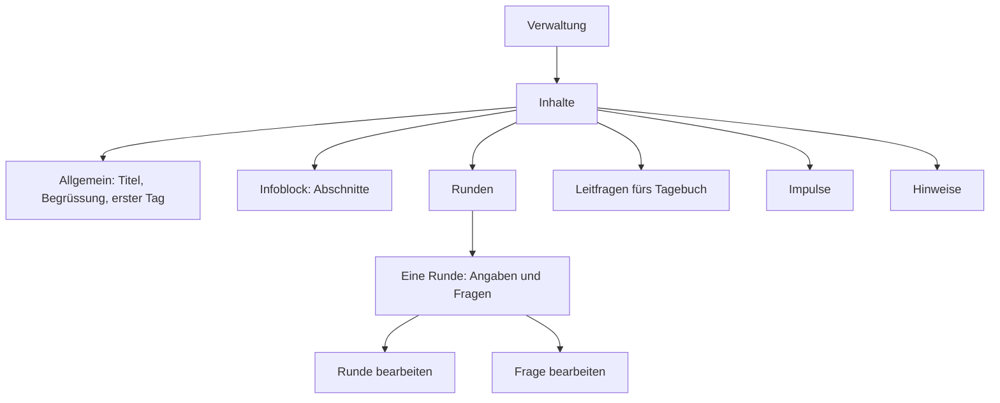

# Design: Eingabemaske für Inhalte (#15)

Grundlage: [Anforderungen](../../anforderungen.md) (Abschnitte «Runden», «Tagebuch», «Impulse», «Infoblock und Texte», «Eingabemaske», «Gast-Ansicht»), [ADR-001](../../adr/ADR-001-technik-pilot.md), [Design Grundgerüst](2026-10-30-grundgeruest-design.md) (Schema 001, Schutz der Forschungsdaten), [Design Anmeldung](2026-10-30-anmeldung-design.md) (#14: `/verwaltung/…`, `braucht_auftraggeberin`, `pruefe_csrf`, `csrf_feld`, Fehlerseiten, Routen-Inventar, Vergabe der Migrationsnummern), Hinweistexte aus #8 (`docs/datenschutz.md`, Abschnitt «Hinweistexte»). Die Entscheidungen hier hat Claude getroffen (Projektregel «Fragen selbst beantworten»); wo es eine Alternative gab, steht die Begründung dabei.

## Zweck

Die Auftraggeberin erfasst alle Inhalte des Instruments selbst: Titel, Begrüssung, Projektstart, Infoblock, Runden mit Fallbeispiel und Fragen, Leitfragen fürs Tagebuch, Impulse und Hinweistexte. Sie arbeitet am Handy oder am Computer, ohne IT-Kenntnisse, und auch noch während der Laufzeit. Die Maske muss vor der Lehrpersonen-Ansicht fertig sein (Ziel Mi 11.11.), damit sie Zeit zum Erfassen hat.

Dieses Issue legt ausserdem Bausteine fest, die #16–#19 übernehmen: die einfache Formatierung (Filter `formatiert`), das Register der festen Texte (`app/texte.py`) und die zentrale Funktion `heute()` (`app/zeit.py`).

## Ziele

- Jeder Inhalt aus der Anforderung «Alle Texte sind Inhalt, kein Code» lässt sich anlegen, ändern, löschen und, wo es eine Reihenfolge gibt, umsortieren.
- Bedienung ohne Fachbegriffe, ohne JavaScript, auf 390 px Breite ohne horizontales Scrollen.
- Einfache Formatierung (Absätze, Aufzählungen, fett), sicher gegen eingeschleustes HTML, ohne neue Dependency.
- Keine Antwort und kein Tagebucheintrag einer Lehrperson geht durch eine Änderung in der Maske verloren oder wird unlesbar.
- Ein Platzhalter-Text kann nicht unbemerkt live gehen: Die Maske zeigt, welche festen Texte die Auftraggeberin noch nicht bestätigt hat.
- Erfundene Platzhalter-Inhalte für Entwicklung und E2E lassen sich mit einem Kommando laden, nie in Produktion.
- Nur die Auftraggeberin kann Inhalte ändern (Test über alle Routen).

## Nicht-Ziele

- Vorschau «So sieht es eine Lehrperson» (#19). Die Maske sieht nur die Einstiegspunkte vor (siehe «Übergabe»).
- Anzeige der Inhalte für Lehrpersonen und Gäste (#16, #19).
- Fragen ausblenden statt löschen, Fragen in eine andere Runde verschieben, Versionsverlauf von Inhalten. Nicht verlangt; eine beantwortete Frage bleibt, ihr Text lässt sich ändern.
- Warnung beim Verlassen einer Seite mit ungespeicherten Änderungen. Bräuchte JavaScript (`beforeunload`), und Safari auf dem iPhone, ihr wahrscheinlichstes Gerät, beachtet das Ereignis meist nicht. Der Nutzen steht nicht im Verhältnis.
- Wählbare Breite der Skala (siehe Entscheidung «Skala»).
- Bilder, Links und Überschriften im Text.

## Anti-Ziele

- Keine neue Dependency (kein Markdown-Paket, kein HTML-Sanitizer, kein `tzdata`). Formatierung mit `markupsafe` (kommt mit Jinja2) und Standardbibliothek.
- Kein JavaScript in der Maske, kein Inline-CSS.
- Keine technischen Begriffe in der Oberfläche (kein «Datensatz», «ID», «Reihenfolge-Wert», «Markdown», «Schlüssel»).
- Kein Löschen von Forschungsdaten über die Maske, auch nicht indirekt.
- Keine echten Inhalte im Repo. Die Platzhalter sind erfunden und neutral.

## Begriffe in der Oberfläche

| Im Code | In der Oberfläche |
|---|---|
| `info_abschnitte` | Infoblock, Abschnitt |
| `runden`, `fallbeispiel` | Runde, Fallbeispiel (freiwillig) |
| `freischaltdatum`, `sichtbar_ab` | «Sichtbar ab» |
| `projektstart` | «Erster Tag für die Lehrpersonen» |
| `typ = freitext` / `skala` | «Antwort als Text» / «Antwort auf einer Skala von 1 bis 5» |
| `skala_min_text`, `skala_max_text` | «Beschriftung bei 1», «Beschriftung bei 5» |
| `leitfragen` | Leitfragen fürs Tagebuch |
| `texte` (Register) | Hinweise; bei der Begrüssung einfach «Begrüssung» |
| Text aus dem Register, noch nicht in der Datenbank | «Vorschlag, noch nicht von dir bestätigt» |
| `reihenfolge` ändern | Knöpfe «Nach oben» / «Nach unten» |
| Woche aus `projektstart` berechnet | «Woche 2» |

Anrede: «du» wie in #14. Sätze kurz, Knöpfe mit Verb («Speichern», «Neue Runde», «Endgültig löschen», «Abbrechen»).

## Aufbau der Maske



- **Übersicht `/verwaltung/inhalte`:** eine Karte pro Bereich (`karte--link`) mit einer Zeile Stand, z. B. «4 Runden, 14 Fragen», «Erster Tag: Mo 23.11.2026», «2 von 5 Hinweisen bestätigt». Offene Punkte stehen als `marke` auf der Karte («Noch offen»): erster Tag nicht festgelegt, Begrüssung oder Hinweise nicht bestätigt, Runde ohne Fragen. Die Übersicht der Verwaltung aus #14 verlinkt hierher (ihr Platzhalter «Inhalte» wird zum Link).
- **Listenseiten** (Infoblock, Runden, Leitfragen, Impulse, Hinweise): oben «‹ Inhalte» (`zurueck`), Titel, ein Satz Erklärung, Knopf «Neu …», darunter die Einträge als Karten. Jede Karte zeigt den Inhalt so, wie ihn die Lehrperson sieht (formatiert), plus «Bearbeiten», «Löschen» und, wo es eine Reihenfolge gibt, «Nach oben»/«Nach unten».
- **Formularseiten:** ein Formular pro Seite (`formular`, `feld`, `hilfe`), Knopf «Speichern» unten, Link «Abbrechen» zurück zur Liste. Bewusst kein Bearbeiten direkt in der Liste: Auf dem Handy wäre die Seite sonst sehr lang, und ein Tipp auf «Nach oben» würde ungespeicherte Änderungen in einem anderen Formular verwerfen.
- **Runde:** Die Seite einer Runde zeigt ihre Angaben (Titel, Sichtbar ab mit Woche, Fallbeispiel formatiert) mit Link «Angaben bearbeiten» und darunter ihre Fragen mit «Neue Frage». Aus dem gleichen Grund wie oben sind Angaben und Fragen getrennte Formulare.
- **Infoblock:** Am Ende der Liste steht eine feste Karte «Datenschutz (immer am Schluss)», nicht verschiebbar, nicht löschbar, mit Link auf den Hinweis `hinweis_datenspeicherung` (Vorgabe aus #8).
- **Gestaltung:** vorhandene Klassen aus `style.css` und die Formularfelder aus #14. Neue Klassen nur wenn nötig, am Ende der Datei im Abschnitt «Pilot: Eingabemaske» (z. B. Zeile mit den Verschiebe-Knöpfen). Breite wie überall `max-width: 40rem`; am Computer genügt das für Textfelder. Lange Textfelder (Infoblock, Fallbeispiel) mit grosszügiger Höhe (`rows="12"`), kurze (Frage, Impuls) mit `rows="3"`.

## Adressen

Alle unter `/verwaltung/inhalte`, ein Router `app/routen/verwaltung_inhalte.py` mit `dependencies=[Depends(braucht_auftraggeberin)]` auf Router-Ebene, damit keine Route die Prüfung vergessen kann. Jede POST-Route hängt zusätzlich `pruefe_csrf` an.

| Methode, Pfad | Was |
|---|---|
| `GET /verwaltung/inhalte` | Übersicht |
| `GET`, `POST /verwaltung/inhalte/allgemein` | Titel, Begrüssung, erster Tag |
| `GET /verwaltung/inhalte/info` | Abschnitte des Infoblocks |
| `GET /verwaltung/inhalte/info/neu` | Formular neuer Abschnitt |
| `POST /verwaltung/inhalte/info` | Abschnitt anlegen (ans Ende) |
| `GET`, `POST /verwaltung/inhalte/info/{id}` | Abschnitt bearbeiten |
| `POST /verwaltung/inhalte/info/{id}/verschieben` | Feld `richtung` = `hoch` oder `runter` |
| `GET`, `POST /verwaltung/inhalte/info/{id}/loeschen` | Bestätigung, Löschen |
| `GET /verwaltung/inhalte/runden` | Runden, sortiert nach «Sichtbar ab» |
| `GET /verwaltung/inhalte/runden/neu` | Formular neue Runde |
| `POST /verwaltung/inhalte/runden` | Runde anlegen, 303 auf ihre Seite |
| `GET /verwaltung/inhalte/runden/{id}` | Seite der Runde: Angaben und Fragen |
| `GET`, `POST /verwaltung/inhalte/runden/{id}/bearbeiten` | Angaben der Runde bearbeiten |
| `GET`, `POST /verwaltung/inhalte/runden/{id}/loeschen` | Bestätigung, Löschen (gesperrt bei Antworten) |
| `GET /verwaltung/inhalte/runden/{id}/fragen/neu` | Formular neue Frage |
| `POST /verwaltung/inhalte/runden/{id}/fragen` | Frage anlegen (ans Ende der Runde) |
| `GET`, `POST /verwaltung/inhalte/fragen/{id}` | Frage bearbeiten |
| `POST /verwaltung/inhalte/fragen/{id}/verschieben` | innerhalb der Runde |
| `GET`, `POST /verwaltung/inhalte/fragen/{id}/loeschen` | Bestätigung, Löschen (gesperrt bei Antworten) |
| `GET /verwaltung/inhalte/leitfragen`, `…/neu`; `POST …/leitfragen` | wie Infoblock |
| `GET`, `POST /verwaltung/inhalte/leitfragen/{id}`, `…/verschieben`, `…/loeschen` | wie Infoblock |
| `GET /verwaltung/inhalte/impulse`, `…/neu`; `POST …/impulse` | Impulse, sortiert nach «Sichtbar ab» |
| `GET`, `POST /verwaltung/inhalte/impulse/{id}`, `…/loeschen` | bearbeiten, löschen (keine Reihenfolge) |
| `GET /verwaltung/inhalte/hinweise` | alle Hinweise aus dem Register mit Stand |
| `GET`, `POST /verwaltung/inhalte/hinweise/{schluessel}` | Hinweis bearbeiten bzw. bestätigen |

Unbekannte `id`, Frage-`id` ausserhalb jeder Runde oder `schluessel`, der nicht im Register steht (auch `begruessung`, die über «Allgemein» läuft), ergeben 404 mit der Fehlerseite aus #14. Pfadparameter sind als `int` typisiert.

## Speichern, Bestätigen, Fehler

- **Muster «Formular abschicken, dann weiterleiten»:** Nach jedem erfolgreichen POST 303 auf die Liste bzw. die Seite der Runde, mit festem Schlüssel `?erledigt=gespeichert|angelegt|geloescht` (Text aus fester Tabelle im Code, wie in #14). Oben erscheint «Gespeichert.» bzw. «Angelegt.» / «Gelöscht.» (`hinweis`, `role="status"`). Neu laden legt nichts doppelt an.
- **Zurück an die richtige Stelle:** Die Weiterleitung hängt den Anker des betroffenen Eintrags an (z. B. `…/info?erledigt=gespeichert#abschnitt-5`, nach dem Verschieben ohne Meldung nur `#abschnitt-5`). Auf dem Handy springt die Seite so zum Eintrag, statt nach oben.
- **Fehler:** Das Formular erscheint wieder mit den eingegebenen Werten (Status 400), oben «Bitte prüfe die markierten Felder.», am Feld ein Satz (`fehler`, per `aria-describedby` verknüpft). Beispiele: «Bitte einen Titel eingeben.», «Bitte ein Datum wählen.», «Für die Skala braucht es beide Beschriftungen.», «Der Text ist zu lang (höchstens 20 000 Zeichen).».
- **Löschen:** immer über eine Bestätigungsseite (GET) mit Knopf «Endgültig löschen» (POST) und Link «Abbrechen». Gesperrte Fälle siehe «Schutz der Forschungsdaten»; dort zeigt die Bestätigungsseite statt des Knopfs die Erklärung, und ein POST antwortet mit 409 und derselben Seite.
- **Eingaben bereinigen:** Zeilenumbrüche auf `\n` vereinheitlichen, Leerraum am Anfang und Ende entfernen. Kurze Texte (Titel, Frage, Leitfrage, Impuls, Beschriftungen) werden zu einer Zeile: Zeilenumbrüche durch Leerzeichen ersetzt.

| Feld | Pflicht | Höchstlänge |
|---|---|---|
| Titel des Instruments | ja | 60 |
| Titel Abschnitt, Titel Runde | ja | 100 |
| Frage, Leitfrage, Impuls | ja | 500 |
| Beschriftung der Skala | ja bei Skala, sonst leer gespeichert | 60 |
| Begrüssung, Abschnitt, Hinweis | ja | 20 000 |
| Fallbeispiel | nein (leer wird `NULL`) | 20 000 |
| Datum | ja (erster Tag: nein, bis er feststeht) | Format `YYYY-MM-DD` |

## Entscheidungen

### Bereiche und Speicherort

| Bereich | Felder | Speicherort |
|---|---|---|
| Allgemein | Titel des Instruments, Begrüssung, erster Tag | `einstellungen` (`titel`, `projektstart`), `texte` (`begruessung`) |
| Infoblock | Titel, Text, Reihenfolge | `info_abschnitte` |
| Runden | Titel, Fallbeispiel (freiwillig), Sichtbar ab | `runden` |
| Fragen | Art (Text/Skala), Frage, Beschriftungen bei 1 und 5, Reihenfolge | `fragen` |
| Leitfragen | Text, Reihenfolge | `leitfragen` |
| Impulse | Text, Sichtbar ab | `impulse` |
| Hinweise | Text pro Schlüssel aus dem Register | `texte` |

- **Titel in `einstellungen`, Begrüssung in `texte`:** Der Titel ist eine Zeile ohne Formatierung, die Begrüssung ein formatierter Text wie die Hinweise. So gilt für alle formatierten festen Texte derselbe Weg (Register, Bestätigung). Ohne gespeicherten Titel gilt «Reflexionsinstrument».
- **Titel im Seitenkopf:** Ein Context-Processor in `app/vorlagen.py` (Starlette `Jinja2Templates(context_processors=[…])`) stellt `instrument_titel` für alle Seiten bereit, auch für `<title>` und die Fehlerseiten. Er liest den Wert über eine kurze eigene Verbindung; schlägt das fehl, gilt der Standardtitel (eine Fehlerseite darf nicht selbst scheitern). Begründung: an einer Stelle statt in jeder Route, und ohne Zwischenspeicher, der nach dem Speichern veralten könnte.
- **Erster Tag:** Hilfetext «Daraus ergibt sich, in welcher Woche ein Eintrag entstanden ist. Die Daten der Runden und Impulse ändern sich dabei nicht.» Solange er fehlt, zeigt die Übersicht «Noch offen».
- **Vorschläge für Datum:** «Neue Runde» und «Neuer Impuls» sind mit erster Tag + 7 × (Anzahl bestehender Runden bzw. Impulse) vorausgefüllt, also Woche 1, 2, 3 … Nur ein Vorschlag, frei änderbar. Ohne ersten Tag bleibt das Feld leer.
- **Woche anzeigen:** Bei Runden und Impulsen steht neben dem Datum «Woche N» (bzw. «vor dem Start»), sobald der erste Tag feststeht, und eine `marke` «Sichtbar» oder «Ab Mo 30.11.» nach `heute()`. So sieht sie den Plan auf einen Blick.

### Runden: Reihenfolge ergibt sich aus dem Datum

Runden werden nach «Sichtbar ab» sortiert (bei gleichem Datum nach Anlage), überall: in der Maske, für Lehrpersonen, Gast und Export. Keine Knöpfe «Nach oben/unten» für Runden. Begründung: Pro Woche wird eine Runde sichtbar; eine zweite, von Hand gesetzte Reihenfolge könnte dem Datum widersprechen (Runde 2 oben, aber früher sichtbar als Runde 1), und die Auftraggeberin denkt in Wochen. Das Umfang-Kästchen «Reihenfolge» im Issue ist damit über das Datum erfüllt. Die Spalte `runden.reihenfolge` aus 001 bleibt ungenutzt (Wert 0).

Ist eine Runde schon sichtbar und wird ihr Datum in die Zukunft verschoben, steht im Formular der Hinweis «Diese Runde ist schon sichtbar. Mit einem späteren Datum verschwindet sie für die Lehrpersonen bis dahin; bisherige Antworten bleiben gespeichert.» Erlaubt, weil ein Tippfehler im Datum korrigierbar sein muss.

Gleiches gilt für Impulse (sortiert nach Datum). Haben zwei Impulse dasselbe Datum, steht in der Liste: «Am selben Tag gibt es noch einen Impuls. Auf der Startseite erscheint der zuletzt erfasste.»

### Skala fest von 1 bis 5

Die Skala hat immer die Werte 1 bis 5; die Auftraggeberin beschriftet nur die beiden Enden. Begründung: Der Prototyp hatte 1–5, und darauf bezog sich ihr «Skala ist gut». Fünf Felder passen in 390 px mit 48 px hohen Tippflächen (`.skala` mit `repeat(5, 1fr)` besteht schon). Eine Mitte erlaubt eine neutrale Antwort, was bei einer Reflexion ohne statistische Auswertung passt. Eine wählbare Breite wäre mehr Formular, mehr Erklärung und für Skalen mit Antworten nicht mehr änderbar, ohne dass jemand danach gefragt hat. Umsetzung: Konstanten `SKALA_MIN = 1`, `SKALA_MAX = 5` in `app/inhalte.py`; #16 prüft gespeicherte Werte dagegen.

### Reihenfolge ändern ohne JavaScript

Für Infoblock-Abschnitte, Fragen (innerhalb ihrer Runde) und Leitfragen: Jede Karte hat zwei kleine Formulare mit POST auf `…/{id}/verschieben` und einem Knopf «Nach oben» bzw. «Nach unten» (Pfeil plus Wort, `knopf--klein`, mindestens 44 px hoch). Der erste Eintrag hat kein «Nach oben», der letzte kein «Nach unten». Jeder Knopf trägt ein `aria-label` mit dem Titel des Eintrags («‹Worum es geht› nach oben»).

Server: in einer Transaktion (`BEGIN IMMEDIATE`) die Liste geordnet lesen (`ORDER BY reihenfolge, id`), den Eintrag mit dem Nachbarn tauschen und alle Werte neu als 1…n schreiben. Neu angelegte Einträge bekommen `max + 1`. Verschieben am Rand ist ohne Wirkung (kein Fehler). Begründung gegen Ziehen mit dem Finger: bräuchte JavaScript und ist auf dem Handy fehleranfällig; bei 3–8 Einträgen pro Liste genügen Knöpfe.

### Einfache Formatierung

Gilt für die langen Texte: Begrüssung, Infoblock-Abschnitte, Fallbeispiele, Hinweise. Titel, Fragen, Leitfragen, Impulse und Beschriftungen sind kurzer Text ohne Formatierung. Begründung: Fragen und Leitfragen erscheinen als Beschriftung von Eingabefeldern (`<label>`, darin sind Absätze und Listen nicht erlaubt), und der Impuls- bzw. Leitfragentext wird als reiner Text in Tagebucheinträge kopiert (`impuls_text`, `leitfrage_text`).

**Regeln** (Hilfetext unter jedem formatierbaren Feld, Klasse `hilfe`: «Leerzeile = neuer Absatz · Zeile mit «- » am Anfang = Aufzählung · \*\*Wort\*\* = fett»):

| Eingabe | Ergebnis |
|---|---|
| eine oder mehrere Leerzeilen | neuer Absatz |
| einfacher Zeilenumbruch | Zeilenumbruch im Absatz |
| Zeile beginnt mit `-`, `*` oder `•`, gefolgt von Leerzeichen oder Tab | Aufzählungspunkt; aufeinanderfolgende solche Zeilen bilden eine Liste. `•` und Tab, weil Word beim Einfügen Aufzählungen so liefert. |
| `**Text**` innerhalb einer Zeile | fett (`<strong>`) |
| alles andere, auch `<b>`, `<script>`, `&` | erscheint genau so als Text |

Eine Liste darf direkt auf eine Textzeile folgen («Dazu gehört:» und darunter «- …»); aus einem Block werden dann ein Absatz und eine Liste. Ein einzelnes `**` ohne Gegenstück bleibt stehen.

**Ablauf in `app/formatierung.py`, Funktion `formatiere(text: str | None) -> Markup`:**
1. `None` oder leer → leeres `Markup`.
2. Zeilenumbrüche vereinheitlichen, Leerraum am Zeilenende entfernen, in Blöcke an Leerzeilen teilen.
3. Pro Block die Zeilen in Läufe gruppieren: Listenzeilen und Textzeilen.
4. **Jede Zeile zuerst mit `markupsafe.escape` escapen**, erst danach auf dem escapten Text `\*\*(\S(?:.*?\S)?)\*\*` durch `<strong>\1</strong>` ersetzen. `*` wird vom Escapen nicht verändert.
5. Textlauf → `<p>` + Zeilen mit `<br>` verbunden + `</p>`; Listenlauf → `<ul>` + je `<li>…</li>` + `</ul>`.
6. Ergebnis als `Markup` zurück.

Sicher, weil jeder Teil aus der Eingabe escapt wird, bevor er mit festen Tags zusammengesetzt wird, und die Funktion nie Attribute erzeugt. Jinja-Filter `formatiert` in `app/vorlagen.py`; Templates schreiben `{{ abschnitt.inhalt | formatiert }}`. Nirgends `| safe` auf Inhalte. Für einen Text ohne Absätze in einem `<p>`-Kontext (z. B. Hinweis-Band) gibt es keine Sonderform; Templates setzen formatierte Texte in ein `<div>`.

### Schutz der Forschungsdaten

| Aktion | Mit Antworten bzw. Einträgen | Begründung |
|---|---|---|
| Text einer Frage, Beschriftungen der Skala ändern | erlaubt. Im Formular steht: «Diese Frage wurde schon N-mal beantwortet. Die Antworten bleiben erhalten und stehen danach unter dem neuen Text.» | Tippfehler müssen korrigierbar sein; die Antwort hängt an der `frage_id`, nicht am Text. |
| Art der Frage ändern (Text ↔ Skala) | **gesperrt**. Die Auswahl ist deaktiviert, mit dem Satz: «Die Art lässt sich nicht mehr ändern, weil die Frage schon beantwortet wurde. Lege bei Bedarf eine neue Frage an.» Der Server prüft das in derselben Transaktion wie das Speichern und antwortet bei abweichender Art mit 400. | Eine Textantwort hätte in einer Skala keinen Platz und umgekehrt: Die Antwort bliebe zwar in der Datenbank, wäre für die Lehrperson aber unsichtbar und im Export widersprüchlich. |
| Frage löschen | **gesperrt** (`ON DELETE RESTRICT`). Bestätigungsseite: «Diese Frage wurde schon N-mal beantwortet. Damit keine Antworten verloren gehen, lässt sie sich nicht löschen. Den Text kannst du weiterhin ändern.» | Vorgabe aus #13. |
| Runde löschen | **gesperrt**, sobald eine ihrer Fragen beantwortet ist (die Kaskade Runde → Fragen scheitert an der Sperre). Meldung sinngemäss wie oben. Ohne Antworten: «Die Runde und ihre N Fragen werden gelöscht.» | Vorgabe aus #13. |
| Runde verschieben (Datum) | erlaubt, Hinweis siehe oben | Antworten bleiben gespeichert. |
| Impuls oder Leitfrage ändern | erlaubt. Hinweis: «N Tagebucheinträge beziehen sich darauf. Sie behalten den Text, den die Lehrperson damals gesehen hat.» | Tagebucheinträge speichern den Text beim Anlegen mit (`impuls_text`, `leitfrage_text`, Schema 001). |
| Impuls oder Leitfrage löschen | erlaubt, gleicher Hinweis auf der Bestätigungsseite. Der Verweis im Eintrag wird geleert (`ON DELETE SET NULL`), der mitgespeicherte Text bleibt. | Kein Datenverlust; der Export weiss weiterhin, worauf sich ein Eintrag bezog. |
| Abschnitt des Infoblocks löschen | erlaubt | Kein Eintrag verweist darauf. |

Die Zahlen N kommen aus der Datenbank (`count(*)`), nur als Anzahl, ohne Namen. Die Prüfung «gibt es Antworten?» geschieht vor dem Löschen in der App, damit die Meldung verständlich ist; zusätzlich fängt die Route `sqlite3.IntegrityError` als Sicherheitsnetz ab und zeigt dieselbe Meldung (409). Als Antwort zählt jede Zeile in `antworten`, auch eine reine Aufnahme (#17).

### Hinweistexte und Register der festen Texte

`app/texte.py` enthält ein Register aller festen Texte. Pro Eintrag:

```python
@dataclass(frozen=True)
class Textvorlage:
    schluessel: str      # Schlüssel in der Tabelle texte
    bezeichnung: str     # Überschrift in der Maske, z. B. «Hinweis im Tagebuch»
    ort: str             # wo er erscheint, in einfacher Sprache
    bereich: str         # "allgemein" (Begrüssung) oder "hinweise"
    vorschlag: str       # gilt, solange die Auftraggeberin nichts gespeichert hat

REGISTER: dict[str, Textvorlage]
```

Funktionen: `lies_text(db, schluessel) -> str` (Text aus der Datenbank, sonst der Vorschlag), `lies_texte(db, bereich) -> list[Textstand]` (`vorlage`, `inhalt`, `bestaetigt: bool`, `geaendert`), `speichere_text(db, schluessel, inhalt)` (`INSERT … ON CONFLICT DO UPDATE`, setzt `geaendert`). Ein Schlüssel, der nicht im Register steht, ist ein Programmierfehler (`KeyError`) bzw. in der Adresse 404.

**Inhalt des Registers:** `begruessung` (Bereich «allgemein», Begrüssung auf der Startseite der Lehrperson) und die fünf Hinweise aus #8 mit Schlüssel, Ort und Platzhalter **unverändert aus `docs/datenschutz.md`**: `hinweis_tagebuch`, `hinweis_wer_sieht_was`, `hinweis_gast`, `hinweis_datenspeicherung`, `hinweis_aufnahme`. **Annahme:** Der Pull Request zu #8 ist beim Bau von #15 gemergt oder diese fünf Schlüssel bleiben gleich. Ändert #8 die Liste, wird nur das Register angepasst; Datenbank und Maske passen sich von selbst an. Weitere Texte späterer Issues kommen ebenfalls nur ins Register.

**Entscheidung: Vorschlag aus dem Register gilt, bis sie bestätigt.** Fehlt ein Text in der Datenbank, zeigen Lehrpersonen- und Gast-Ansicht den Vorschlag. Es gibt keine Migration, die Texte einfügt. Abweichung von `docs/datenschutz.md` (#8, Abschnitt «Für #15»: «Die Migration von #15 legt die fünf Schlüssel mit den Platzhaltern an»), begründet:
- Ein Text in der Datenbank sähe gleich aus, ob die Auftraggeberin ihn geschrieben hat oder die Migration. Mit dem Register ist «noch nicht bestätigt» schlicht «keine Zeile».
- Neue oder geänderte Schlüssel brauchen keine Migration; die Nummern aus #14 bleiben unberührt.
- Die Vorschläge aus #8 sind ausdrücklich so formuliert, dass sie im Notfall stehen bleiben können. Ein leerer Hinweis wäre schlimmer als ein neutraler.

**Damit kein Vorschlag unbemerkt live geht:** Die Liste «Hinweise» und das Formular «Allgemein» markieren jeden nicht bestätigten Text mit `marke` «Vorschlag, noch nicht von dir bestätigt»; die Übersicht zählt sie («2 von 5 Hinweisen bestätigt», Marke «Noch offen»). Bestätigen heisst speichern, auch unverändert. Die Vorschläge im Register sind neutral und ohne Anrede (wie in #8); die erfundenen Entwicklungs-Platzhalter («Platzhalter: …») stehen nie im Register, sondern nur in der Datei für `platzhalter-laden` (siehe unten). Leer speichern ist nicht möglich (#8).

Die Hinweis-Liste zeigt pro Karte: Bezeichnung, «Erscheint: …» (`ort`), Stand, den Text formatiert, Link «Bearbeiten». Im Formular steht der Ort als Hilfetext über dem Feld.

### Datum und Zeitzone

Neues Modul `app/zeit.py`, genutzt von #15, #16, #18, #19:

```python
ZEITZONE = ZoneInfo("Europe/Zurich")

def heute(jetzt: datetime | None = None) -> date:
    """Heutiges Datum in Zürich. jetzt (zeitzonenbewusst) nur für Tests."""

def hole_heute(request: Request) -> date:
    """FastAPI-Dependency: request.app.state.heute()."""

def lies_datum(text: str) -> date | None:
    """Nur genau YYYY-MM-DD (Regex vor date.fromisoformat, das ab Python 3.11
    auch 20261123 annimmt); sonst None."""

def ist_erreicht(datum: date, heute: date) -> bool:   # datum <= heute
def woche(datum: date, projektstart: date) -> int | None:  # None vor dem Start, sonst (Tage // 7) + 1
def datum_kurz(datum: date) -> str:                   # "Mo 30.11.2026", Wochentage fest im Code, ohne locale
```

- `erstelle_app` setzt `app.state.heute = zeit.heute`. Routen bekommen das Datum nur über `Depends(hole_heute)`, Fachfunktionen als Parameter `heute: date`. Tests setzen `app.state.heute = lambda: date(2026, 11, 30)`; kein Monkeypatching der Uhr.
- «Sichtbar ab» heisst: ab 00:00 Uhr Zürcher Zeit an diesem Tag. Gespeichert als Text `YYYY-MM-DD`; der Vergleich in SQL (`freischaltdatum <= :heute`, mit `heute.isoformat()`) ist bei diesem Format korrekt.
- Eingabe über `<input type="date">` (liefert `YYYY-MM-DD`, auf dem Handy mit Kalender). Anzeige überall mit `datum_kurz`, als Jinja-Filter `datum` registriert.
- `zoneinfo` findet die Zeitzonen im Produktions-Image unter `/usr/share/zoneinfo` (geprüft) und lokal auf macOS. Deshalb keine Dependency `tzdata`. Ein Test stellt sicher, dass `Europe/Zurich` lädt.

### Datenmodell: keine Migration 002

#15 braucht kein neues Schema. Alles Nötige steht in 001:
- `einstellungen`: neue Schlüssel `titel` und `projektstart` (Einzelwerte, keine Spalten).
- `texte`: Begrüssung und Hinweise über das Register, ohne Vorbefüllung.
- `info_abschnitte`, `runden`, `fragen`, `leitfragen`, `impulse` mit allen Feldern und `reihenfolge`; `runden.reihenfolge` bleibt ungenutzt.
- Sperren und Textkopien für den Schutz der Forschungsdaten bestehen seit 001.

Es entsteht **keine Datei** `002_….sql`. Die Nummer 002 bleibt laut #14 für #15 reserviert und damit leer; `migriere` erlaubt Lücken. #16 legt wie geplant `003` an. Prüfungen wie «Datum im Format `YYYY-MM-DD`» oder «Skala braucht Beschriftungen» bleiben in der App (eine `CHECK`-Bedingung bräuchte in SQLite einen Neuaufbau der Tabelle, für vier Wochen Laufzeit unverhältnismässig).

### Platzhalter-Inhalte für Entwicklung und E2E

- **Datei:** `tests/platzhalter/inhalte.json`, nur erfundene, neutrale Texte (Grundlage: die Platzhalter aus `prototyp/js/inhalte.js`, angepasst): Titel, Begrüssung, 4 Infoblock-Abschnitte (einer mit Aufzählung und Fettdruck), 4 Runden (1–3 mit Fallbeispiel, Runde 4 ohne, als Rückblick), je 3–4 Fragen mit Text und Skala, 3 Leitfragen, 4 Impulse. Datumsangaben als Versatz in Tagen zum ersten Tag (`"tag": 0, 7, 14, 21`), damit die Datei nicht veraltet. Hinweise sind nicht enthalten: Dafür gelten die Vorschläge aus dem Register, und so ist die Markierung «noch nicht bestätigt» in der Entwicklung sichtbar.
- **Kommando:** `python -m app.kommandos platzhalter-laden [--projektstart YYYY-MM-DD] [--ersetzen]`. Standard für den ersten Tag ist `heute()`, damit Runde 1 sofort sichtbar ist. Das Kommando legt die Inhalte über dieselben Funktionen aus `app/inhalte.py` an wie die Maske (prüft damit auch deren Validierung). Make-Ziel `make platzhalter`.
- **Nie in Produktion, dreifach:** (1) Mit `PRODUKTION=1` verweigert das Kommando mit einer Meldung und Exit-Code 1. (2) Die Datei liegt unter `tests/`; `.dockerignore` lässt nur `app/` ins Image, sie existiert dort also nicht. (3) Sind schon Inhalte vorhanden (eine Zeile in `info_abschnitte`, `runden`, `leitfragen` oder `impulse`), verweigert es ohne `--ersetzen`; `--ersetzen` löscht zuerst alle Inhalte und scheitert, wenn Antworten bestehen (Sperre aus 001, verständliche Meldung).
- `app/kommandos.py` (#14) liest heute vor jedem Unterbefehl ein Passwort ein. Der Umsetzer verschiebt das Einlesen in die beiden Unterbefehle, die es brauchen.

### Vorschau

Gehört zu #19. #15 setzt an drei Stellen einen markierten Platz im Template (`{# #19: Vorschau-Link #}`) und zeigt dort noch nichts: Übersicht «Inhalte» («So sieht es eine Lehrperson»), Seite einer Runde («Diese Runde ansehen», auch vor ihrem Datum), Liste des Infoblocks. Vorgeschlagene Adressen für #19: `/verwaltung/vorschau` und `/verwaltung/vorschau/runden/{id}`. Keine toten Links in #15.

## Aufbau im Code

```
app/
  inhalte.py         Fachlogik ohne FastAPI: lesen, anlegen, ändern, löschen, verschieben,
                     Prüfungen, Zählen von Antworten/Einträgen, SKALA_MIN/SKALA_MAX
  texte.py           Register der festen Texte, lies_text, lies_texte, speichere_text
  formatierung.py    formatiere()
  zeit.py            heute, hole_heute, lies_datum, ist_erreicht, woche, datum_kurz
  vorlagen.py        + Filter formatiert, datum; Context-Processor instrument_titel
  routen/verwaltung_inhalte.py
  templates/verwaltung/inhalte/   uebersicht, allgemein, liste_*, formular_*, runde, loeschen
tests/
  platzhalter/inhalte.json
  test_formatierung.py, test_zeit.py, test_texte.py, test_inhalte.py, test_verwaltung_inhalte.py
```

Fachfehler meldet `app/inhalte.py` über eine eigene Exception mit Feldname und Satz (wie `EingabeFehler` in `app/konten.py`), damit Routen und Kommando dieselben Meldungen zeigen. Der Umsetzer darf `inhalte.py` aufteilen, wenn es zu gross wird.

## Prüfung und Nachweis

**pytest** (Fixtures aus #14: `konto_auftraggeberin`, `konto_lehrperson`, `anmelden`, CSRF-Helfer; dazu eine Fixture, die Antworten und Tagebucheinträge direkt in die Datenbank schreibt, weil die Lehrpersonen-Ansicht erst mit #16 kommt):

- **Nur die Auftraggeberin ändert Inhalte (Akzeptanzkriterium):** Das Routen-Inventar aus #14 deckt «ohne Anmeldung» ab (GET → 303, POST ohne CSRF → 403). Zusätzlich ein Test über alle Routen mit Präfix `/verwaltung/inhalte`: als Lehrperson angemeldet und mit gültigem CSRF-Feld antwortet jede GET- und POST-Route mit 403, und nach allen POST-Anfragen ist der Inhalt der Datenbank unverändert (Vergleich eines Abzugs aller Inhaltstabellen vorher und nachher).
- **Formatierung:** Absätze, `<br>`, Liste mit `-`, `*`, `•` und Tab, Liste direkt nach Textzeile, fett, einzelnes `**`, `\r\n`, leerer Text und `None`. Eingeschleustes HTML: `<script>`, ``, `"` und `'`, `&amp;`, `**<b>x</b>**`, `- <script>` erscheinen escapt. Eigenschaftstest über eine Liste feindlicher Eingaben: Nach Entfernen der erlaubten Tags (`p`, `br`, `ul`, `li`, `strong`, ohne Attribute) enthält die Ausgabe kein `<` mehr.
- **Zeit:** `heute()` mit `2026-11-22T23:30Z` → 23.11.2026 (Zürich, Winterzeit), mit `2026-10-24T22:30Z` → 25.10.2026 (Sommerzeit); `lies_datum` lehnt `20261123`, `2026-11-31`, `23.11.2026` ab; `woche` für Tag 0, 6, 7 und vor dem Start; `datum_kurz`; `Europe/Zurich` lädt.
- **Register:** jeder Eintrag hat Bezeichnung, Ort und nicht leeren Vorschlag; die fünf Schlüssel aus #8 sind enthalten; ohne Zeile gilt der Vorschlag und `bestaetigt` ist falsch; nach dem Speichern (auch unverändert) ist er bestätigt; leer speichern → 400; unbekannter Schlüssel in der Adresse → 404.
- **Allgemein:** Titel, Begrüssung und erster Tag speichern; Titel erscheint im Kopf und in `<title>`; ungültiges Datum → 400 mit Meldung, Eingaben bleiben stehen.
- **Infoblock, Leitfragen, Fragen:** anlegen am Ende, bearbeiten, verschieben (Mitte, Rand ohne Wirkung), nach Löschen ist die Reihenfolge lückenlos; Weiterleitung mit Anker.
- **Runden und Impulse:** Sortierung nach Datum; Vorschlag für das Datum aus dem ersten Tag; Fallbeispiel leer → `NULL`; Hinweis bei sichtbarer Runde mit späterem Datum.
- **Schutz der Forschungsdaten (Akzeptanzkriterium «Ändern einer Frage verliert keine Antworten»):** Frage mit Antworten: Text und Beschriftungen ändern → Antworten unverändert (gleiche Zeilen, gleiche `frage_id`, gleicher Inhalt); Art ändern → 400, Art und Antworten unverändert; löschen → 409 mit Meldung, Frage und Antworten da. Runde mit beantworteter Frage löschen → 409, alles da. Runde ohne Antworten löschen → Runde und Fragen weg. Impuls und Leitfrage mit Tagebucheinträgen ändern und löschen → Einträge da, `impuls_text`/`leitfrage_text` unverändert, Verweis geleert. Sicherheitsnetz: `IntegrityError` beim Löschen ergibt 409 statt 500.
- **Kommando `platzhalter-laden`:** lädt in eine leere Datenbank (Anzahl Runden, Fragen usw. wie in der Datei); verweigert mit `PRODUKTION=1`; verweigert bei vorhandenen Inhalten ohne `--ersetzen`; `--ersetzen` scheitert verständlich, wenn Antworten bestehen; die Datei besteht die Validierung der Maske.

**E2E** (`tests/e2e-pilot.mjs`, Abschnitt «Abläufe» erweitern, mit `muss()` aus #14). Vorher Auftraggeberin per Kommando anlegen und `platzhalter-laden` ausführen. In 390 px, hell und dunkel; einmal am Computer (1280 px):
1. Übersicht «Inhalte» zeigt die Bereiche, «Hinweise» mit «Noch offen»; kein horizontales Scrollen, keine Konsolenfehler, auf jeder besuchten Seite.
2. Allgemein: Titel ändern → neuer Titel im Kopf; Begrüssung mit Leerzeile, Aufzählung und `**fett**` → Liste und Fettdruck sichtbar.
3. Infoblock: Abschnitt mit `<script>alert(1)</script>` anlegen → Text erscheint als Text, kein Dialog; Abschnitt mit «Nach oben» verschieben → Reihenfolge stimmt, Seite steht beim Abschnitt.
4. Runde anlegen (ohne Fallbeispiel), Frage als Text und Frage als Skala anlegen, Skala ohne Beschriftung → Meldung am Feld; Fragen umsortieren.
5. Leitfrage und Impuls anlegen, Impuls löschen über die Bestätigungsseite.
6. Hinweise: einen Vorschlag unverändert speichern → Marke «bestätigt», Zähler auf der Übersicht steigt.
7. Lehrperson meldet sich an und öffnet `/verwaltung/inhalte` → «Kein Zugriff».
8. Screenshots: Übersicht, Liste Infoblock, Seite einer Runde, Formular Frage mit Fehlermeldung, Hinweise, Bestätigungsseite Löschen.

Die Sperre beim Löschen beantworteter Fragen prüft nur pytest, weil Antworten erst mit #16 über die Oberfläche entstehen. #16 ergänzt den E2E-Ablauf «Lehrperson antwortet, Auftraggeberin versucht die Frage zu löschen».

**fly.io:** Nach dem Deploy als Auftraggeberin anmelden, einen Abschnitt anlegen und wieder löschen, Übersicht in 390 px prüfen. Keine Platzhalter laden.

**Akzeptanzkriterien aus dem Issue:**
- «Ohne technische Begriffe, auf Handy und Computer»: Begriffstabelle oben, E2E in 390 px und 1280 px, Screenshots im Pull Request.
- «Ändern einer Frage mit bestehenden Antworten verliert keine Antworten»: pytest unter «Schutz der Forschungsdaten».
- «Nur die Auftraggeberin kann Inhalte ändern»: Routen-Inventar (#14) plus Lehrpersonen-Test über alle `/verwaltung/inhalte`-Routen mit unveränderter Datenbank.

## Übergabe an spätere Issues

- **#16 Lehrpersonen-Ansicht:** Texte nur über `lies_text(db, schluessel)`, lange Texte nur über `| formatiert`, Datum nur über `hole_heute`. Runden sichtbar, wenn `freischaltdatum <= heute`, sortiert nach `freischaltdatum, id`, auch beim Aufruf über die direkte Adresse. Aktueller Impuls: der mit dem spätesten `sichtbar_ab <= heute`, bei Gleichstand die höchste `id`. Infoblock: Abschnitte nach `reihenfolge, id`, danach fest «Datenschutz» mit `hinweis_datenspeicherung`. Beim Anlegen eines Tagebucheintrags zu Impuls oder Leitfrage deren Text nach `impuls_text` bzw. `leitfrage_text` kopieren. Skalawerte gegen `SKALA_MIN`/`SKALA_MAX` prüfen. Fragen und Leitfragen als reiner Text. Nächste Migration ist `003`. Braucht der E2E-Lauf ein anderes «heute», dann über eine Einstellung, die mit `PRODUKTION=1` den Start verweigert (Entscheidung bei #16).
- **#17 Aufnahmen:** `hinweis_aufnahme` aus dem Register. Eine Antwort, die nur aus einer Aufnahme besteht, sperrt die Frage gegen Löschen wie jede andere.
- **#18 Einträge und Export:** Woche über `zeit.woche(datum, projektstart)`; erster Tag aus `einstellungen.projektstart`. Der Export zeigt den aktuellen Fragetext; die Maske weist beim Ändern beantworteter Fragen darauf hin.
- **#19 Gast-Ansicht und Vorschau:** Vorschau-Links an den drei markierten Stellen; `hinweis_gast` aus dem Register; die Gast-Ansicht nutzt dieselbe Regel `ist_erreicht` wie #16. Empfehlung: In der Vorschau nicht bestätigte Texte markieren.
- **#8 Datenschutz:** In `docs/datenschutz.md`, Abschnitt «Für #15», den ersten Punkt anpassen: Die Schlüssel stehen im Register `app/texte.py`, ihre Vorschläge gelten bis zur Bestätigung; keine Migration. Wer zuletzt merged, gleicht das an.

## Dem Umsetzer überlassen

Genaue Texte der Erklärungen, Hilfetexte und Meldungen (im Ton oben), Wortlaut der Vorschläge für `begruessung` (neutral, ohne Anrede), Inhalt der Platzhalter-Datei (erfunden, neutral), Aufteilung der Templates, Gestaltung der Verschiebe-Knöpfe und der Übersicht, Aufteilung der Tests auf Dateien. Reihenfolge der Umsetzung so, dass bei Zeitnot zuerst Allgemein, Runden mit Fragen und Infoblock bedienbar sind, dann Leitfragen, Impulse und Hinweise.

## Klärungen nach dem Builder-Check (Claude)

- **Impuls oder Leitfrage löschen:** Gewollt. Nach `ON DELETE SET NULL` hängt der Tagebucheintrag nur noch über den mitgespeicherten Text (`impuls_text`, `leitfrage_text`) am Impuls bzw. an der Leitfrage. Der Export (#18) liest den Text, nicht die ID. Die Maske sagt beim Löschen: «Einträge, die sich darauf beziehen, bleiben erhalten.»
- **Datenbankschicht:** `app/db.py` öffnet pro Anfrage eine Verbindung mit `isolation_level=None` (Autocommit, Transaktionen steuert der Code selbst mit `BEGIN IMMEDIATE` … `COMMIT`/`ROLLBACK`) und setzt `PRAGMA foreign_keys = ON`. Der Context-Processor nutzt keine eigene Verbindung, wenn sich das vermeiden lässt (Titel über die Anfrage-Verbindung oder einmal pro Anfrage gelesen); eine kurze eigene Verbindung ist zulässig.
- **Runde ohne Antworten löschen:** Möglich, die Fragen gehen per Kaskade mit. Tagebuch und Gast-Ansicht hängen nicht an Runden.
- **Hinweistexte:** Verbindlich sind Schlüssel und Platzhalter aus `docs/datenschutz.md` von #8 (PR #24, wird vor der Umsetzung von #15 auf `main` gemergt).
- **Vorschlag für das Freischaltdatum** einer neuen Runde: letztes Freischaltdatum + 7 Tage; ohne Runden der Projektstart; ohne Projektstart leer.
- **`platzhalter-laden` in Produktion:** Das Kommando verweigert, wenn die Umgebungsvariable `PRODUKTION` den Wert `1` hat (wie `lade_einstellungen`), ohne den geheimen Schlüssel zu lesen.
- **Migrationsnummern:** #15 braucht keine Migration. 002 bleibt unbenutzt (Lücken sind erlaubt), #16 behält 003.
