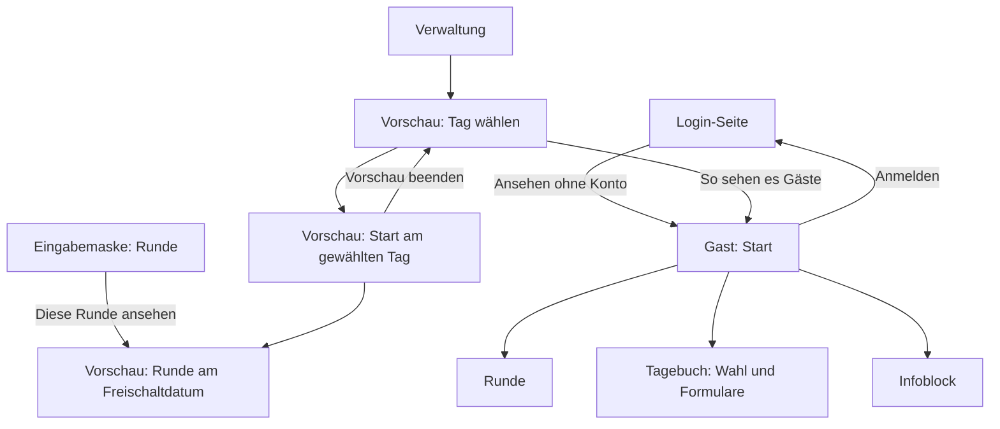

# Design: Gast-Ansicht ohne Konto und Vorschau (#19)

Grundlage: [Anforderungen](../../anforderungen.md) (Abschnitte «Gast-Ansicht», «Eingabemaske der Auftraggeberin»: Vorschau), [ADR-001](../../adr/ADR-001-technik-pilot.md), [Design Anmeldung](2026-10-30-anmeldung-design.md) (#14: Präfix `/gast`, ``, `pruefe_csrf`, Routen-Inventar, Fehlerseiten), [Design Eingabemaske](2026-10-30-eingabemaske-design.md) (#15: `hinweis_gast`, `lies_texte`, `zeit.py`, drei markierte Plätze für Vorschau-Links), [Design Lehrpersonen-Ansicht](2026-10-30-lehrpersonen-ansicht-design.md) (#16, **verbindlich**: `Ansicht`, `kontext_*`, `VORLAGEN`, `sichtbar.py`, leere Router `gast.py` und `verwaltung_vorschau.py`, `tests/testdaten.py` mit `abzug`), [datenschutz.md](../../datenschutz.md) (Hinweistext `hinweis_gast`), [loeschkonzept.md](../../loeschkonzept.md) (Gast-Ansicht bis Stufe 2). Die Entscheidungen hier hat Claude getroffen (Projektregel «Fragen selbst beantworten»); wo es eine Alternative gab, steht die Begründung dabei.

## Zweck

Zwei Ansichten, die die Seiten der Lehrperson zeigen, ohne etwas zu speichern:
- **Gast-Ansicht:** Ein Knopf «Ansehen ohne Konto» auf der Login-Seite zeigt das Instrument mit den echten, schon freigeschalteten Inhalten, für die Dozentin und die Öffentlichkeit.
- **Vorschau:** Die Auftraggeberin sieht aus der Eingabemaske, wie es eine Lehrperson an einem gewählten Tag sieht, auch vor dem Datum einer Runde. Ziel Fr 13.11., zusammen mit #16.

Beide bauen nur auf den Bausteinen von #16 auf: dieselben Templates, dieselben `kontext_*`-Funktionen, nur ein anderes `Ansicht`-Objekt.

## Ziele

- Ein Gast erreicht von der Login-Seite mit einem Tipp die Startseite, ohne Konto, ohne Passwort.
- Der Gast sieht genau das, was eine Lehrperson heute sieht, aber ohne Antworten, Einträge, Namen und Aufnahmen. Noch nicht freigeschaltete Runden und Impulse sind unsichtbar, auch über die direkte Adresse (404).
- Nach jeder Bedienung der Gast-Ansicht ist die Datenbank unverändert. Das ist doppelt abgesichert: Die Verbindung ist nur lesend, und ein Test vergleicht alle Tabellen.
- Aus der Gast-Ansicht führt kein Link und kein Formular zu Einträgen, zur Lehrpersonen-Ansicht oder zur Eingabemaske.
- Die Auftraggeberin wählt in der Vorschau einen Tag und sieht die Startseite, Runden und Impulse so, wie sie an diesem Tag erscheinen (Woche, aktueller Impuls, «Nächste Runde ab …»). Aus der Seite einer Runde in der Eingabemaske kommt sie mit einem Tipp in die Vorschau genau dieser Runde.

## Nicht-Ziele

- Neue Seiten oder eigene Templates für Gast und Vorschau. Gezeigt werden die Templates von #16 (Start, Infoblock, Runde, Tagebuch-Wahl, Tagebuch-Formulare).
- «Meine Einträge», Eintrag ansehen, ändern, löschen, Aufnahmen (#16, #17) im Gast-Modus oder in der Vorschau.
- Vorschau als bestimmte Lehrperson (mit ihren Antworten). Die Auftraggeberin liest Einträge in #18.
- Ein eigener Zähler oder eine Statistik über Gäste.
- Änderungen an `app/main.py` (Router sind seit #16 eingebunden) und an Migrationen.

## Anti-Ziele

- Kein Speichern, auch nicht vorübergehend: keine Sitzung, kein Cookie für den Gast-Modus, keine Zeile in der Datenbank, kein Log mit Inhalt.
- Kein Parameter wie `?modus=gast` an Routen der Lehrperson. Der Gast-Modus ergibt sich allein aus dem Präfix `/gast` (Begründung in #16).
- Kein JavaScript, kein Inline-CSS, keine neue Dependency.
- Keine echten Inhalte im Repo; Tests und E2E nutzen die Platzhalter aus #15.

## Begriffe in der Oberfläche

| Im Code | In der Oberfläche |
|---|---|
| Gast-Ansicht, `/gast` | «Ansehen ohne Konto» (Knopf), «Ansicht ohne Speichern» (Band, Text `hinweis_gast`) |
| Vorschau, `/verwaltung/vorschau` | «Vorschau», «So sieht es eine Lehrperson» |
| Stichtag der Vorschau | «So sieht es eine Lehrperson am Mo 30.11.2026 (Woche 2)» |
| Eingabe verworfen | «Nicht gespeichert. In der Ansicht ohne Konto wird nichts gespeichert.» bzw. «Nicht gespeichert. In der Vorschau wird nichts gespeichert.» |
| `Ansicht.ausgang` | Gast: «Anmelden»; Vorschau: «Vorschau beenden» |

## Adressen

### Gast (`app/routen/gast.py`, ohne Anmeldung)

| Methode, Pfad | Seite (`VORLAGEN` aus #16) | Verhalten |
|---|---|---|
| `GET /gast` | `start` | Startseite «Willkommen», Begrüssung, Impuls, freigeschaltete Runden, «Nächste Runde ab …» ohne Titel |
| `GET /gast/info` | `info` | Infoblock samt Abschnitt «Datenschutz» |
| `GET /gast/runden/{runde_id}` | `runde` | leeres Formular; 404, wenn nicht freigeschaltet oder unbekannt |
| `POST /gast/runden/{runde_id}` | `runde` | prüft wie bei der Lehrperson, speichert nichts, zeigt die Seite mit den Eingaben und der Meldung «Nicht gespeichert …» (200), bei ungültiger Eingabe 400 |
| `GET /gast/tagebuch/neu` | `tagebuch_wahl` | Wahl frei, zum Impuls, zu einer Leitfrage |
| `GET`, `POST /gast/tagebuch/neu/frei` | `tagebuch_neu` | wie Runde |
| `GET`, `POST /gast/tagebuch/neu/impuls/{impuls_id}` | `tagebuch_neu` | 404, wenn der Impuls noch nicht sichtbar ist |
| `GET`, `POST /gast/tagebuch/neu/leitfrage/{leitfrage_id}` | `tagebuch_neu` | 404 bei unbekannter Leitfrage |

Alle POST-Routen hängen `pruefe_csrf` an. Es gibt bewusst **keine** Adressen für Einträge, Eintrag ändern, Löschen und Aufnahmen; jede andere Adresse unter `/gast` ergibt 404.

### Vorschau (`app/routen/verwaltung_vorschau.py`, `braucht_auftraggeberin` auf Router-Ebene)

| Methode, Pfad | Was |
|---|---|
| `GET /verwaltung/vorschau` | Auswahl des Tags (eigenes Template `verwaltung/vorschau.html`). Mit `?am=YYYY-MM-DD`: 303 auf `/verwaltung/vorschau/{am}`. Mit `?ziel=info`: 303 auf `/verwaltung/vorschau/{standardtag}/info` |
| `GET /verwaltung/vorschau/{am}` | Startseite an diesem Tag |
| `GET /verwaltung/vorschau/{am}/info` | Infoblock |
| `GET`, `POST /verwaltung/vorschau/{am}/runden/{runde_id}` | Runde, sichtbar ab ihrem Datum; POST speichert nichts |
| `GET /verwaltung/vorschau/{am}/tagebuch/neu` | Tagebuch-Wahl |
| `GET`, `POST /verwaltung/vorschau/{am}/tagebuch/neu/frei`, `…/impuls/{impuls_id}`, `…/leitfrage/{leitfrage_id}` | Tagebuch-Formulare; POST speichert nichts |

`{am}` ist ein Datum `YYYY-MM-DD` (geprüft mit `zeit.lies_datum`, sonst 404). `ziel` und `am` in der Abfrage werden gegen eine feste Liste bzw. `lies_datum` geprüft; Ungültiges zeigt die Auswahlseite ohne Weiterleitung.



## Entscheidungen

### Knopf «Ansehen ohne Konto» auf der Login-Seite

Im vorbereiteten `` von `anmelden.html`, unter der Karte mit dem Formular, eine eigene ruhige Karte:
- Satz «Du möchtest das Instrument nur ansehen?»
- Link im Stil eines Zweitknopfs (`<a class="knopf knopf--zweit" href="/gast">Ansehen ohne Konto</a>`)
- Hilfetext «Ohne Anmeldung. Es wird nichts gespeichert.»

**Link statt Formular:** Ansehen ändert nichts, also ein `GET`. Kein Formular, kein CSRF, kein Cookie nötig, und der Link lässt sich weitergeben (die Auftraggeberin kann der Dozentin direkt `…/gast` schicken). Der Knopf ist bewusst zweitrangig gestaltet: Die Seite gehört den Lehrpersonen, der Login bleibt die Hauptaktion. Wer angemeldet ist, sieht die Login-Seite nicht (303 auf die Startseite, #14) und damit auch den Knopf nicht.

### Darstellung über die Bausteine aus #16

Jede Gast-Route ist eine Zeile: `templates.TemplateResponse(request, VORLAGEN[…], kontext_…(db, ansicht, …))`.
- **Gast:** `fuer_gast(heute, band=lies_text(db, "hinweis_gast"), ausgang=("Anmelden", "/"))`, Stichtag `heute` über `Depends(hole_heute)`. Damit gilt genau die Regel der Lehrpersonen aus `sichtbar.py`; #19 schreibt keine eigene Abfrage auf `freischaltdatum` oder `sichtbar_ab`.
- **Vorschau:** `fuer_vorschau(stichtag=am, band=…, ausgang=("Vorschau beenden", "/verwaltung/vorschau"))`, `basis` = `/verwaltung/vorschau/{am}`. Weil das Datum im Pfad steckt, bauen alle Links der Templates über `ansicht.url(…)` den Tag automatisch mit; es braucht keinen Abfrage-Parameter und keinen Zustand.
- **Gemeinsamer Code:** Die Routen für Start, Info, Runde und Tagebuch sind in Gast und Vorschau gleich, nur die Ansicht und die Meldung unterscheiden sich. Ein neues Modul `app/routen/ohne_speichern.py` stellt `registriere_seiten(router, hole_ansicht, meldung)` bereit, das diese Routen an einen Router hängt; `gast.py` und `verwaltung_vorschau.py` rufen es je einmal auf. Begründung: Die beiden Listen könnten sonst auseinanderlaufen (eine Route nur in einer Ansicht vergessen oder anders geprüft). Eigene Datei statt Erweiterung von #16, damit es keine Überschneidung gibt.

### Formulare: POST auf eine Route, die nichts speichert

Ein Gast tippt auf «Speichern»: Das Formular geht an `/gast/…`. Die Route liest und prüft die Eingaben mit denselben Funktionen wie bei der Lehrperson (`lies_runden_eingaben`, Normalisierung des Tagebuchtexts aus `app/eintraege.py`), ruft aber nie eine speichernde Funktion auf. Antwort: dieselbe Seite **direkt gerendert (200)**, mit den eingegebenen Werten in den Feldern und oben der Meldung «Nicht gespeichert. In der Ansicht ohne Konto wird nichts gespeichert.» (`role="status"`). Ungültige Eingaben (Skala `7`, Text über 20 000 Zeichen) ergeben dieselbe Fehlermeldung wie bei der Lehrperson (400).

Begründung:
- **Ohne JavaScript bedienbar**, wie alle Seiten. Ein deaktivierter Knopf wirkt kaputt, und der Gast soll den Ablauf kennenlernen, inklusive «was passiert beim Speichern».
- **Eingaben bleiben stehen.** Der wahrscheinlichste Irrläufer ist eine Lehrperson, deren Anmeldung abgelaufen ist und die über «Ansehen ohne Konto» einen Eintrag tippt. Sie kann den Text so noch kopieren und sich anmelden. Eine Weiterleitung (303) würde ihn verwerfen.
- **Direkt rendern statt weiterleiten:** Es gibt nichts Gespeichertes, auf das eine Weiterleitung zeigen könnte. Neu laden fragt der Browser dann «Formular erneut senden?»; das ist harmlos, weil nichts gespeichert wird.
- **Gleiche Prüfung wie bei der Lehrperson:** kein zweiter Code, und der Gast erlebt dieselben Meldungen.
- **CSRF bleibt** (Empfehlung aus #16): Das Cookie `csrf` setzt die Middleware ohnehin für jeden Besuch, das Routen-Inventar bleibt einheitlich (jede POST-Route prüft CSRF), und fremde Seiten können die Gast-Routen nicht als Echo für beliebigen Text benutzen. Die Eingaben werden wie immer escapt; Einträge werden nie formatiert (#16).

**Meldung statt `hinweis_gast` beim Speichern:** `docs/datenschutz.md` (#8) sieht `hinweis_gast` auch «als Meldung statt einer Bestätigung» vor. Weil derselbe Text als Band direkt darüber steht, stünde er doppelt. Die Meldung ist darum ein kurzer fester Satz, der Hinweis bleibt im Band. Angepasst werden die Spalte «Wo er erscheint» in `docs/datenschutz.md` und das Feld `ort` von `hinweis_gast` in `app/texte.py` (beides: «Gast-Ansicht: als Band oben auf jeder Seite»).

**Verworfen:** Formulare im Gast-Modus ohne `action` bzw. mit deaktiviertem Knopf (wirkt kaputt, zeigt den Ablauf nicht); Abfangen per JavaScript (nicht ohne JS bedienbar, mehr Code); Weiterleitung mit `?erledigt=gast` (Text verloren).

### Nur lesende Datenbankverbindung

Gast- und Vorschau-Routen holen die Verbindung über eine Dependency `hole_db_lesend` (in `ohne_speichern.py`): `hole_db` aus #13 plus `PRAGMA query_only = ON`. Jeder Versuch zu schreiben scheitert dann in SQLite mit einem Fehler, statt still etwas zu speichern. Weil FastAPI eine Dependency pro Anfrage nur einmal auflöst, nutzen alle Funktionen dieser Anfrage dieselbe lesende Verbindung. Die Verbindung gilt nur für diese Anfrage (#13: eine pro Anfrage), andere Anfragen sind nicht betroffen.

Begründung: Das Akzeptanzkriterium «Datenbank unverändert» hängt so nicht nur daran, dass niemand später versehentlich eine speichernde Funktion aufruft. Der Test mit dem Vergleich aller Tabellen bleibt der Nachweis.

### Nur freigeschaltete Inhalte, keine Einträge

- Stichtag des Gasts ist `heute()` in Zürich (`hole_heute`, in Tests `heute_ist`). Eine Runde vor ihrem Datum fehlt auf der Startseite, und `GET`/`POST /gast/runden/{id}` ergibt 404, nicht unterscheidbar von einer unbekannten `id`. Gleiches für Impulse. Nach Woche 4 ist alles sichtbar (Anforderung).
- `Ansicht` im Modus `gast` hat `konto_id = None` (erzwungen in `__post_init__`, #16). Die `kontext_*`-Funktionen liefern dann keine Antworten, keinen Antwortstand und keine Zahl der Einträge. Die Navigation zeigt «Einträge» nicht, die Links «Löschen» und das Skript `entwurf.js` fehlen (#16).
- Aufnahmen: In #16 und #17 erscheint eine Aufnahme nur über `_aufnahme.html` auf Eintrags-Seiten. Die gibt es unter `/gast` nicht, und eine Gast-Route für `/…/aufnahmen/…` gibt es nicht.

### Sitzung und Cookies im Gast-Modus

- **Kein Login, keine Sitzung, kein eigenes Cookie.** Der Modus steckt im Pfad. Gast-Routen lesen das Sitzungs-Cookie nicht (keine Dependency `aktuelles_konto`), setzen es nicht, verlängern es nicht und löschen es nicht. Der Gast bekommt nur das Cookie `csrf`, das jeder Besucher der Login-Seite schon hat (steht in `docs/datenschutz.md`).
- **Wer angemeldet ist und `/gast` öffnet,** sieht die Gast-Ansicht wie jeder andere: ohne Namen im Kopf (`konto_von` liefert `None`, weil die Sitzung nicht geprüft wird), ohne eigene Einträge. Seine Sitzung bleibt unberührt; «Anmelden» führt über `/` zurück auf die eigene Startseite. Begründung: Die Auftraggeberin kann so prüfen, was Gäste sehen, ohne sich abzumelden. Eine Weiterleitung angemeldeter Personen bräuchte eine Sitzungsprüfung in der Gast-Ansicht, also genau die Kopplung, die hier vermieden wird.
- **Ausgang:** Jede Gast-Seite zeigt oben den Link «Anmelden» auf `/` (Bedarf an #16, «Ausgang»). Ohne ihn käme ein Gast nur über die Zurück-Taste zur Login-Seite.

### Vorschau: Tag wählen statt «alles sichtbar»

**Entscheidung: Die Vorschau simuliert ein Datum.** Die Auftraggeberin wählt einen Tag, und alles erscheint wie an diesem Tag: Woche, Runden bis zu diesem Tag, aktueller Impuls, «Nächste Runde ab …». Die Seite einer noch nicht freigeschalteten Runde erreicht sie über deren Freischaltdatum: Der Link «Diese Runde ansehen» in der Eingabemaske führt auf `/verwaltung/vorschau/{freischaltdatum}/runden/{id}`.

Begründung:
- Die Auftraggeberin plant in Wochen (#15). Sie will prüfen, was in Woche 3 auf der Startseite steht, welcher Impuls dann gilt und ob die Runde zum richtigen Tag erscheint. «Alles sichtbar» (`date.max`) zeigt nur den letzten Impuls und nie «Nächste Runde ab …», also ein Bild, das keine Lehrperson je sieht.
- Es gilt überall dieselbe Regel aus `sichtbar.py`, nur der Stichtag ist ein anderer (Absicht von #16: Stichtag statt «heute»). Es gibt keinen Sonderweg, der die Freischaltung aufhebt.
- Die Anforderung «auch für noch nicht freigeschaltete Runden» ist erfüllt: Jede Runde ist an ihrem Freischaltdatum sichtbar.

**Datum im Pfad, nicht in der Abfrage:** `ansicht.url(…)` hängt Pfade an `basis`; mit `basis = /verwaltung/vorschau/2026-11-30` tragen alle Links aus den Templates von #16 den Tag automatisch mit. Ein Abfrage-Parameter ginge beim ersten Link verloren, ein Cookie wäre Zustand, der in einem zweiten Tab überraschend wechselt.

**Auswahlseite `/verwaltung/vorschau`** (im Rahmen der Verwaltung, `verwaltung/vorschau.html`):
- `h1` «Vorschau», Satz «So sieht es eine Lehrperson an einem bestimmten Tag. In der Vorschau wird nichts gespeichert.»
- Link-Karten: «Heute, Mo 16.11.2026» und je Runde «Woche N, ab Mo 23.11.2026: *Titel*» (gleiche Daten nur einmal), sortiert nach Datum. Liste aller Runden über die Funktion aus #15 (`app/inhalte.py`), Woche über `zeit.woche`.
- Formular `GET` mit `<input type="date" name="am">` und Knopf «Ansehen» für jeden anderen Tag.
- Karte «Ansicht ohne Konto»: «So sehen es Gäste, heute. Diese Ansicht ist öffentlich: Wer die Adresse kennt, sieht die schon freigeschalteten Runden und Impulse mit Fallbeispielen und Fragen.» mit Link auf `/gast`. Das ist der Hinweis an die Auftraggeberin, den die Anforderungen verlangen («Die Inhalte sind über die Gast-Ansicht öffentlich»).
- Link «‹ Verwaltung».

**Standardtag** (für `?ziel=info`): der spätere von heute und dem ersten Tag des Projekts; ohne ersten Tag heute. Vor dem Start sieht sie so Woche 1.

**Band der Vorschau** (Text aus dem Code, formatiert angezeigt): «Vorschau: So sieht es eine Lehrperson am Mo 30.11.2026 (Woche 2). Es wird nichts gespeichert.» Sind feste Texte noch nicht bestätigt (`lies_texte(db, …)`, Feld `bestaetigt`), folgt der Satz «Noch Vorschläge statt deiner Texte: Begrüssung, Hinweis im Tagebuch.» mit den Bezeichnungen aus dem Register. Das setzt die Empfehlung aus #15 um, ohne Templates von #16 zu ändern.

**Vorschau-Links in der Eingabemaske** (an den drei markierten Plätzen `{# #19: Vorschau-Link #}` aus #15):

| Ort | Text | Ziel |
|---|---|---|
| Übersicht «Inhalte» | «So sieht es eine Lehrperson» | `/verwaltung/vorschau` |
| Seite einer Runde | «Diese Runde ansehen» | `/verwaltung/vorschau/{freischaltdatum}/runden/{id}` |
| Liste des Infoblocks | «So sieht es eine Lehrperson» | `/verwaltung/vorschau?ziel=info` |

Dazu wird in der Übersicht der Verwaltung (`verwaltung/start.html`, #14) der Platzhalter «Vorschau» zum Link auf `/verwaltung/vorschau`.

POST in der Vorschau verhält sich wie im Gast-Modus (nichts gespeichert, Meldung «Nicht gespeichert. In der Vorschau wird nichts gespeichert.»), über denselben Code.

### Suchmaschinen

Die Gast-Ansicht ist von der Login-Seite verlinkt und damit für Suchmaschinen auffindbar. Die Fallbeispiele stammen aus einer laufenden Masterarbeit. **Entscheidung:** Kopfzeile `X-Robots-Tag: noindex, nofollow` auf allen Antworten, in `sicherheits_header` (`app/sicherheit.py`), mit Test. Begründung: Öffentlich heisst hier «für wen die Adresse hat», nicht «in Suchergebnissen». Global statt nur unter `/gast`, weil auch die Login-Seite nicht in Suchergebnissen erscheinen muss, und eine Zeile in der bestehenden Middleware einfacher ist als eine `robots.txt`-Route (die ins Routen-Inventar müsste). Schützt nur gegen Suchmaschinen, die sich daran halten; mehr ist bei einer bewusst öffentlichen Ansicht nicht nötig.

### Missbrauch und Rate-Limit

**Entscheidung: kein Rate-Limit für die Gast-Routen.**
- Es gibt nichts zu erraten (kein Passwort, kein Geheimnis) und nichts zu sammeln: Unbekannte und noch nicht freigeschaltete `id`s sind beide 404, die Inhalte sind ohnehin öffentlich.
- Es wird nichts geschrieben, also kann niemand die Datenbank oder das Volume füllen. Die teure Operation der App (bcrypt) liegt nur auf `/anmelden` und ist dort schon begrenzt (#14).
- Eine Seite kostet eine kurze lesende SQLite-Abfrage und ein Template, gleich viel wie die bereits öffentliche Login-Seite. Ein Zähler pro IP würde gegen verteilte Anfragen nicht helfen, bräuchte aber wieder IP-Adressen im Arbeitsspeicher (Datensparsamkeit, `docs/datenschutz.md`). Gegen Überlast greift die Verbindungsgrenze des fly-Proxys; kostet eine Spitze etwas, dann Datenvolumen im Rappenbereich.
- Die Gast-POSTs haben `pruefe_csrf`; fremde Seiten können sie nicht in Massen über Besucher auslösen.

**Restrisiko, nicht in #19 gelöst:** Ein sehr grosser Formular-Body wird von Starlette ganz eingelesen, bevor eine Prüfung läuft (Hinweis (a) aus den Reviews zu #14). Das gilt schon heute für `POST /anmelden` und für jede POST-Route, nicht erst für Gäste. Die Grenze für den Upload-Pfad baut #17; eine allgemeine Grenze für alle Formulare (etwa 2 MB, Content-Length in derselben kleinen Middleware) wäre die einfache Erweiterung. Das gehört als Befund in `docs/beobachtungen.md` (Hinweis an den Orchestrator), nicht in dieses Issue.

## Datenmodell (nur Nutzung)

Keine Migration, kein neues Feld. Gelesen werden über die Bausteine von #15/#16: `runden`, `fragen`, `impulse`, `leitfragen`, `info_abschnitte`, `texte`, `einstellungen` (Titel, erster Tag). Nie gelesen: `antworten`, `tagebucheintraege`, `aufnahmen`, `konten` (ausser `braucht_auftraggeberin` in der Vorschau). Geschrieben: nichts (`PRAGMA query_only`).

## Sicherheit und Datenschutz

| Punkt | Umsetzung | Nachweis |
|---|---|---|
| Gast speichert nichts | lesende Verbindung, keine speichernden Aufrufe | Test «Datenbank unverändert» (alle Tabellen über `abzug`, plus Inhalt des Aufnahmen-Ordners) |
| Keine Einträge, Namen, Aufnahmen | `Ansicht` ohne `konto_id`, keine Routen für Einträge | Test mit Einträgen und Aufnahme einer Lehrperson in der Datenbank: kein Text, kein Anzeigename, kein `/aufnahmen/` in irgendeiner Gast-Seite |
| Kein Vorauslesen | Stichtag `heute`, Regel aus `sichtbar.py` | Test «nicht freigeschaltete Runde unsichtbar», GET und POST 404 |
| Kein Weg zu Einträgen oder Maske | nur Links über `ansicht.url` und Ausgang `/` | Test, der alle Gast-Seiten abläuft und jedes `href` und `action` prüft |
| Sitzung unberührt | keine Sitzungs-Dependency | Test: angemeldete Lehrperson öffnet `/gast`, Antwort ohne `Set-Cookie: sitzung`, ohne ihren Namen |
| XSS über zurückgegebene Eingaben | Autoescape, Einträge nie formatiert | Test: `<script>` im Gast-POST erscheint escapt |
| CSRF | `pruefe_csrf` auf jedem Gast-POST | Routen-Inventar |
| Vorschau nur für die Auftraggeberin | `braucht_auftraggeberin` auf Router-Ebene | Routen-Inventar (ohne Anmeldung 303, Lehrperson 403) |
| Suchmaschinen | `X-Robots-Tag: noindex, nofollow` | `test_sicherheit.py` |

`docs/datenschutz.md`, Tabelle «Prüfung der Datensparsamkeit»: neue Zeile direkt nach «Keine IP-Adressen in Logs»: «Gast-Ansicht speichert nichts | Kein Login, kein eigenes Cookie, Datenbank nur lesend; Eingaben werden geprüft und verworfen | Test `test_gast_datenbank_unveraendert`». Ausserdem die Spalte «Wo er erscheint» bei `hinweis_gast` (siehe oben).

## Routen-Inventar (`tests/test_routen_inventar.py`)

Die Gast-Routen werden **einzeln** eingetragen, nicht über das Präfix `/gast`:

```python
# Gast-Ansicht (#19): ohne Anmeldung erreichbar, speichert nichts (Datenbank nur lesend,
# Nachweis in test_gast.py). Jede /gast-Route steht einzeln hier; eine neue braucht eine
# bewusste Ergaenzung mit Begruendung im Pull Request.
GAST_GET = {
    "/gast",
    "/gast/info",
    "/gast/runden/1",
    "/gast/tagebuch/neu",
    "/gast/tagebuch/neu/frei",
    "/gast/tagebuch/neu/impuls/1",
    "/gast/tagebuch/neu/leitfrage/1",
}
GAST_POST = {
    "/gast/runden/1",
    "/gast/tagebuch/neu/frei",
    "/gast/tagebuch/neu/impuls/1",
    "/gast/tagebuch/neu/leitfrage/1",
}
OEFFENTLICH = {"/", "/healthz"} | GAST_GET
# Laeuft ohne Sitzung, aber mit CSRF-Schutz: Anmelden und die Formulare der Gast-Ansicht.
OHNE_SITZUNG = {"/anmelden"} | GAST_POST
```

Neuer Test `test_gast_liste_deckt_sich_mit_den_routen`: Die `/gast`-Pfade aus `inventar(…, "GET")` bzw. `"POST"` sind genau `GAST_GET` bzw. `GAST_POST`.

Begründung:
- **Einzeln statt Präfix:** Mit einer Präfix-Regel wäre jede künftige Route unter `/gast` (etwa eine versehentliche `/gast/eintraege`) ohne Prüfung öffentlich. So scheitert eine neue Gast-Route zuerst an `test_get_routen_brauchen_anmeldung` und muss bewusst eingetragen werden; der Gleichheitstest meldet zusätzlich veraltete Einträge.
- **POST in `OHNE_SITZUNG`:** Das ist genau die bestehende Bedeutung (ohne Sitzung, mit CSRF). `test_post_routen_brauchen_csrf` prüft die Gast-POSTs dann ohne Anmeldung auf 403, `test_post_ohne_anmeldung_leitet_um` überspringt sie (sie leiten nicht um, sondern zeigen die Seite).
- **Vorschau:** braucht keine Ausnahme. Ihre Pfade beginnen mit `/verwaltung`; das Inventar prüft sie wie alle anderen (Pfadparameter `{am}` wird zu `1`, die Anmeldeprüfung läuft vor der Prüfung des Datums).

## Prüfung und Nachweis

**pytest** (Fixtures aus #14 und #16: `client`, `lehrperson`, `zweite_lehrperson`, `auftraggeberin`, `anmelden`, `csrf_von`, `db`, `heute_ist`; Daten über `tests/testdaten.py`). Neue Dateien `tests/test_gast.py`, `tests/test_vorschau.py`.

Gast:
- **Datenbank unverändert (Akzeptanzkriterium):** Inhalte (zwei Runden, eine davon künftig, Impulse, Leitfragen, Infoblock), eine Lehrperson mit Antworten, Tagebucheinträgen aller Arten und einer Aufnahme samt Testdatei. `abzug(db)` und Liste des Aufnahmen-Ordners merken. Dann ohne Anmeldung: alle GET-Seiten, jeder POST mit gültigen Werten, mit ungültigen Werten (Skala `7`, Text über 20 000 Zeichen), ohne CSRF, auf eine künftige Runde und einen künftigen Impuls. Danach `abzug` und Ordner gleich. Dasselbe mit angemeldeter Lehrperson im selben Browser.
- **Nur lesend:** Eine Gast-Route, deren Verbindung absichtlich schreibt (Test-Route oder direkter Aufruf von `hole_db_lesend` plus `INSERT`), scheitert mit `sqlite3.OperationalError`.
- **Kein Weg zu Einträgen oder Maske (Akzeptanzkriterium):** Ab `/gast` alle Seiten ablaufen (Breitensuche über `href` auf eigene Pfade). Jedes `href` und jedes `action` ist `/`, beginnt mit `/gast` oder mit `/static/`; keines enthält `/lehrperson`, `/verwaltung`, `/eintraege`, `/aufnahmen`. Kein Formular «Abmelden», kein Anzeigename. `GET /gast/eintraege`, `/gast/tagebuch/1`, `/gast/tagebuch/1/loeschen` → 404.
- **Nicht freigeschaltete Runde unsichtbar (Akzeptanzkriterium):** Mit `heute_ist` vor dem Datum fehlt der Titel der Runde auf `/gast` (auch nicht als «Nächste Runde ab …»); `GET` und `POST /gast/runden/{id}` → 404; am Datum sichtbar. Künftiger Impuls: nicht auf der Startseite, `…/neu/impuls/{id}` → 404.
- **Keine Einträge:** Antwort- und Eintragstexte und der Anzeigename der Lehrperson kommen in keiner Gast-Seite vor; die Runde zeigt leere Felder, auch wenn die Lehrperson geantwortet hat.
- **Speichern verworfen:** POST einer Runde zeigt 200, die Meldung «Nicht gespeichert …» und die eingegebenen Werte; ungültige Skala → 400 mit Meldung am Feld; `<script>` erscheint escapt.
- **Sitzung:** Angemeldete Lehrperson öffnet `/gast`: kein `Set-Cookie: sitzung`, ihr Name fehlt, danach ist sie weiterhin angemeldet (`/lehrperson` → 200).
- **Login-Seite:** enthält einen Link auf `/gast` mit dem Text «Ansehen ohne Konto».
- **Band:** `hinweis_gast` (Vorschlag aus dem Register bzw. gespeicherter Text) steht auf jeder Gast-Seite; der Link «Anmelden» auf `/`.

Vorschau:
- `/verwaltung/vorschau/{Datum vor Runde 2}` zeigt Runde 1, nicht Runde 2, «Nächste Runde ab …»; am Datum von Runde 2 beide; Woche passend zum gewählten Tag; aktueller Impuls des gewählten Tags.
- `…/{freischaltdatum}/runden/{id}` einer künftigen Runde → 200 mit Fallbeispiel und Fragen.
- Ungültiges Datum (`2026-13-01`, `abc`, `20261130`) → 404. `?am=2026-11-30` → 303 auf `/verwaltung/vorschau/2026-11-30`; `?ziel=info` → 303 auf den Infoblock am Standardtag; unbekanntes `ziel` → Auswahlseite.
- Links in Vorschau-Seiten beginnen mit `/verwaltung/vorschau/{am}` (Tag bleibt erhalten).
- POST in der Vorschau: Datenbank unverändert (`abzug`), Meldung «Nicht gespeichert …».
- Band nennt nicht bestätigte Texte; nach dem Bestätigen fehlt der Satz.
- Die drei Links in der Eingabemaske und der Link in der Übersicht der Verwaltung zeigen auf die richtigen Adressen.

Allgemein:
- Routen-Inventar mit den Änderungen oben, inklusive `test_gast_liste_deckt_sich_mit_den_routen`.
- `X-Robots-Tag: noindex, nofollow` auf `/`, `/gast` und einer Fehlerseite.

**E2E** (`tests/e2e-pilot.mjs`, Funktion `ablaufGast`, von #16 vorbereitet; mit `muss()` aus #14). Vorher wie bei #16: Auftraggeberin anlegen, `platzhalter-laden --projektstart <heute − 7 Tage>` (Runden 1 und 2 sichtbar, 3 und 4 nicht). In 390 px hell und dunkel, einmal am Computer (1280 px). Auf jeder besuchten Seite: kein horizontales Scrollen, keine Konsolenfehler.
1. Login-Seite: Knopf «Ansehen ohne Konto» sichtbar, Tipp darauf.
2. Gast-Start: Band mit `hinweis_gast`, «Willkommen», Impuls, Runden 1 und 2, «Nächste Runde ab …» ohne Titel; Navigation mit drei Einträgen (ohne «Einträge»); kein Name, kein «Abmelden».
3. Runde 1: Text tippen, «Speichern» → Meldung «Nicht gespeichert …», Text steht noch im Feld.
4. Tagebuch: frei schreiben, «Speichern» → Meldung; Infoblock öffnen.
5. Adresse von Runde 3 unter `/gast` direkt öffnen → «Nicht gefunden» (**Akzeptanzkriterium**).
6. «Anmelden» → Login-Seite.
7. Als Auftraggeberin: Verwaltung → «Vorschau» → Tag von Runde 3 wählen → Runde 3 sichtbar, Band mit Datum und Woche. Eingabemaske, Runde 4 → «Diese Runde ansehen» → Runde 4 mit Fragen. «Vorschau beenden» → Auswahlseite.
8. Screenshots: Login mit Gast-Knopf (hell, dunkel, 1280 px), Gast-Start, Gast-Runde nach «Speichern», Gast «Nicht gefunden», Auswahlseite der Vorschau, Vorschau-Start in Woche 3, Vorschau einer künftigen Runde.

Der Nachweis «Datenbank unverändert» liegt in pytest, nicht im E2E-Lauf (dort fehlt ein sauberer Vergleich aller Tabellen).

**fly.io:** Nach dem Deploy (ohne Platzhalter, ohne Inhalte oder mit den ersten Inhalten der Auftraggeberin): `/gast` in 390 px öffnen, Band sichtbar; `curl -I …/gast` zeigt `X-Robots-Tag` und kein `Set-Cookie: sitzung`. Als Auftraggeberin die Vorschau einmal öffnen.

**Akzeptanzkriterien aus dem Issue:**
- «Nach Bedienung der Gast-Ansicht ist die Datenbank unverändert»: pytest «Datenbank unverändert» (alle Tabellen) und «Nur lesend».
- «Kein Weg aus der Gast-Ansicht zu Einträgen oder zur Eingabemaske»: pytest «Kein Weg …» (alle Seiten abgelaufen), E2E Schritte 2 und 6.
- «Eine noch nicht freigeschaltete Runde ist in der Gast-Ansicht nicht sichtbar»: pytest «Nicht freigeschaltete Runde unsichtbar», E2E Schritt 5.
- Aus dem Umfang: deutlicher Hinweis (Band auf jeder Seite, E2E Schritt 2); Vorschau auch für noch nicht freigeschaltete Runden (pytest Vorschau, E2E Schritt 7).

## Bedarf an #16

Was #19 von den Bausteinen braucht und #16 so noch nicht festlegt:

1. **CSRF-Feld in allen gemeinsamen Formularen, unabhängig vom Modus.** #16 schreibt: «`csrf_feld`, `data-entwurf` und die Links «Löschen» erscheinen nur bei `ansicht.speichert`». Dann scheitert jeder Gast- und Vorschau-POST mit 403 an `pruefe_csrf`, das #16 selbst für diese Routen empfiehlt. Änderung: `{{ csrf_feld(request) }}` immer; nur `data-entwurf` und «Löschen» hängen an `ansicht.speichert`.
2. **Ausgang im Rahmen.** `Ansicht` erhält das Feld `ausgang: tuple[str, str] | None = None` (Text, Adresse); `fuer_gast(heute, band, ausgang)` und `fuer_vorschau(stichtag, band, ausgang)` nehmen es als Parameter. `lehrperson/_rahmen.html` zeigt es, wenn gesetzt, auf jeder Seite als Link oben rechts im Kopf (Block `kopf_rechts`, nach Name und «Abmelden»). Ohne ihn hätte die Gast-Ansicht keinen Weg zurück zur Anmeldung.
3. **Eingaben, Fehler und Meldung als Teil der Kontext-Signatur.** `kontext_runde(db, ansicht, runde_id, eingaben=None, fehler=None, meldung=None)` und `kontext_tagebuch_neu(db, ansicht, art, bezug_id=None, text=None, fehler=None, meldung=None)`. `eingaben` hat die Form, die `lies_runden_eingaben` liefert (bzw. bei Fehlern die rohen Formularwerte), und ersetzt in der Anzeige die gespeicherten Antworten; `meldung` (reiner Text) erscheint oben mit `role="status"` an derselben Stelle wie «Gespeichert.». #16 braucht denselben Weg ohnehin für die Fehlerseite (400 mit eingegebenen Werten); festgelegt in der Signatur statt durch nachträgliches Ergänzen des Dictionaries in der Route, damit #19 nicht die Schlüsselnamen der Templates kennen muss.
4. **Alles Datumsabhängige über `ansicht.stichtag`.** «Woche N», «seit …», «Nächste Runde ab …», «Die erste Runde erscheint am …» und der aktuelle Impuls rechnen in `kontext_*` mit `ansicht.stichtag`, nie mit `heute()`. Test in `test_ansicht.py` mit `fuer_vorschau(date(…))`: Woche und «Nächste Runde ab» passen zum Stichtag. Sonst zeigt die Vorschau für Woche 3 die Woche von heute.
5. **Prüf- und Normalisierungsfunktion für Tagebuchtext öffentlich.** Die Normalisierung (`\r\n` → `\n`, Leerraum, höchstens 20 000 Zeichen, leer → Meldung) als eigene Funktion in `app/eintraege.py` (etwa `lies_tagebuchtext(text) -> str`, wirft `EingabeFehler`), nicht nur innerhalb von `lege_tagebucheintrag_an`. Dann prüft der Gast-POST ohne zu speichern genau wie die Lehrperson.

Keine weitere Migration, kein weiteres Schema.

## Dateien

| Datei | Änderung | Überschneidung |
|---|---|---|
| `app/routen/gast.py` | füllt den leeren Router aus #16: Präfix `/gast`, `hole_ansicht_gast`, `registriere_seiten` | nein |
| `app/routen/verwaltung_vorschau.py` | füllt den leeren Router: Präfix `/verwaltung/vorschau`, Auswahlseite, `hole_ansicht_vorschau`, `registriere_seiten` unter `/{am}` | nein |
| `app/routen/ohne_speichern.py` | neu: `hole_db_lesend`, `registriere_seiten` | nein |
| `app/templates/anmelden.html` (#14) | `` füllen | nein (nur #19, laut #16) |
| `app/templates/verwaltung/vorschau.html` | neu: Auswahlseite | nein |
| `app/templates/verwaltung/start.html` (#14) | Platzhalter «Vorschau» wird Link | **ja, gering**: #18 ändert «Einträge» in derselben Liste (in #16 bekannt) |
| `app/templates/verwaltung/inhalte/…` (#15) | drei markierte Plätze füllen | nein |
| `app/sicherheit.py`, `tests/test_sicherheit.py` | `X-Robots-Tag` | gering: #17 und #18 sehen dort keine Änderung vor |
| `app/texte.py` (#15) | `ort` von `hinweis_gast` | gering: laut #16 ändert sonst niemand die Datei |
| `app/static/css/style.css` | eigener Abschnitt «Pilot: Gast und Vorschau (#19)» (Gast-Karte auf der Login-Seite, Auswahlseite) | nein (vorbereiteter Abschnitt) |
| `tests/test_routen_inventar.py` | `GAST_GET`, `GAST_POST`, neuer Gleichheitstest | nein |
| `tests/test_gast.py`, `tests/test_vorschau.py` | neu | nein |
| `tests/e2e-pilot.mjs` | Funktion `ablaufGast` | nein (vorbereitete Funktion) |
| `docs/datenschutz.md` | Zeile in «Prüfung der Datensparsamkeit», Ort von `hinweis_gast` | gering: #17 ändert eine andere Zeile derselben Tabelle; neue Zeile nicht direkt daneben |

Nicht angefasst: Templates von #16, `app/main.py`, `app/eintraege.py`, `app/sichtbar.py`, `app/ansicht.py`, `seiten_lehrperson.py` (Änderungen daran nur über «Bedarf an #16»), `tests/conftest.py`, `tests/testdaten.py`, Migrationen.

## Reihenfolge der Umsetzung

1. `ohne_speichern.py` mit `hole_db_lesend` und `registriere_seiten`, Vorschau mit Auswahlseite und den Links aus der Eingabemaske (Ziel Fr 13.11., die Auftraggeberin prüft damit ihre Inhalte).
2. Gast-Router, Knopf auf der Login-Seite, Routen-Inventar.
3. `X-Robots-Tag`, Doku-Änderungen.

Bei Zeitnot fällt zuerst das Band «Noch Vorschläge statt deiner Texte» weg, dann die Liste der Runden auf der Auswahlseite (das Datumsfeld genügt).

## Dem Umsetzer überlassen

Genaue Texte (Meldungen, Hilfetexte, Auswahlseite) im Ton oben; Gestaltung der Gast-Karte auf der Login-Seite und der Auswahlseite; wie `registriere_seiten` die Meldung je Ansicht erhält (Parameter oder aus der Ansicht abgeleitet); ob der Vorschau-Router die Seiten über `include_router(…, prefix="/{am}")` oder über Pfade mit `{am}` einbindet; Aufteilung der Tests auf Dateien; Umsetzung der Breitensuche im Test (regulärer Ausdruck über `href`/`action` genügt).

## Klärungen nach dem Builder-Check (Claude)

Geprüft gegen `main` (Stand nach #15), das Design und den Plan von #16 sowie die Designs #17 und #18.

- **Schnittstellen von #16:** Alles, was dieses Design unter «Bedarf an #16» verlangt, ist im Design und Plan von #16 eingearbeitet (CSRF-Feld in jedem Formular, `Ansicht.ausgang`, `kontext_runde`/`kontext_tagebuch_neu` mit `eingaben`/`text`, `fehler`, `meldung`, Stichtag überall, `lies_tagebuchtext(text, pflicht=True)` mit `InhaltFehler`). #19 baut nichts davon selbst.
- **`test_geruest.py` von #16 darf #19 nicht brechen:** `test_leere_router` (verlangt `gast.router.routes == []`) und `test_verwaltung_unveraendert` (verlangt zweimal «folgt») scheitern, sobald #17, #18 oder #19 ihre Plätze füllen, und alle drei müssten dieselben Zeilen ändern. #16 liefert die Tests so, dass sie nach #17–#19 weiter gelten (siehe Plan, «Vorbereitung»). Die Kommentarzeilen `{# #19: … #}` bleiben stehen; #19 ersetzt nur den Block bzw. die Zeile darunter.
- **`app/texte.py` bleibt unverändert:** Das Feld `ort` von `hinweis_gast` lautet schon «Beim Ansehen ohne Konto, oben auf jeder Seite.» und nennt keine Meldung. Angepasst wird nur die Spalte «Wo er erscheint» in `docs/datenschutz.md`.
- **Restrisiko Grösse von Anfragen erledigt:** #16 begrenzt jede Anfrage auf 1 MiB (`app/groesse.py`). Das gilt auch für die Gast-POSTs; kein Eintrag in `docs/beobachtungen.md`.
- **Neue Zeile in `docs/datenschutz.md` direkt nach «Kein Tracking»** statt nach «Keine IP-Adressen in Logs». Sie passt dort genauso (kein eigenes Cookie), und zwischen ihr und der Zeile «Aufnahmen ohne Zusatzangaben», die #17 ändert, liegen mehrere unveränderte Zeilen. So führt Git beide Änderungen ohne Konflikt zusammen.
- **Gemeinsamer Code:** `registriere_seiten(router, hole_ansicht, meldung)` hängt die fünf GET- und vier POST-Seiten mit relativen Pfaden (`""`, `/info`, `/runden/{runde_id}`, …) an den übergebenen Router. Die Vorschau registriert sie auf einem Unter-Router `APIRouter(prefix="/{am}")` und bindet ihn in ihren Router ein. `meldung` ist ein Parameter (fester Text pro Ansicht).
- **Lesende Verbindung:** `hole_db_lesend` hängt an `hole_db`. FastAPI löst `hole_db` pro Anfrage nur einmal auf, darum ist in der Vorschau auch die Verbindung von `braucht_auftraggeberin` lesend. Das schadet nicht, weil die Sitzungsprüfung nur liest und Cookies setzt, nichts schreibt. Ein Test prüft, dass jede Route unter `/gast` und `/verwaltung/vorschau` `hole_db_lesend` nutzt. Auch die Auswahlseite liest über `hole_db_lesend`.
- **Reihenfolge bei POST:** `pruefe_csrf` hängt als Routen-Abhängigkeit vor allen Parametern und läuft deshalb vor der Prüfung von Runde, Impuls und Datum. Ohne CSRF folgt also immer 403, auch bei einer unbekannten Runde (Routen-Inventar). Danach erst die Sichtbarkeit (404), dann die Eingaben (400). Bei Runden wird zuerst `sichtbare_runde` geprüft, weil `lies_runden_eingaben` die Fragen der Runde braucht.
- **Antwort beim Gast-POST:** Die Felder zeigen die rohen Formularwerte (`dict(formular)` bzw. den eingegebenen Text). Bei ungültiger Eingabe (400) erscheint wie bei der Lehrperson nur die Fehlermeldung, nicht zusätzlich «Nicht gespeichert …». `anker` wird ignoriert; die Meldung steht oben auf der Seite.
- **Datum der Vorschau:** gültig ist `lies_datum(am)` und `ist_plausibel` (Jahre 2020–2099 wie in #15), sonst 404. Das Datumsfeld der Auswahlseite hat `required`, `min="2020-01-01"`, `max="2099-12-31"`.
- **Abfrage auf der Auswahlseite:** `?am=` gültig → 303 auf `/verwaltung/vorschau/{am}`, zusammen mit `ziel=info` auf `…/{am}/info`; nur `ziel=info` → Infoblock am Standardtag; alles andere → Auswahlseite (200), ohne Meldung.
- **Band ohne Woche:** Steht kein erster Tag fest oder liegt der Tag davor, entfällt «(Woche N)»: «Vorschau: So sieht es eine Lehrperson am Mo 30.11.2026. Es wird nichts gespeichert.» Unbestätigt heisst: jeder Text aus `REGISTER`, für den `lies_textstand(…).bestaetigt` falsch ist, in der Reihenfolge des Registers.
- **Liste der Tage auf der Auswahlseite:** eine Karte pro Datum, nach Datum sortiert. Heute ist immer dabei; fällt eine Runde auf heute, steht ihr Titel in der Karte «Heute». Mehrere Runden am selben Tag stehen in einer Karte, mit « · » getrennt. «Woche N» nur, wenn sie sich berechnen lässt. Die Logik steckt in einer reinen Funktion (`vorschau_tage`), getestet ohne Datenbank.
- **Kopf der Vorschau:** Die Auftraggeberin ist angemeldet, darum zeigt der Kopf ihren Namen und «Abmelden» (aus `basis.html`), daneben «Vorschau beenden». Im Gast-Modus fehlen Name und «Abmelden», weil keine Sitzung geprüft wird.
- **Navigation der Verwaltung:** Mit «Einträge» (#18) und «Vorschau» (#19) stehen fünf Links in `.verwaltungsnavigation` (Flexbox ohne Umbruch); auf 390 px kann das überlaufen. #19 ergänzt in seinem CSS-Abschnitt `flex-wrap: wrap` für diese Leiste. Ein zweiter, gleicher Eintrag von #18 schadet nicht. Geprüft wird nach dem Merge aller drei im E2E.
- **E2E-Ausgangslage:** Der E2E-Lauf lädt die Platzhalter mit erstem Tag = heute (Runde 1 sichtbar, Runden 2–4 an heute + 7/14/21 nicht). Der Ablauf von #15 setzt den ersten Tag aber auf den 14.01.2030 und legt «E2E-Runde» (14.01.2030) an. `ablaufGast` setzt deshalb zu Beginn als Auftraggeberin den ersten Tag wieder auf heute (Seite «Allgemein»). Gast: Runde 1 und «Nächste Runde ab …», Runde 2 über die direkte Adresse → «Nicht gefunden». Vorschau: Tag von Runde 3 → «Woche 3». Runde 4 → «Diese Runde ansehen». Die IDs 1–4 und die Titel stammen aus `tests/platzhalter/inhalte.json` (frische Datenbank).
- **README:** Die Zeile «Stand» ändern #17, #18 und #19 sonst alle. #19 lässt das README darum unberührt; der Orchestrator führt es nach dem Merge aller drei nach.
- **`X-Robots-Tag` auch auf `/static/`:** Er kommt in `sicherheits_header` und gilt damit für jede Antwort. Das ist harmlos und einfacher als eine Ausnahme.
