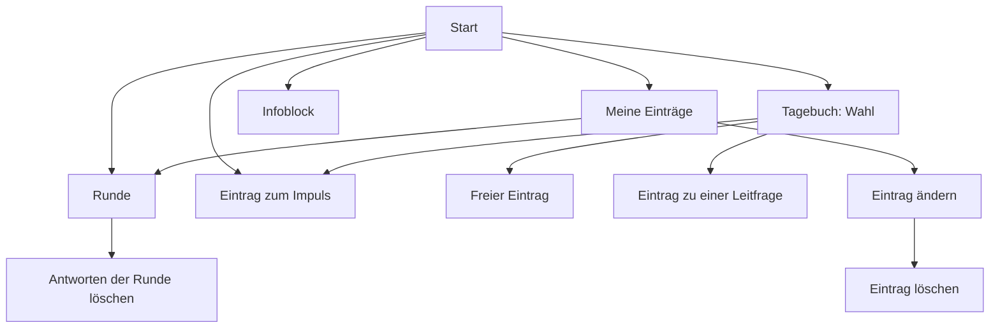

# Design: Lehrpersonen-Ansicht (#16)

Grundlage: [Anforderungen](../../anforderungen.md) (Abschnitte «Ablauf für eine Lehrperson», «Runden», «Tagebuch», «Impulse», «Infoblock und Texte», «Gast-Ansicht», «Einträge lesen und Export»), [ADR-001](../../adr/ADR-001-technik-pilot.md), [Design Grundgerüst](2026-10-30-grundgeruest-design.md) (Schema 001, «Schutz der Forschungsdaten»), [Design Anmeldung](2026-10-30-anmeldung-design.md) (#14: Präfixe, `braucht_lehrperson`, `pruefe_csrf`, `csrf_feld`, fremde Objekte → 404, Routen-Inventar, Migrationsnummern), [Design Eingabemaske](2026-10-30-eingabemaske-design.md) (#15: `app/zeit.py`, `app/texte.py`, `app/inhalte.py`, `app/eingaben.py`, `transaktion` in `app/db.py`, Filter `formatiert` und `datum`, Global `zahl`, Skala 1–5, Platzhalter-Inhalte), die Designs [Sprachaufnahmen](2026-10-30-sprachaufnahmen-design.md) (#17), [Auswertung und Export](2026-10-30-auswertung-export-design.md) (#18) und [Gast-Ansicht und Vorschau](2026-10-30-gast-vorschau-design.md) (#19) mit ihrem «Bedarf an #16» (eingearbeitet, siehe Schluss), [datenschutz.md](../../datenschutz.md) (Hinweistexte) und [loeschkonzept.md](../../loeschkonzept.md) (Löschen während der Laufzeit), Prototyp (`prototyp/`) als Vorbild für Aufbau und Stil. Die Entscheidungen hier hat Claude getroffen (Projektregel «Fragen selbst beantworten»); wo es eine Alternative gab, steht die Begründung dabei.

## Zweck

Alles, was eine Lehrperson im Instrument sieht und tut: Startseite, Infoblock, Runden beantworten, Tagebuch schreiben (frei, zu einer Leitfrage, zum Impuls), «Meine Einträge» mit Ändern und Löschen. Ziel Fr 13.11., zusammen mit der Vorschau (#19); Aufnahmen folgen in #17.

Dieses Issue legt ausserdem **das Datenmodell für #17, #18 und #19 endgültig fest (Migration 003)** und die **gemeinsamen Bausteine**, mit denen diese drei Issues danach parallel in eigenen Worktrees gebaut werden, ohne dieselben Dateien gleichzeitig zu ändern.

## Ziele

- Eine Lehrperson findet sich ohne Hilfe zurecht, auf dem Handy (390 px) und am Computer, ohne horizontales Scrollen.
- Runden und Impulse erscheinen ab ihrem Datum (Zürcher Zeit). Eine noch nicht freigeschaltete Runde ist auch über die direkte Adresse nicht erreichbar (404).
- Antworten und Tagebucheinträge werden mit «Speichern» gespeichert und lassen sich jederzeit ändern und löschen. Eine unterbrochene Eingabe geht nicht verloren, wenn zwischendurch gespeichert wurde.
- Jeder Eintrag trägt Erstell- und Änderungszeitpunkt und die Art (Runde, Tagebuch, Impuls).
- Eine Lehrperson sieht ausschliesslich ihre eigenen Antworten und Einträge, auch nicht über direkte Adressen (404).
- Die Seiten lassen sich ohne Kopie im Gast-Modus und als Vorschau darstellen (#19).
- Nach #16 brauchen #17, #18 und #19 keine eigene Migration und ändern `app/main.py` nicht.
- Keine Anfrage kann die App über ihre Grösse lahmlegen: höchstens 1 MiB pro Anfrage, nur die Upload-Routen von #17 bis 16 MiB.

## Nicht-Ziele

- Sprachaufnahme, Upload, Abspielen (#17). #16 sieht die Plätze vor, löscht aber schon Aufnahmen mit, wenn ein Eintrag gelöscht wird (siehe «Löschen»).
- Gast-Ansicht und Vorschau als Seiten (#19). #16 liefert die Bausteine dafür.
- Ansicht der Auftraggeberin, Export (#18).
- Farbkennzeichnung der Bereiche, Stil nach Vorgaben der Auftraggeberin (#20). #16 setzt nur eine Klasse pro Bereich, an die #20 andocken kann.
- Rückblick auf die eigenen Antworten aus Runde 1 (Anforderung: «nicht nötig»), Versionsverlauf, endgültiges Abschicken.
- Warnung beim Verlassen einer Seite (`beforeunload`): Safari auf dem iPhone beachtet sie meist nicht. Der Entwurfsschutz unten deckt den Fall besser ab.

## Anti-Ziele

- Keine neue Dependency, kein Frontend-Build. JavaScript nur für den Entwurfsschutz (eine Datei aus `/static`, die Seiten funktionieren ohne).
- Kein Inline-JavaScript, kein Inline-CSS (CSP aus #13).
- Einträge der Lehrpersonen werden nie formatiert (`formatiert` gilt nur für Texte der Auftraggeberin). Sie erscheinen als Text mit erhaltenen Zeilenumbrüchen (`white-space: pre-wrap`), `**` bleibt `**`.
- Keine Titel noch nicht freigeschalteter Runden, auch nicht als Vorschau-Zeile auf der Startseite.
- Keine echten Inhalte im Repo; Tests und E2E nutzen die erfundenen Platzhalter aus #15.

## Begriffe in der Oberfläche

| Im Code | In der Oberfläche |
|---|---|
| Runde freigeschaltet | «seit Mo 23.11.» |
| nächste Freischaltung | «Nächste Runde ab Mo 30.11.» |
| Antwortstand | «Jetzt beantworten» / «Angefangen, 2 von 4» / «Beantwortet» |
| `tagebucheintraege`, `art = frei` | Tagebuch, «Freier Eintrag» |
| `art = leitfragen` | «Zur Leitfrage» |
| `art = impuls` | «Zum Impuls» |
| `art = aufnahme` (#17) | «Gesprochener Eintrag» |
| Skala ohne Wert | «Keine Angabe» |
| Entwurf aus dem Browser | «Nicht gespeicherter Text wurde wiederhergestellt.» |
| Auftraggeberin | «Projektleiterin» (wie im Hinweistext aus #8) |

Anrede «du», kurze Sätze, Knöpfe mit Verb («Speichern», «Endgültig löschen», «Abbrechen»).

## Seiten und Adressen

Alle unter `/lehrperson`, Router `app/routen/lehrperson.py` mit `dependencies=[Depends(braucht_lehrperson)]` auf Router-Ebene (besteht seit #14). Jede POST-Route hängt zusätzlich `pruefe_csrf` an. Pfad-IDs mit `Id` aus `app/typen.py` (#14), Formularfelder untypisiert als `Annotated[str, Form()] = ""` (Regel aus #15). «Formular abschicken, dann weiterleiten» (303) wie in #14/#15, Meldungen über `?erledigt=` mit Texten aus der festen Tabelle `ERLEDIGT` in `app/routen/lehrperson.py`:

| Schlüssel | Meldung | gesetzt von |
|---|---|---|
| `gespeichert` | «Gespeichert.» | #16 (Runde, Eintrag), #17 (Aufnahme) |
| `geloescht` | «Gelöscht.» | #16 |
| `aufnahme_geloescht` | «Die Aufnahme wurde gelöscht.» | #17 (Weiterleitung auf die Runde) |

Jede Seite mit Meldung (Runde, Eintrag, Meine Einträge) liest den Schlüssel nur aus dieser Tabelle; Unbekanntes zeigt nichts.

| Methode, Pfad | Seite | Gemeinsam mit #19 |
|---|---|---|
| `GET /lehrperson` | Startseite | ja |
| `GET /lehrperson/info` | Infoblock | ja |
| `GET /lehrperson/runden/{runde_id}` | Runde: Fallbeispiel, Fragen, eigene Antworten (404, wenn nicht freigeschaltet) | ja |
| `POST /lehrperson/runden/{runde_id}` | alle Antworten der Runde speichern, 303 zurück auf die Runde | nein |
| `GET`, `POST /lehrperson/runden/{runde_id}/loeschen` | Bestätigung, alle eigenen Antworten dieser Runde löschen | nein |
| `GET /lehrperson/tagebuch/neu` | Wahl: frei schreiben, (frei sprechen, #17), zum Impuls, zu einer Leitfrage | ja |
| `GET`, `POST /lehrperson/tagebuch/neu/frei` | Formular freier Eintrag, anlegen | GET ja |
| `GET`, `POST /lehrperson/tagebuch/neu/impuls/{impuls_id}` | Formular zum Impuls (404, wenn nicht sichtbar) | GET ja |
| `GET`, `POST /lehrperson/tagebuch/neu/leitfrage/{leitfrage_id}` | Formular zu einer Leitfrage | GET ja |
| `GET`, `POST /lehrperson/tagebuch/{eintrag_id}` | eigenen Eintrag ansehen und ändern (404 bei fremdem) | nein |
| `GET`, `POST /lehrperson/tagebuch/{eintrag_id}/loeschen` | Bestätigung, löschen | nein |
| `GET /lehrperson/eintraege` | Meine Einträge | nein |

Für #17 reserviert (dort gebaut, in `app/routen/aufnahmen.py`): `GET`, `POST /lehrperson/tagebuch/neu/aufnahme`, `GET /lehrperson/aufnahmen/{aufnahme_id}` (Datei abspielen, nur eigene), `GET /verwaltung/aufnahmen/{aufnahme_id}` (für die Auftraggeberin), Soll: `GET`, `POST /lehrperson/runden/{runde_id}/fragen/{frage_id}/aufnahme` und `…/aufnahme/loeschen`. #18 verlinkt auf `/verwaltung/aufnahmen/{aufnahme_id}`, deshalb steht sie hier fest. Die beiden POST-Adressen mit Datei sind die Upload-Routen, für die die grössere Grenze gilt (siehe «Grösse von Anfragen»).



### Startseite

Von oben nach unten (Reihenfolge wie im Prototyp, den die Auftraggeberin «gut» fand):
1. Überzeile «Woche N», sobald der erste Tag feststeht und erreicht ist (`zeit.woche(ansicht.stichtag, lies_projektstart(db))`). Keine Angabe «von 4»: Die Zahl der Wochen ist nirgends erfasst.
2. `h1` «Hallo, *Anzeigename*» (Gast und Vorschau: «Willkommen»), darunter die Begrüssung (`lies_text(db, "begruessung") | formatiert`). Den Anzeigenamen liefert `kontext_start` nur bei `ansicht.konto_id`.
3. Hinweis `hinweis_wer_sieht_was` (Klasse `hinweis`), immer sichtbar (Vorgabe aus #8).
4. Karte «Impuls dieser Woche» (`karte--impuls`) mit dem aktuellen Impuls und Knopf «Dazu schreiben». Ohne sichtbaren Impuls entfällt die Karte.
5. Karte «Runden»: alle freigeschalteten Runden als Links (`runde`), sortiert nach Datum, mit Marke nach Antwortstand. Gibt es eine spätere Runde, steht darunter eine gestrichelte Zeile «Nächste Runde ab Mo 30.11.» (ohne Titel). Ohne freigeschaltete Runde: «Die erste Runde erscheint am Mo 23.11.»
6. Karte «Tagebuch»: «N Einträge · Halte fest, was dir auffällt.» (`zahl(n, "Eintrag", "Einträge")`, nur bei `ansicht.zeigt_eintraege`) und Knopf «Neuer Tagebucheintrag».
7. Link-Karte «Worum es geht» zum Infoblock.

### Infoblock

`h1` «Worum es geht», je Abschnitt ein `<details class="karte aufklapp">` mit `<summary>` (Titel) und dem formatierten Text, sortiert nach `reihenfolge, id`. Der erste Abschnitt ist offen. Als letzter, fester Abschnitt «Datenschutz» mit `hinweis_datenspeicherung` (Vorgabe aus #8). Aufklappen ohne JavaScript.

### Runde

- «‹ Start», `h1` Titel, Marke «seit Mo 23.11.»; wenn schon Antworten bestehen: «Zuletzt gespeichert: Di 24.11.2026, 18:40».
- Oben die Meldung (`role="status"`): aus `?erledigt=` (Tabelle `ERLEDIGT`) bzw. der Parameter `meldung` von `kontext_runde` (#19: «Nicht gespeichert …»). Bei Fehlern «Bitte prüfe die markierten Felder.» und die Meldung am Feld (`<p class="fehler" id="fehler-{feld}">`, `aria-describedby`), wie in #15.
- Fallbeispiel (falls vorhanden) in der Karte `fall`, formatiert.
- `hinweis_tagebuch` über den Fragen (Empfehlung aus #8).
- Ein Formular mit allen Fragen in ihrer Reihenfolge:
  - **Freitext:** `<label>` mit dem Fragetext (reiner Text), `<textarea name="antwort_{frage_id}" id="frage-{frage_id}" rows="5" maxlength="20000">` mit der gespeicherten Antwort. Darunter ein kleiner Knopf «Speichern» (`knopf--klein knopf--zweit`, `name="anker" value="frage-{frage_id}"`).
  - **Skala:** `<fieldset>` mit `<legend>`, fünf Radio-Knöpfe 1–5 (`.skala`), Beschriftungen bei 1 und 5 (`.skala__pole`), darunter ein sechster, unauffälliger Radio-Knopf «Keine Angabe» (`value=""`). Er ist ausgewählt, solange nichts gespeichert ist. Begründung: Ohne JavaScript lässt sich eine Radio-Auswahl sonst nicht mehr aufheben, und eine Antwort muss sich löschen lassen.
  - Am Ende der grosse Knopf «Speichern».
- Unter dem Formular: «Du kannst jederzeit zurückkommen und deine Antworten ändern.» und, wenn Antworten bestehen, der Link «Meine Antworten zu dieser Runde löschen».
- Runde ohne Fragen: Fallbeispiel und der Satz «Zu dieser Runde gibt es noch keine Fragen.», kein Formular.

Platz für #17 (Soll): unter jeder Freitext-Frage ein markierter Platz `{# #17: Antwort einsprechen #}` innerhalb von ``. #17 setzt dort einen Submit-Knopf des Runden-Formulars mit `name="anker" value="aufnahme-{frage_id}"` (siehe «Speichern einer Runde»).

### Tagebuch

**Wahl (`/lehrperson/tagebuch/neu`):** Link-Karten «Frei schreiben», `{# #17: Frei sprechen #}`, «Zum Impuls dieser Woche» (nur wenn es einen gibt, mit dem Impulstext als Unterzeile), darunter `h2` «Zu einer Leitfrage schreiben» und jede Leitfrage als eigene Link-Karte (entfällt ohne Leitfragen). So ist eine Leitfrage einen Tipp entfernt.

**Formular (frei, Impuls, Leitfrage):** «‹ Tagebuch», `h1` «Freier Eintrag» / «Zum Impuls» / «Zur Leitfrage»; bei Impuls und Leitfrage deren Text in einer Karte (`karte--impuls`) über dem Feld; `hinweis_tagebuch`; `<textarea name="text" rows="10" maxlength="20000">` mit Label «Dein Eintrag»; «Speichern». Nach dem Speichern 303 auf die Seite des neuen Eintrags mit «Gespeichert.» und den Links «Zur Startseite» und, bei einer Leitfrage, «Zu einer weiteren Leitfrage schreiben».

**Eintrag ansehen und ändern (`/lehrperson/tagebuch/{id}`):** Überzeile Art, «Erstellt Mo 23.11.2026, 18:40» und, falls verschieden, «geändert Di 24.11.2026, 07:15»; Bezug aus dem **mitgespeicherten** Text (`impuls_text`, `leitfrage_text`), nicht aus der aktuellen Tabelle; Aufnahme über das Teil-Template `_aufnahme.html`, falls `aufnahme_id` gesetzt (`url` = `/lehrperson/aufnahmen/{aufnahme_id}`, die Route baut #17); Textfeld mit dem Text, «Speichern», Link «Eintrag löschen». Art und Bezug lassen sich nicht ändern. Bei `art = aufnahme` heisst das Feld «Notiz zur Aufnahme (freiwillig)» und darf leer gespeichert werden (dann `text = NULL`). Platz `{# #17: Aufnahme ersetzen oder löschen #}` unter dem Player.

### Meine Einträge

`h1` «Meine Einträge», Satz «Nur du und die Projektleiterin sehen sie.». Liste als `karte--eintrag`, **neueste zuerst** (wie im Prototyp, `erstellt` absteigend):

| Eintrag | Marke | Titelzeile | Vorschau | Link |
|---|---|---|---|---|
| Antworten einer Runde (eine Karte pro Runde) | «Runde» | Titel der Runde | «3 von 4 Fragen beantwortet» und der Anfang der ersten Textantwort | Seite der Runde |
| Freier Eintrag | «Tagebuch» | «Freier Eintrag» | Anfang des Texts (2 Zeilen) | Eintrag |
| Zur Leitfrage | «Tagebuch» | «Zur Leitfrage: …» (gekürzt) | Anfang des Texts | Eintrag |
| Zum Impuls | «Impuls» | «Zum Impuls: …» (gekürzt) | Anfang des Texts | Eintrag |
| Gesprochen (#17) | «Tagebuch» | «Gesprochener Eintrag» | «Aufnahme, 2 Min.» (Filter `dauer`), darunter der Anfang der Notiz, falls vorhanden | Eintrag |

Kopfzeile jeder Karte: Erstellzeitpunkt, bei Änderung zusätzlich «geändert …». Für eine Runde gilt als Erstellzeitpunkt die früheste, als Änderungszeitpunkt die späteste Antwort. Antworten zu Runden, die (nach einer Datumsänderung der Auftraggeberin) gerade nicht freigeschaltet sind, erscheinen nicht; sie bleiben gespeichert und erscheinen wieder ab dem neuen Datum. Ohne Einträge: «Noch keine Einträge.» und Knopf «Ersten Tagebucheintrag schreiben».

### Navigation

Leiste unten wie im Prototyp (`.tabs`, vier Einträge mit den SVG-Symbolen aus `prototyp/index.html`): «Start», «Tagebuch» (→ Wahl), «Einträge», «Info». Der aktive Eintrag trägt `aria-current="page"` (Variable `bereich` pro Seite). Begründung: Die Auftraggeberin kennt sie aus dem Prototyp, und unten ist sie mit dem Daumen erreichbar. Am Computer bleibt sie unten (wie im Prototyp); oben stehen weiterhin Titel, Name und «Abmelden» aus #14, dahinter (Block `kopf_rechts`, nach `super()`) der Link `ansicht.ausgang`, falls gesetzt (Gast: «Anmelden», Vorschau: «Vorschau beenden»; `knopf knopf--klein knopf--zweit`). Ohne «Einträge» (Gast, Vorschau) hat die Leiste drei Spalten: `.tabs` erhält dafür `grid-auto-flow: column; grid-auto-columns: 1fr` statt `repeat(4, 1fr)`. `.inhalt` hat unten schon genug Abstand (`6rem`).

Jede Seite setzt `bereich` ∈ {`start`, `runden`, `tagebuch`, `eintraege`, `info`}, das Layout schreibt es als Klasse `bereich--…` an `<main>` (neuer Block `main_klasse` in `basis.html`). #20 kann die Bereiche damit einfärben, ohne Templates zu ändern.

## Entscheidungen

### Freischaltung und Stichtag

- Runden sichtbar, wenn `freischaltdatum <= stichtag`, sortiert nach `freischaltdatum, id`; Impulse sichtbar, wenn `sichtbar_ab <= stichtag` (Regeln aus #15). Für Lehrpersonen und Gäste ist der Stichtag `heute()` in Europe/Zurich (`Depends(hole_heute)` aus #15).
- **Aktueller Impuls:** der mit dem spätesten `sichtbar_ab <= stichtag`, bei Gleichstand die höchste `id` (#15). Er bleibt aktuell, bis der nächste sichtbar wird, also auch nach Woche 4.
- **Direkte Adresse:** Jede Route, die eine Runde oder einen Impuls über die `id` lädt (GET und POST), fragt mit derselben Bedingung ab. Nicht sichtbar und nicht vorhanden sind nicht unterscheidbar: beides 404 mit der Fehlerseite aus #14.
- **Ein Eintrag zum Impuls** lässt sich zu jedem schon sichtbaren Impuls anlegen, nicht nur zum aktuellen. Begründung: Wer die Startseite am Sonntag öffnet und am Montag tippt, soll keine Fehlermeldung sehen, weil inzwischen der nächste Impuls gilt.
- **Stichtag statt «heute» als Parameter:** Alle Abfragen nehmen `stichtag: date`, nie `None`. Die Vorschau (#19) übergibt den gewählten Tag (Datum im Pfad, eine Runde wird an ihrem Freischaltdatum gezeigt). Begründung: Ein vergessenes `None` könnte nie versehentlich die Freischaltung aufheben, und Vorschau, Gast und Lehrperson laufen durch denselben Code.
- **Alles Datumsabhängige rechnet mit `ansicht.stichtag`:** «Woche N», «seit …», «Nächste Runde ab …», «Die erste Runde erscheint am …» und der aktuelle Impuls entstehen in den `kontext_*`-Funktionen aus `ansicht.stichtag`, nie aus `heute()` oder `hole_heute`. Sonst zeigte die Vorschau für Woche 3 die Woche von heute (#19).
- **Kein Vorauslesen über die Startseite:** Spätere Runden erscheinen nur als «Nächste Runde ab …», ohne Titel. Begründung: Der Titel eines Fallbeispiels kann schon Inhalt verraten; dieselbe Überlegung wie bei der Gast-Ansicht in den Anforderungen.

### Speichern einer Runde

- **Ein Formular, ein Speichern für alle Felder.** Pro Frage gibt es höchstens eine Zeile in `antworten` (`UNIQUE (frage_id, konto_id)` aus 001). Der Server nimmt nur Felder `antwort_{id}` für Fragen **dieser** Runde an; alles andere wird ignoriert.
- **Ablauf** in einer Transaktion (`with transaktion(db):` aus `app/db.py`, #15; öffnet `BEGIN IMMEDIATE` nur, wenn noch keine läuft), alles oder nichts:
  1. Eingaben lesen und prüfen (`lies_runden_eingaben`, ohne Datenbank, damit #19 dieselbe Prüfung ohne Speichern nutzt): Text über `eingaben.langer_text(wert, feld, None)` aus #15 (`\r\n` → `\n`, Leerraum am Anfang und Ende weg; nur Leerraum gilt als leer, höchstens `LAENGE_LANG` = 20 000 Zeichen, Meldung `zu_lang`); Skala `""` oder eine Ganzzahl von `SKALA_MIN` bis `SKALA_MAX` (`app/inhalte.py`, #15), sonst `InhaltFehler(feld, "Bitte einen Wert von 1 bis 5 wählen.")`. Fehlerklasse ist `eingaben.InhaltFehler` (#15), keine eigene. Ein Fehler → Seite über `kontext_runde(…, eingaben=formular, fehler={feld: meldung})` mit den eingegebenen Werten, Meldung am Feld, Status 400, nichts gespeichert.
  2. Pro Frage mit der bestehenden Zeile vergleichen: unverändert → nichts tun (sonst würde `geaendert` jeder Antwort bei jedem Speichern neu gesetzt und der Export wäre wertlos); neu und nicht leer → `INSERT`; geändert → `UPDATE … SET geaendert = jetzt`; leer und keine Aufnahme an der Zeile → `DELETE`; leer, aber mit Aufnahme (#17) → Text bzw. Skalawert auf `NULL`, Zeile bleibt.
- **Leere Felder löschen die Antwort** (statt einen leeren Text zu speichern). Begründung: Es soll keine Zeilen ohne Inhalt geben; «beantwortet» heisst so immer «es gibt eine Zeile», für Startseite, Übersicht (#18) und Export gleich. Ein Feld leeren und speichern ist der natürliche Weg, eine einzelne Antwort zu löschen. Alle Antworten einer Runde auf einmal löscht «Meine Antworten zu dieser Runde löschen» (mit Bestätigung).
- **Zwischenspeichern ohne JavaScript:** Jeder «Speichern»-Knopf (auch die kleinen unter den Freitextfeldern) speichert das ganze Formular und führt per 303 zurück auf dieselbe Runde, mit «Gespeichert.» oben (`role="status"`) und zum Anker der Frage (`#frage-{id}`; der Wert von `anker` wird gegen `frage-\d{1,10}` geprüft, sonst kein Anker).
- **«Speichern und einsprechen» (für #17):** `anker` darf auch `aufnahme-\d{1,10}` sein. Gehört diese Frage zur Runde und ist sie vom Typ `freitext`, leitet die Route nach dem Speichern auf `/lehrperson/runden/{runde_id}/fragen/{frage_id}/aufnahme` (Seite von #17) statt zurück auf die Runde. Sonst wie ohne Anker (`/lehrperson/runden/{runde_id}?erledigt=gespeichert`). So geht getippter Text nicht verloren, wenn die Lehrperson zur Aufnahme wechselt. Bis #17 gemergt ist, ergibt die Zieladresse 404; der Knopf erscheint erst mit #17. Es gibt kein Abschicken, nach dem nichts mehr geht. Damit ist das Akzeptanzkriterium «unterbrochene Eingabe geht nicht verloren, wenn zwischendurch gespeichert wurde» erfüllt: Gespeichertes steht beim nächsten Öffnen wieder im Formular, auf jedem Gerät.
- **Kleine Speichern-Knöpfe unter jedem Freitextfeld:** Bei einem langen Fallbeispiel und vier Fragen liegt der Knopf am Ende auf dem Handy mehrere Bildschirme entfernt. Unterbrechungen passieren mitten im Schreiben.
- **Gleichzeitiges Bearbeiten auf zwei Geräten:** Das zuletzt gespeicherte Formular gilt für jede Frage, die es geändert hat. Bei einer Person und einem Formular pro Runde genügt das.

### Abgelaufene Anmeldung und Entwurfsschutz

**Was ohne Schutz passiert:** Ist die Anmeldung beim Absenden abgelaufen, leitet `braucht_lehrperson` auf die Login-Seite (#14), ist das Formular abgelaufen, zeigt `pruefe_csrf` 403. In beiden Fällen ist der getippte Text weg. Beides ist selten («Angemeldet bleiben» ist Standard, Sitzung und CSRF-Cookie werden täglich verlängert). Häufiger sind zwei andere Fälle: Safari auf dem iPhone lädt einen Tab im Hintergrund neu, während die Lehrperson kurz in einer anderen App ist; und ein Tipp auf die Navigationsleiste unten, direkt unter der Tastatur, verlässt die Seite.

**Entscheidung: kleiner Entwurfsschutz im Browser-Tab (Soll).** Eine Datei `app/static/js/entwurf.js` (rund 60 Zeilen, keine Dependency, über `<script src defer>` nur auf Seiten mit Lehrpersonen-Formular):
- Formulare mit dem Attribut `data-entwurf="{konto_id}:{formular}"` (z. B. `7:runde-3`, `7:neu-impuls-2`, `7:tagebuch-15`) werden beobachtet. Bei jeder Eingabe in ein `textarea` speichert das Skript den Wert in **`sessionStorage`** unter `entwurf:{schlüssel}:{feldname}`.
- Beim Laden: Gibt es einen Entwurf und ist er (normalisiert wie auf dem Server) gleich dem Wert vom Server, wird er gelöscht; dann ist er gespeichert. Ist er verschieden, setzt das Skript ihn ins Feld und zeigt über dem Formular «Nicht gespeicherter Text wurde wiederhergestellt. Bitte speichern.» mit Knopf «Verwerfen».
- Nach dem Anlegen eines neuen Tagebucheintrags rendert die Seite des neuen Eintrags `data-entwurf-verwerfen="{konto_id}:neu-…"`; das Skript löscht diesen Entwurf. Der Schlüssel ergibt sich auf dem Server aus Art und Bezug des Eintrags, nicht aus der Adresse.
- Der Knopf «Abmelden» löscht alle Einträge mit Präfix `entwurf:` (Ereignis `submit` auf dem Abmelde-Formular).
- Nicht im Gast-Modus und in der Vorschau (dort fehlt `data-entwurf`).

**Begründung für `sessionStorage` statt `localStorage`:** `sessionStorage` überlebt das Neuladen und das Wiederherstellen eines Tabs, auch den Umweg über die Login-Seite im selben Tab, endet aber mit dem Tab. Auf einem gemeinsam genutzten Schulcomputer bleibt so kein Text liegen; der Schlüssel enthält die Konto-ID, damit nie der Entwurf einer anderen Person in ein Formular gelangt.

**Verworfen:** Text bei 403 vom Server zurück ins Formular schreiben (eine gefälschte Anfrage könnte damit beliebigen Text in der App anzeigen); automatisches Speichern im Hintergrund per `fetch` (mehr JavaScript, und eine Antwort hätte ohne Zutun der Lehrperson einen neuen Änderungszeitpunkt); `beforeunload` (siehe Nicht-Ziele).

**Soll, nicht Muss:** Das Akzeptanzkriterium hängt nicht daran. Bei Zeitnot fällt der Entwurfsschutz als Erstes weg. Wird er gebaut, kommt in `docs/datenschutz.md` (Tabelle «Welche Daten entstehen») eine Zeile: «Entwurf eines noch nicht gespeicherten Texts | Browser-Tab (`sessionStorage`) | Schutz vor Verlust beim Neuladen | ja, bis gespeichert, verworfen, abgemeldet oder Tab geschlossen».

### Tagebuch: eine Leitfrage pro Eintrag

Schema 001 hat pro Tagebucheintrag genau einen Bezug (`leitfrage_id`, `leitfrage_text` bzw. `impuls_id`, `impuls_text`). **Entscheidung: Ein Eintrag «zu Leitfragen» bezieht sich auf genau eine Leitfrage.** Wer zu mehreren schreiben möchte, legt mehrere Einträge an; die Bestätigung bietet «Zu einer weiteren Leitfrage schreiben» an.

Begründung:
- Eintrag zum Impuls und Eintrag zur Leitfrage sind dieselbe Form: ein Anstoss plus Text. Ein Formular, ein Template, eine Zeile im Export.
- Im Export (#18) wird jeder Eintrag zu genau einer Zeile mit der Leitfrage in der Spalte «Frage», gleich wie eine Antwort auf eine Runden-Frage.
- Ein Tagebuch lebt vom Moment: Eine Lehrperson greift die Leitfrage auf, die zu ihrem Tag passt. Mehrere Pflichtfelder auf einer Seite wären eine zweite Runde.
- Das Schema passt ohne Änderung.

**Verworfen:** mehrere Leitfragen in einem Eintrag (eigene Tabelle für Teilantworten, Neuaufbau oder ungenutzte Spalten in `tagebucheintraege`, Export mit Untergliederung). **Rückweg ohne Migration:** Will die Auftraggeberin nach dem Testlauf alle Leitfragen auf einer Seite, kann das Formular sie zeigen und pro ausgefülltem Feld einen Eintrag anlegen. Das ist nur eine Änderung der Oberfläche.

**Arten und Felder** (gilt für #16 und #17, prüft die App beim Anlegen):

| `art` | `text` | `impuls_id`, `impuls_text` | `leitfrage_id`, `leitfrage_text` | `aufnahme_id` | Art im Export |
|---|---|---|---|---|---|
| `frei` | Pflicht | leer | leer | leer | Tagebuch |
| `leitfragen` | Pflicht | leer | gesetzt (Text kopiert) | leer | Tagebuch |
| `impuls` | Pflicht | gesetzt (Text kopiert) | leer | leer | Impuls |
| `aufnahme` (#17) | freiwillig | leer | leer | Pflicht | Tagebuch |

Der Bezugstext wird beim Anlegen kopiert und danach nie geändert (Vorgabe aus #13/#15). `leitfrage_id` und `impuls_id` können später durch Löschen in der Maske `NULL` werden; angezeigt und exportiert wird immer der kopierte Text. Ein leerer Text bei `frei`, `leitfragen`, `impuls` → 400 «Der Eintrag ist noch leer.» (beim Ändern: «Zum Löschen bitte ‹Eintrag löschen› wählen.»). Bei `aufnahme` ist der Text beim Anlegen und beim Ändern freiwillig, leer wird `NULL`. Ändern setzt `geaendert` nur, wenn sich der Text ändert.

**Prüfung des Texts als eigene Funktion:** `lies_tagebuchtext(text, pflicht=True)` in `app/eintraege.py` normalisiert über `eingaben.langer_text` (#15) und wirft `InhaltFehler("text", "Der Eintrag ist noch leer.")` bzw. die Längenmeldung. `lege_tagebucheintrag_an` und `aendere_tagebucheintrag` rufen sie auf (`pflicht = art != "aufnahme"`); #19 ruft sie im Gast- und Vorschau-POST auf, ohne zu speichern, und erhält so dieselben Meldungen. Die Meldung «Zum Löschen bitte …» beim Ändern ersetzt die Route.

### Löschen

- Immer über eine Bestätigungsseite (GET) mit «Endgültig löschen» (POST) und «Abbrechen», danach 303 auf «Meine Einträge» mit «Gelöscht.». Text der Bestätigung: «Diesen Eintrag löschen? Das lässt sich nicht rückgängig machen.» bzw. «Alle deine Antworten zu *Runde* löschen? …».
- Jede Abfrage filtert in SQL nach `konto_id` (Regel aus #14). Ein fremder oder unbekannter Eintrag ergibt bei GET und POST 404, und es wird nichts gelöscht.
- **Aufnahmen werden schon in #16 mitgelöscht.** `loesche_tagebucheintrag` und `loesche_antworten_der_runde` lesen die `aufnahme_id`s, löschen in derselben Transaktion Eintrag bzw. Antworten und die Zeilen in `aufnahmen`, und nach dem `COMMIT` die Dateien (`aufnahmen.loesche_dateien`: nur Namen nach dem Muster `DATEINAME`, nur im Aufnahmen-Ordner, fehlende Datei wird ignoriert). Begründung: Dann muss #17 die Löschwege von #16 nicht anfassen; getestet wird mit einer Aufnahme-Zeile und einer Testdatei. Reihenfolge «erst Datenbank, dann Datei»: Scheitert das Löschen der Datei, bleibt höchstens eine Datei ohne Zeile, nie eine Zeile ohne Datei. #17 räumt solche Waisen nach jedem Speichern einer Aufnahme auf (`raeume_waisen`, Design #17).
- **Dateinamen-Muster:** `DATEINAME = re.compile(r"[0-9a-f]{32}\.(webm|m4a|ogg)")` in `app/aufnahmen.py`, geprüft mit `fullmatch`. `aufnahme_pfad` gibt bei einem anderen Namen `None` zurück, `loesche_dateien` überspringt ihn. Ein manipulierter Name in der Datenbank trifft so nie eine Datei ausserhalb des Ordners oder eine fremde Datei darin (#17 baut Ausliefern und Aufräumen darauf).
- `PRAGMA secure_delete = ON` (#8) überschreibt den gelöschten Text in der Datenbankdatei; Reste in WAL und Snapshots behandelt das Löschkonzept.

### Zeitpunkte anzeigen

Zeitstempel sind UTC-Text (`2026-11-23T17:40:00Z`, Schema 001). Neu in `app/zeit.py` (neben `datum_kurz`, `woche`, `heute` aus #15):

```python
def lokal(zeitstempel: str) -> datetime:
    """UTC-Text aus der Datenbank als zeitzonenbewusste Zeit in Europe/Zurich."""


def zeitpunkt_kurz(zeitstempel: str) -> str:
    """'Mo 23.11.2026, 18:40' (nutzt datum_kurz aus #15)."""
```

Neue Jinja-Filter in `app/vorlagen.py` (neben `formatiert`, `datum` und dem Global `zahl` aus #15):
- `zeitpunkt`: UTC-Text → `zeitpunkt_kurz`, `None` → leer (wie `datum`).
- `dauer`: Sekunden → «45 Sek.», ab 60 Sekunden ganze Minuten aufgerundet («61» → «2 Min.», «60» → «1 Min.»), `None` → leer. Genutzt von «Meine Einträge» und `_aufnahme.html`; liegt hier, damit #17 `vorlagen.py` nicht ändern muss.

#18 nutzt `lokal(z).date()` für Datum und Woche im Export.

### Ungültige Zahlen in der Adresse

Besteht seit #14: `Id = Annotated[int, Path(ge=1, le=2**63 - 1)]` in `app/typen.py` und ein Handler in `erstelle_app`, der jeden `RequestValidationError` als Fehlerseite 404 zeigt. #16 nutzt `Id` für alle Pfad-IDs (`runde_id`, `impuls_id`, `leitfrage_id`, `eintrag_id`). Daraus folgt wie in #15: Formularfelder sind nie typisiert und nie Pflicht (`Annotated[str, Form()] = ""`), sonst endete ein fehlendes Feld als 404; geprüft wird in der Fachlogik. Test: `abc`, `0`, `-1`, `99999999999999999999` → 404 auf je einer GET- und einer POST-Route von #16.

### Grösse von Anfragen

**Ausgangslage:** Starlette liest einen Formular-Body ganz ein, bevor eine Prüfung läuft (bei Routen mit `Form()`-Parametern schon vor den Abhängigkeiten, sonst in `pruefe_csrf`). uvicorn begrenzt die Grösse nicht, Starlette nur pro Feld (1 MB) bei bis zu 1000 Feldern. Betroffen ist auch `POST /anmelden`, ohne Anmeldung erreichbar, auf einer Maschine mit 256 MB Arbeitsspeicher. Gefunden in den Designs #17 und #19.

**Entscheidung (Orchestrator, aus #17 und #19): eine kleine ASGI-Middleware in `app/groesse.py`, die jede Anfrage mit mehr als 1 MiB Body mit 413 abweist.** Ausnahme sind die Upload-Routen von #17 mit eigener Grenze von 16 MiB.

```python
GRENZE = 1024 * 1024
GRENZE_UPLOAD = 16 * 1024 * 1024  # #17: MAX_ANFRAGE_BYTES = GRENZE_UPLOAD
UPLOAD_PFADE = (
    re.compile(r"/lehrperson/tagebuch/neu/aufnahme"),
    re.compile(r"/lehrperson/runden/\d{1,19}/fragen/\d{1,19}/aufnahme"),
)


def grenze_fuer(pfad: str) -> int: ...  # GRENZE_UPLOAD bei fullmatch, sonst GRENZE


class ZuGross(HTTPException): ...  # Status 413; Starlette-HTTPException


class GroessenGrenze:  # reine ASGI-Middleware wie SicherheitsHeaderMiddleware
    def __init__(self, app: ASGIApp) -> None: ...
    async def __call__(self, scope: Scope, receive: Receive, send: Send) -> None: ...
```

- **Wie:** Die Middleware ersetzt nur `receive`. Ist `Content-Length` angegeben und keine Zahl oder grösser als die Grenze, wirft der erste Aufruf von `receive` `ZuGross`, bevor ein Byte gelesen ist. Ohne `Content-Length` (chunked) zählt sie die gelesenen Bytes und wirft, sobald die Summe die Grenze übersteigt. Höchstens ein Stück über der Grenze liegt dann im Speicher.
- **Warum über `receive` und eine `HTTPException`:** FastAPI wirft eine Starlette-`HTTPException` aus dem Lesen des Bodys unverändert weiter (sonst macht es daraus 400). So erzeugt der bestehende Handler `http_fehler` die Fehlerseite mit Kopfzeilen, Titel und Cookies wie jede andere; die Middleware muss nichts selbst rendern. Geprüft mit FastAPI 0.162 und Starlette 1.10 (Routen mit `Form()`, mit `pruefe_csrf` als Abhängigkeit, mit Multipart, mit und ohne `Content-Length`: jeweils 413). Eine Anfrage, deren Body niemand liest (GET), bleibt unberührt.
- **Text der Fehlerseite:** `FEHLERTEXTE[413] = ("Zu gross", "Es wurde nichts gespeichert, weil die Eingabe zu gross ist. Eine Aufnahme darf höchstens 10 Minuten lang sein.")` in `app/main.py`. Ein Text für beide Fälle, weil `FEHLERTEXTE` nach Status geht; mit JavaScript zeigt #17 beim Hochladen ohnehin seine eigene Meldung.
- **Einbinden:** in `erstelle_app` als innerste der Middlewares (vor `CookieMiddleware` und `SicherheitsHeaderMiddleware` hinzugefügt), damit die 413-Seite dieselben Kopfzeilen bekommt.
- **Warum 1 MiB (Orchestrator, statt zuerst 1 MiB):** Eine Runde mit vier fast vollen Freitextfeldern (je bis 20 000 Zeichen, URL-kodiert mit Umlauten bis etwa 6 Byte pro Zeichen) kann gegen 500 KB erreichen. Eine abgewiesene Antwort wäre für eine Lehrperson verlorener Text. 1 MiB deckt jede zulässige Eingabe ab und schützt die Maschine (256 MB) trotzdem: Auch viele gleichzeitige Anfragen à 1 MiB bleiben weit unter dem Speicher.
- **#17** übernimmt `GRENZE_UPLOAD` als `MAX_ANFRAGE_BYTES` (eine Quelle) und behält in `begrenze_upload` nur, was die Middleware nicht leistet: 411 ohne `Content-Length` und die engen Formular-Grenzen (`max_files=1`, `max_fields=5`). `UPLOAD_PFADE` nennt genau die beiden Upload-Adressen aus dem Design #17; kommt eine dazu, ergänzt #17 diese Liste (eine Zeile in einer Datei, die sonst niemand ändert).

### Gemeinsame Darstellung für Lehrperson, Gast und Vorschau

Die Seiten Start, Infoblock, Runde und die Tagebuch-Formulare werden von #19 in zwei weiteren Modi gebraucht. Statt Kopien oder `if gast`-Zweigen in den Routen gibt es ein **Ansichts-Objekt**, das jede dieser Seiten bekommt:

```python
# app/ansicht.py
Modus = Literal["lehrperson", "gast", "vorschau"]


@dataclass(frozen=True)
class Ansicht:
    modus: Modus
    stichtag: date  # bis zu diesem Tag sind Runden und Impulse sichtbar
    basis: str  # "/lehrperson", "/gast", "/verwaltung/vorschau/2026-11-30"
    konto_id: int | None  # nur bei "lehrperson"; sonst None (geprüft in __post_init__)
    band: str | None = None  # Text des Bands oben (Gast, Vorschau), formatiert angezeigt
    ausgang: tuple[str, str] | None = None  # (Text, Adresse): Link oben rechts im Kopf

    @property
    def speichert(self) -> bool: ...  # modus == "lehrperson"

    @property
    def zeigt_eintraege(self) -> bool: ...  # modus == "lehrperson"

    def url(self, pfad: str = "") -> str: ...  # basis + pfad


def fuer_lehrperson(konto: Konto, heute: date) -> Ansicht: ...


def fuer_gast(heute: date, band: str, ausgang: tuple[str, str]) -> Ansicht: ...


def fuer_vorschau(stichtag: date, band: str, ausgang: tuple[str, str]) -> Ansicht: ...


def hole_ansicht_lehrperson(
    konto: Annotated[Konto, Depends(braucht_lehrperson)],
    heute: Annotated[date, Depends(hole_heute)],
) -> Ansicht: ...
```

- `__post_init__` erzwingt: `konto_id` ist genau im Modus `lehrperson` gesetzt. Gast und Vorschau können damit keine Einträge laden, auch nicht aus Versehen.
- `fuer_vorschau` setzt `basis = f"/verwaltung/vorschau/{stichtag.isoformat()}"`: Der Tag steckt im Pfad, alle Links der Templates tragen ihn mit (#19).
- Templates bauen jeden Link mit `ansicht.url("/runden/" ~ runde.id)`; die Navigation zeigt «Einträge» nur bei `ansicht.zeigt_eintraege`. **`csrf_feld(request)` steht in jedem Formular, unabhängig vom Modus** (#19: Gast- und Vorschau-POSTs prüfen CSRF, sonst scheiterten sie mit 403). Nur `data-entwurf` und die Links «Löschen» hängen an `ansicht.speichert`. Formulare zeigen auf `ansicht.url(…)`, im Gast-Modus also auf `/gast/…` (#19: prüft, speichert nichts, zeigt die Seite mit den Eingaben).
- Das Layout `lehrperson/_rahmen.html` zeigt `ansicht.band` als Band oben (`hinweis`, `role="note"`), wenn gesetzt, und `ansicht.ausgang` als Link im Kopf (siehe «Navigation»). #19 setzt nur Text und Ausgang (`hinweis_gast` und «Anmelden» → `/`, bzw. Vorschau-Text und «Vorschau beenden» → `/verwaltung/vorschau`), ohne Templates von #16 zu ändern.
- Die Seiten-Inhalte stellen Funktionen zusammen, die Route und Ansicht trennen. Eingaben, Fehler und Meldung gehören zur Signatur, damit #19 die Schlüsselnamen der Templates nicht kennen muss; #16 braucht denselben Weg für die Fehlerseite (400 mit den eingegebenen Werten):

```python
# app/seiten_lehrperson.py: gibt jeweils den Template-Kontext zurück, mit "ansicht" und "bereich"
def kontext_start(db, ansicht: Ansicht) -> dict: ...


def kontext_info(db, ansicht: Ansicht) -> dict: ...


def kontext_runde(
    db,
    ansicht: Ansicht,
    runde_id: int,
    eingaben: Mapping[str, str] | None = None,  # Formularwerte ersetzen gespeicherte Antworten
    fehler: dict[str, str] | None = None,  # Feldname -> Meldung
    meldung: str | None = None,  # reiner Text oben, role="status"
) -> dict: ...  # HTTPException(404), wenn nicht sichtbar oder unbekannt


def kontext_tagebuch_wahl(db, ansicht: Ansicht) -> dict: ...


def kontext_tagebuch_neu(
    db,
    ansicht: Ansicht,
    art: str,  # "frei" | "impuls" | "leitfragen"
    bezug_id: int | None = None,
    text: str | None = None,
    fehler: dict[str, str] | None = None,
    meldung: str | None = None,
) -> dict: ...  # 404 bei unbekanntem bzw. nicht sichtbarem Bezug


VORLAGEN: dict[str, str]  # "start" -> "lehrperson/start.html", ...
```

`eingaben` sind die rohen Formularwerte (`antwort_{frage_id}` → Text), so wie sie abgeschickt wurden; ist es gesetzt, zeigt das Formular diese Werte statt der gespeicherten. Ohne `konto_id` enthalten die Kontexte keine Antworten, keinen Antwortstand, keinen Anzeigenamen und keine Zahl der Einträge. Alles Datumsabhängige rechnen sie aus `ansicht.stichtag`. Eine Route von #19 ist damit eine Zeile: `templates.TemplateResponse(request, VORLAGEN["runde"], kontext_runde(db, ansicht, runde_id, eingaben=formular, meldung=…))`.

**Verworfen:** eine Route mit `?modus=gast` (der Schutz der Lehrpersonen-Routen hinge dann an einem Parameter), Kopien der Templates für #19 (doppelte Pflege, und #20 müsste beide gestalten).

## Gemeinsame Bausteine (Module und Signaturen)

Fachlogik ohne FastAPI, Datenbank als erster Parameter, wie `app/inhalte.py` aus #15.

### `app/sichtbar.py`: was an einem Stichtag sichtbar ist

```python
def sichtbare_runden(db, stichtag: date) -> list[sqlite3.Row]: ...  # Zeilen wie inhalte.runden


def naechste_freischaltung(db, stichtag: date) -> date | None: ...  # frühestes Datum > stichtag


def sichtbare_runde(db, runde_id: int, stichtag: date) -> sqlite3.Row | None: ...


def aktueller_impuls(db, stichtag: date) -> sqlite3.Row | None: ...


def sichtbarer_impuls(db, impuls_id: int, stichtag: date) -> sqlite3.Row | None: ...
```

`sichtbar.py` enthält nur, was vom Stichtag abhängt, und baut auf den Abfragen von `app/inhalte.py` (#15) auf: `runden(db)` (mit `anzahl_fragen`, nach `freischaltdatum, id`), `runde(db, runde_id)`, `impulse(db)` (nach `sichtbar_ab, id`), `impuls(db, impuls_id)`; die Regel «Datum ≤ Stichtag» über `zeit.ist_erreicht`. Filtern in Python ist bei wenigen Dutzend Zeilen angemessen. Alles ohne Stichtag nutzen #16–#19 direkt aus `app/inhalte.py`: `fragen(db, runde_id)` (nach `reihenfolge, id`), `leitfragen(db)`, `leitfrage(db, leitfrage_id)`, `info_abschnitte(db)`, `lies_projektstart(db)`; Texte über `texte.lies_text(db, schluessel)`. Nur `sichtbar.py` kennt die Regel «Datum ≤ Stichtag»; #18 und #19 rufen sie nicht selbst in SQL nach.

### `app/eintraege.py`: Antworten und Tagebuch einer Lehrperson

Fehler wirft das Modul als `eingaben.InhaltFehler(feld, meldung)` aus #15 (keine eigene Klasse; `konten.EingabeFehler` bleibt den Zugängen vorbehalten).

```python
def lies_tagebuchtext(text: str, pflicht: bool = True) -> str | None: ...  # wirft InhaltFehler


def antworten_der_runde(db, konto_id: int, runde_id: int) -> dict[int, sqlite3.Row]: ...


def lies_runden_eingaben(
    fragen: list[sqlite3.Row], formular: Mapping[str, str]
) -> dict[int, tuple[str | None, int | None]]: ...  # frage_id -> (text, skalawert); ohne db


def speichere_antworten(
    db, konto_id: int, eingaben: dict[int, tuple[str | None, int | None]], jetzt: str | None = None
) -> int: ...  # Anzahl geänderter Zeilen


def loesche_antworten_der_runde(
    db, konto_id: int, runde_id: int, aufnahmen_verzeichnis: Path
) -> int: ...


@dataclass(frozen=True)
class Stand:
    beantwortet: int
    fragen: int


def rundenstand(db, konto_id: int) -> dict[int, Stand]: ...  # runde_id -> Stand, alle Runden


def anzahl_tagebucheintraege(db, konto_id: int) -> int: ...


def lege_tagebucheintrag_an(
    db,
    konto_id: int,
    art: str,
    text: str | None,
    *,
    impuls: sqlite3.Row | None = None,
    leitfrage: sqlite3.Row | None = None,
    aufnahme_id: int | None = None,
    jetzt: str | None = None,
) -> int: ...


def hole_tagebucheintrag(db, konto_id: int, eintrag_id: int) -> sqlite3.Row | None: ...


def aendere_tagebucheintrag(db, konto_id: int, eintrag_id: int, text: str | None) -> bool: ...


def loesche_tagebucheintrag(
    db, konto_id: int, eintrag_id: int, aufnahmen_verzeichnis: Path
) -> bool: ...


@dataclass(frozen=True)
class Zeile:  # eine Antwort oder ein Tagebucheintrag, flach (Grundlage für Liste und Export)
    quelle: str  # "antwort" | "tagebuch"
    id: int
    konto_id: int
    anzeigename: str
    art: str  # "runde" | "tagebuch" | "impuls"
    tagebuch_art: str | None  # frei | leitfragen | impuls | aufnahme
    angeleitet: bool  # True genau bei art == "runde"
    runde_id: int | None
    runde_titel: str | None
    runde_freischaltdatum: str | None
    frage_id: int | None
    frage: str | None  # aktueller Fragetext; bei Tagebuch der kopierte Bezugstext
    frage_typ: str | None
    frage_reihenfolge: int | None
    text: str | None
    skalawert: int | None
    aufnahme_id: int | None
    aufnahme_dateiname: str | None
    aufnahme_mime_typ: str | None
    aufnahme_dauer_sekunden: int | None
    erstellt: str  # UTC-Text
    geaendert: str  # gleich erstellt, solange nie geändert


def zeilen_von(db, konto_id: int) -> list[Zeile]: ...


def alle_zeilen(db) -> list[Zeile]: ...  # nur für die Auftraggeberin (#18)


@dataclass(frozen=True)
class Eintrag:  # was in einer Liste als eine Karte erscheint
    art: str  # "runde" | "tagebuch" | "impuls"
    konto_id: int
    anzeigename: str
    runde_id: int | None  # bei Runde
    eintrag_id: int | None  # bei Tagebuch
    erstellt: str  # Runde: früheste Antwort
    geaendert: str  # Runde: späteste Antwort
    zeilen: list[Zeile]  # Runde: Antworten nach Fragenreihenfolge; Tagebuch: eine Zeile


def gruppiere(zeilen: list[Zeile]) -> list[Eintrag]: ...  # neueste zuerst, stabil
```

`zeilen_von` und `alle_zeilen` teilen sich eine SQL-Abfrage (`UNION ALL` aus `antworten` mit `fragen`, `runden`, `konten`, `aufnahmen` und `tagebucheintraege` mit `konten`, `aufnahmen`); der einzige Unterschied ist `WHERE konto_id = ?`. Zwei Funktionen statt `konto_id: int | None`, damit «alle» nie aus Versehen entsteht. «Meine Einträge» nutzt `gruppiere(zeilen_von(…))`, gefiltert auf freigeschaltete Runden; #18 nutzt `alle_zeilen` für Export und `gruppiere(alle_zeilen(…))` bzw. `gruppiere(zeilen_von(…))` für die Leseansicht.

**Festlegungen, auf die sich #17 und #18 verlassen:**
- **Transaktion des Aufrufers:** Jede schreibende Funktion in `app/eintraege.py` arbeitet in `with transaktion(db):` (#15). Läuft schon eine Transaktion, öffnet sie keine eigene und macht kein `COMMIT`; #17 legt so Aufnahme-Zeile und Eintrag in einer Transaktion an. Ausnahme sind `loesche_tagebucheintrag` und `loesche_antworten_der_runde`: Sie löschen die Dateien erst nach dem `COMMIT` und brauchen deshalb ihre eigene Transaktion. Läuft schon eine, werfen sie `RuntimeError` (Programmierfehler, mit Test).
- `alle_zeilen` filtert nicht nach Freischaltung und liefert auch Antworten, die nur aus einer Aufnahme bestehen. Die Filterung für «Meine Einträge» geschieht danach in der Route bzw. in `seiten_lehrperson.py`.
- `zeilen_von(db, konto_id)` ist eine reine Datenfunktion; auch die Verwaltung (#18) ruft sie für den Filter nach Lehrperson auf.
- `gruppiere` sortiert neueste zuerst nach `erstellt`, bei Gleichstand nach Art (`tagebuch` vor `runde`) und `id` absteigend (Runde: `runde_id`, Tagebuch: `eintrag_id`), damit Tests stabil sind.
- `erstellt` und `geaendert` sind UTC-Text. Beim Anlegen setzt die App beide auf **denselben** Wert (`jetzt`, ein Wert pro Anfrage), damit `geaendert == erstellt` «nie geändert» heisst.

### `app/aufnahmen.py`: Dateien der Aufnahmen (Grundstock aus #16, #17 erweitert)

```python
DATEINAME = re.compile(r"[0-9a-f]{32}\.(webm|m4a|ogg)")  # fullmatch; Konvention für alle Dateien


def aufnahme_pfad(verzeichnis: Path, dateiname: str) -> Path | None: ...  # None ohne Muster


def loesche_dateien(verzeichnis: Path, dateinamen: list[str]) -> None: ...  # still bei Fehlern


def aufnahmen_von_eintraegen(db, aufnahme_ids: list[int]) -> list[sqlite3.Row]: ...
```

`loesche_dateien` überspringt Namen ohne Muster und fehlende Dateien und loggt einen Fehler beim Löschen nur als Ereignis, ohne Dateinamen. #18 behandelt `aufnahme_pfad(…) is None` wie eine fehlende Datei («Datei fehlt»).

### `app/ansicht.py`, `app/seiten_lehrperson.py`

Siehe «Gemeinsame Darstellung».

### Templates

| Template | Inhalt | Nutzt |
|---|---|---|
| `lehrperson/_rahmen.html` | erweitert `basis.html`: Band, Ausgang im Kopf (`kopf_rechts`), Navigation, Klasse `bereich--…`, Meldung oben, `entwurf.js` bei `ansicht.speichert` | alle Lehrpersonen-Seiten, #19 |
| `lehrperson/_navigation.html` | Leiste unten | `_rahmen.html` |
| `lehrperson/start.html`, `info.html`, `runde.html`, `tagebuch_wahl.html`, `tagebuch_neu.html` | gemeinsame Seiten | #16, #19 |
| `lehrperson/tagebuch_eintrag.html`, `eintraege.html`, `loeschen.html` | nur Lehrperson | #16 |
| `_aufnahme.html` | `<audio controls preload="none" src="{{ url }}">` plus Dauer; Parameter `aufnahme` (Zeile oder `Zeile`), `url` | #16 (Einträge mit Aufnahme), #17, #18 |

### Testdaten

`tests/testdaten.py` (importierbar, keine Fixtures), damit #17–#19 `conftest.py` nicht ändern müssen. Die Daten gehen direkt per SQL in die Datenbank, ohne Prüfung. Tests importieren das **Modul** (`import testdaten`, Aufruf `testdaten.lege_runde_an(…)`), damit es keinen Namenskonflikt mit `inhalte.lege_runde_an` (#15) oder `aufnahmen.lege_aufnahme_an` (#17) gibt.

```python
def lege_runde_an(
    db,
    titel: str = "Runde",
    freischaltdatum: str = "2026-11-23",
    fragen: tuple[tuple[str, str], ...] = (("freitext", "Frage A"), ("skala", "Frage B")),
    fallbeispiel: str | None = None,
) -> tuple[int, list[int]]: ...  # (runde_id, frage_ids); Skala mit Beschriftungen


def lege_impuls_an(db, text: str = "Impuls", sichtbar_ab: str = "2026-11-23") -> int: ...


def lege_leitfrage_an(db, text: str = "Leitfrage") -> int: ...


def lege_antwort_an(
    db,
    frage_id: int,
    konto_id: int,
    text: str | None = "Antwort",
    skalawert: int | None = None,
    aufnahme_id: int | None = None,
) -> int: ...  # Reihenfolge der Parameter wie der Helfer aus #15


def lege_eintrag_an(
    db,
    konto_id: int,
    art: str = "frei",
    text: str | None = "Text",
    impuls_id: int | None = None,
    leitfrage_id: int | None = None,
    aufnahme_id: int | None = None,
) -> int: ...  # kopiert impuls_text bzw. leitfrage_text aus der Quelle


def lege_aufnahme_an(db, konto_id: int, verzeichnis: Path, dauer_sekunden: int = 5) -> int: ...


def abzug(db) -> dict[str, list[tuple]]: ...  # alle Tabellen, sortiert: "Datenbank unverändert"
```

- `lege_aufnahme_an` vergibt den Dateinamen nach dem Muster `DATEINAME` (`secrets.token_hex(16) + ".webm"`), schreibt eine Datei mit echtem WebM-Anfang (`b"\x1aE\xdf\xa3"` plus einige Bytes) und setzt `mime_typ = "audio/webm"`, `groesse_bytes` passend. Sonst liefern die Auslieferungs-Tests von #17 für diese Testdaten 404.
- **Helfer aus #15:** `lege_antwort_an` und `lege_eintrag_an` stehen heute in `tests/conftest.py` (#15, Task 4). #16 verschiebt sie nach `testdaten.py` (gleiche Namen, gleiche Reihenfolge der Parameter, nur ergänzt) und passt die Importe in `tests/test_inhalte.py` und `tests/test_verwaltung_inhalte.py` an. Eine Quelle statt zwei.
- **Fixtures in `conftest.py`:** Aus #14 bestehen `client`, `einstellungen`, `lehrperson`, `zweite_lehrperson`, `auftraggeberin` und die Helfer `anmelden`, `csrf_von`; aus #15 die Fixtures `db` und `festes_heute` (Montag 30.11.2026) sowie die Helfer `als_leitung(client, auftraggeberin)` und `als_lehrperson(client, lehrperson)` (Funktionen, Import `from conftest import …`). #16 ergänzt nur die Fixture `heute_ist(client)`: Sie gibt eine Funktion zurück, die `client.app.state.heute` auf ein beliebiges Datum setzt (`heute_ist(date(2026, 11, 22))`). `festes_heute` bleibt für Tests, denen ein fester Montag genügt.

## Datenmodell

### Prüfung gegen #16 bis #19

| Bedarf | Abgedeckt durch | Änderung |
|---|---|---|
| #16: eine Antwort pro Frage und Lehrperson, ändern, löschen, Zeitpunkte | `antworten` mit `UNIQUE (frage_id, konto_id)`, `erstellt`, `geaendert` (001) | keine |
| #16: Tagebuch frei, zur Leitfrage, zum Impuls, mit kopiertem Bezugstext | `tagebucheintraege` (001), eine Leitfrage pro Eintrag (siehe oben) | keine |
| #16: Freischaltung, aktueller Impuls | `runden.freischaltdatum`, `impulse.sichtbar_ab` (001) | keine |
| #17: Aufnahme am Tagebucheintrag und an einer Antwort | `aufnahme_id` in beiden Tabellen, `ON DELETE SET NULL` (001) | Eindeutigkeit, siehe unten |
| #17: Zugriff nur für die eigene Lehrperson und die Auftraggeberin | `aufnahmen.konto_id` (001) | Index |
| #17: Länge anzeigen ohne die Datei zu laden | fehlt | `aufnahmen.dauer_sekunden` |
| #17: Löschen von Datei und Zeile | App (`app/aufnahmen.py`), Kaskade bei Konto (#14) | keine |
| #18: Woche ab Projektstart | `einstellungen.projektstart` + `erstellt` (berechnet, `zeit.woche`) | keine |
| #18: angeleitet/freiwillig, Art, Runde, Frage, Antwort, Skalawert | `Zeile` aus `antworten`/`tagebucheintraege` (berechnet) | keine |
| #18: Link und Dateiname der Aufnahme | `aufnahmen.id`, `dateiname`, `mime_typ` (001) | keine |
| #18: Übersicht pro Lehrperson | `rundenstand`, `anzahl_tagebucheintraege` | keine |
| #19: Gast speichert nichts | – | keine |
| #19: Vorschau auch für nicht freigeschaltete Runden | Stichtag als Parameter | keine |

### Migration 003

Datei `app/migrationen/003_lehrpersonen_ansicht.sql`:

```sql
-- Datenmodell fuer #16 bis #19. Nur Ergaenzungen: eine Spalte und Indizes.
-- Keine Fremdschluessel-Regel aendert sich, darum kein Neuaufbau einer Tabelle.

-- Laenge einer Aufnahme in ganzen Sekunden, vom Browser gemessen (#17).
-- Nur zur Anzeige ("Aufnahme, 2 Min."); die Obergrenze prueft der Server ueber die Groesse.
ALTER TABLE aufnahmen ADD COLUMN dauer_sekunden INTEGER
    CHECK (dauer_sekunden IS NULL OR dauer_sekunden >= 0);

-- Eine Aufnahme gehoert hoechstens zu einer Antwort bzw. einem Tagebucheintrag.
CREATE UNIQUE INDEX idx_antworten_aufnahme
    ON antworten (aufnahme_id) WHERE aufnahme_id IS NOT NULL;
CREATE UNIQUE INDEX idx_tagebucheintraege_aufnahme
    ON tagebucheintraege (aufnahme_id) WHERE aufnahme_id IS NOT NULL;

-- Zugriffspruefung und Loeschen pro Konto (#17, #18).
CREATE INDEX idx_aufnahmen_konto ON aufnahmen (konto_id);
```

Geprüft gegen das Schema 001 mit SQLite 3.54 (lokal): `ADD COLUMN` mit `CHECK` funktioniert bei einer `STRICT`-Tabelle, ein Text in `dauer_sekunden` wird abgewiesen, eine zweite Verknüpfung derselben Aufnahme scheitert am Index. Der Umsetzer prüft zusätzlich im Produktions-Image (`python:3.13-slim`), dass die Migration läuft (Test in der CI genügt, sie nutzt dieselbe Python-Version).

**Begründungen:**
- **`dauer_sekunden`:** Die Listen von #16 («Meine Einträge») und #18 (Übersicht) sollen «Aufnahme, 2 Min.» zeigen, ohne jede Datei zu laden (`preload="none"`, wenig Datenvolumen auf dem Handy). Den Wert misst der Browser beim Aufnehmen; der Server prüft nur `0 ≤ dauer ≤ Obergrenze + Toleranz`. Ohne Umwandlung auf dem Server (ADR-001) lässt sich die Länge nicht zuverlässig aus der Datei lesen. Nutzt #17 die Spalte doch nicht, bleibt sie `NULL`, ohne Schaden.
- **Eindeutige Indizes auf `aufnahme_id`:** Eine Aufnahme an zwei Einträgen würde beim Löschen des einen die Datei des anderen entfernen. Die App prüft zusätzlich, dass die Aufnahme dem Konto gehört; der Index fängt Programmierfehler ab. Teilindex (`WHERE … IS NOT NULL`), weil viele Zeilen keine Aufnahme haben.
- **Keine weiteren Änderungen:** Alles andere ist berechnet (Woche, Art, angeleitet) oder steht in 001. Prüfungen wie «Antwort hat Inhalt» oder «Art `impuls` braucht `impuls_text`» bleiben in der App: Eine neue `CHECK`-Bedingung auf einer bestehenden Tabelle bräuchte in SQLite einen Neuaufbau, für vier Wochen unverhältnismässig (wie #15).
- **Verworfen:** eine Spalte `frage_text` in `antworten` (Fragetext zum Zeitpunkt der Antwort). #15 hat entschieden, dass der Export den aktuellen Fragetext zeigt und die Maske beim Ändern beantworteter Fragen darauf hinweist. `AUTOINCREMENT` für `tagebucheintraege`: Eine wiederverwendete `id` ist harmlos, weil jede Abfrage nach `konto_id` filtert und Seiten nicht zwischengespeichert werden (`no-store`).

**Hinweis zu SQLite:** `ALTER TABLE … ADD COLUMN` und neue Indizes gehen ohne Neuaufbau. Fremdschlüssel-Regeln (`ON DELETE …`) und `CHECK` auf bestehenden Spalten lassen sich nicht nachträglich ändern; das bräuchte neue Tabelle, kopieren, `DROP`, umbenennen. `migriere` schaltet dafür die Fremdschlüssel während der Migration aus und prüft vor dem `COMMIT` mit `foreign_key_check` (#13). 003 braucht das nicht.

### Regel für #17, #18, #19

- **Keines der drei Issues legt eine Migration an.** Das Datenmodell oben ist vollständig für ihren Umfang.
- Braucht eines doch etwas: Datei erst beim Merge anlegen, nach dem Rebase auf `main`, mit der nächsten freien Nummer (004, 005 …), und im Pull Request begründen. Nie eine Nummer vorab im Worktree vergeben; `migriere` überspringt Nummern ≤ `user_version`, eine zu kleine Nummer liefe nie.
- `001` und `003` werden nie geändert.

### Konventionen, auf die sich #17 und #18 verlassen

- `aufnahmen.dateiname`: zufällig (`secrets.token_hex(16)`) plus Endung passend zu `mime_typ` (`.webm`, `.m4a`, `.ogg`), nie aus Eingaben gebildet; passt immer auf `DATEINAME`.
- `antworten`: Eine Zeile existiert genau dann, wenn `text`, `skalawert` oder `aufnahme_id` gesetzt ist. Eine Zeile zählt als «beantwortet».
- Zeitstempel als UTC-Text; beim Anlegen `geaendert == erstellt`; `geaendert` ändert sich nur bei echter Änderung des Inhalts.

## Aufbau im Code

```
app/
  ansicht.py              Ansicht, fuer_lehrperson/gast/vorschau, hole_ansicht_lehrperson
  sichtbar.py             Freischaltung und aktueller Impuls am Stichtag (auf inhalte.py)
  eintraege.py            Antworten und Tagebuch einer Lehrperson, Zeile, Eintrag, gruppiere, rundenstand
  aufnahmen.py            Grundstock: DATEINAME, Pfad, Dateien löschen (#17 erweitert)
  seiten_lehrperson.py    kontext_* und VORLAGEN
  groesse.py              GroessenGrenze (1 MiB, Upload-Routen 16 MiB), ZuGross
  zeit.py                 + lokal, zeitpunkt_kurz
  vorlagen.py             + Filter zeitpunkt, dauer
  main.py                 + FEHLERTEXTE[413], GroessenGrenze, vier leere Router eingebunden
  routen/lehrperson.py    Routen dieses Issues, ERLEDIGT
  routen/aufnahmen.py     leer (router = APIRouter()), für #17
  routen/verwaltung_eintraege.py  leer, für #18
  routen/gast.py, routen/verwaltung_vorschau.py  leer, für #19
  migrationen/003_lehrpersonen_ansicht.sql
  static/js/entwurf.js    (Soll)
  static/css/style.css    + Abschnitt «Pilot: Lehrpersonen-Ansicht», leere Abschnitte für #17, #18, #19
  templates/basis.html    + Block main_klasse
  templates/_aufnahme.html
  templates/lehrperson/   _rahmen, _navigation, start, info, runde, tagebuch_wahl, tagebuch_neu,
                          tagebuch_eintrag, eintraege, loeschen
  templates/verwaltung/   start.html, rahmen.html: vorbereitete Plätze für #18 und #19
tests/
  testdaten.py            (nimmt die Helfer aus conftest.py von #15 auf)
  conftest.py             + Fixture heute_ist
  test_sichtbar.py, test_eintraege.py, test_lehrperson.py, test_ansicht.py, test_migration_003.py,
  test_groesse.py
  e2e-pilot.mjs           + Ablauf #16, leere Funktionen ablaufAufnahmen/ablaufEintraege/ablaufGast,
                          Chrome-Schalter für ein künstliches Mikrofon
```

**Leere Router für die Folge-Issues:** #16 legt `app/routen/aufnahmen.py`, `verwaltung_eintraege.py`, `gast.py` und `verwaltung_vorschau.py` mit je `router = APIRouter()` und einem Satz Docstring an und bindet sie in `erstelle_app` mit `app.include_router(….router)` **ohne `prefix`** ein. Begründung: Sonst ergänzen alle drei Issues dieselben Zeilen in `main.py` und kollidieren beim Merge. Ein leerer Router hat keine Routen und ändert nichts am Verhalten. Die Folge-Issues setzen `prefix` und `dependencies` in ihrer eigenen Datei; `aufnahmen.py` braucht keinen gemeinsamen Präfix, weil es Adressen unter `/lehrperson` und `/verwaltung` enthält (zwei Unter-Router, #17).

**Abschnitte in `style.css` und `e2e-pilot.mjs`:** Aus demselben Grund legt #16 am Ende von `style.css` drei Kommentar-Überschriften an («Pilot: Aufnahmen (#17)», «Pilot: Einträge und Export (#18)», «Pilot: Gast und Vorschau (#19)»), jeweils mit einer Leerzeile und einer Zeile `/* Ende #NN */` dazwischen, und im E2E-Skript drei leere, schon aufgerufene Funktionen. Jedes Issue schreibt nur in seinen Abschnitt; Git kann die Änderungen dann ohne Konflikt zusammenführen. In `starteChrome()` ergänzt #16 die Schalter `--use-fake-ui-for-media-stream` und `--use-fake-device-for-media-stream` (künstliches Mikrofon mit bestätigter Freigabe für #17, ohne Wirkung auf die anderen Abläufe).

**Vorbereitete Plätze in der Verwaltung (für #18 und #19):** Heute stehen «Einträge» und «Vorschau» in `templates/verwaltung/start.html` in **einer** Schleife (``); #18 und #19 müssten dieselbe Zeile ändern. #16 ersetzt die Schleife durch zwei eigene `<li class="karte karte--ruhend">`-Blöcke «Einträge» und «Vorschau» (gleiches Aussehen wie heute), jeder mit einer Kommentarzeile `{# #18: Link Einträge #}` bzw. `{# #19: Link Vorschau #}` davor, und dazwischen eine unveränderliche Zeile `{# Trennzeile zwischen #18 und #19, nicht ändern #}`. In `templates/verwaltung/rahmen.html` kommen nach dem Link «Inhalte» die Zeilen `{# #18: Navigation Einträge #}`, dieselbe Trennzeile und `{# #19: Navigation Vorschau #}`. Jedes Issue ersetzt nur seinen Block bzw. seine Zeile; zwischen beiden Änderungen bleibt eine unveränderte Zeile, also führt Git sie ohne Konflikt zusammen.

## Übergabe an #17, #18, #19

### #17 Sprachaufnahmen

- Routen in `app/routen/aufnahmen.py` (Adressen siehe oben, zwei Unter-Router für `/lehrperson` und `/verwaltung`); Aufnahme-Logik in `app/aufnahmen.py`; Skript `app/static/js/aufnahme.js`.
- Plätze in Templates von #16: `tagebuch_wahl.html` (`{# #17: Frei sprechen #}`, in jedem Modus gerendert; #17 zeigt ohne `ansicht.speichert` eine gedämpfte Karte ohne Link), `runde.html` (`{# #17: Antwort einsprechen #}`, nur bei `ansicht.speichert`, Soll), `tagebuch_eintrag.html` (`{# #17: Aufnahme ersetzen oder löschen #}`). `_aufnahme.html` besteht; Parameter `aufnahme`, `url` bleiben gleich, weil #18 es nutzt.
- Von #16 bereitgestellt: Filter `dauer`, `FEHLERTEXTE[413]`, `anker = aufnahme-{frage_id}` auf der Runde, Meldung `aufnahme_geloescht`, Muster `DATEINAME` mit `aufnahme_pfad`/`loesche_dateien`, `testdaten.lege_aufnahme_an` mit echtem Dateianfang, Chrome-Schalter im E2E, `GRENZE_UPLOAD` und `UPLOAD_PFADE` in `app/groesse.py`, leerer Text bei `art = aufnahme`.
- Speichern: Tagebuch mit `lege_tagebucheintrag_an(…, art="aufnahme", aufnahme_id=…)` innerhalb der eigenen Transaktion von #17 (die Funktion öffnet dann keine zweite); Antwort mit Aufnahme über eine eigene Funktion in `app/aufnahmen.py`, die die Antwortzeile anlegt oder ergänzt (Konvention «Zeile existiert, wenn Inhalt»). Vor dem Verknüpfen prüfen, dass `aufnahmen.konto_id` dem Konto entspricht.
- Hochladen: Entscheidung von #17 (ein POST mit `fetch` und `FormData`, Datei und Eintrag zusammen). Grösse: Die Middleware lässt auf den Upload-Pfaden bis `GRENZE_UPLOAD` durch; `begrenze_upload` prüft zusätzlich `Content-Length` (411 ohne) und die Formular-Grenzen. Waisen räumt `raeume_waisen` nach jedem Speichern auf.
- Löschen eines Eintrags bzw. aller Antworten einer Runde samt Aufnahme ist mit #16 erledigt; #17 ergänzt nur einen Test und einen E2E-Schritt mit echter Aufnahme.
- `hinweis_aufnahme` aus dem Register. Test «fremde Aufnahme über direkte Adresse → 404» mit `zweite_lehrperson`.

### #18 Ansicht der Auftraggeberin und Export

- Routen in `app/routen/verwaltung_eintraege.py` unter `/verwaltung/eintraege…`, Templates unter `templates/verwaltung/eintraege/`.
- Daten nur über `alle_zeilen`, `zeilen_von`, `gruppiere`, `rundenstand`, `anzahl_tagebucheintraege` aus `app/eintraege.py` und `sichtbare_runden` aus `app/sichtbar.py`; Woche über `zeit.woche(zeit.lokal(z.erstellt).date(), projektstart)` mit `inhalte.lies_projektstart(db)`; Art aus `Zeile.art`, angeleitet aus `Zeile.angeleitet`; Frage aus `Zeile.frage`. Es gelten die «Festlegungen, auf die sich #17 und #18 verlassen» (oben).
- Link zur Aufnahme: `/verwaltung/aufnahmen/{id}` (Route baut #17); im ZIP die Datei über `aufnahme_pfad`, das bei einem Namen ohne Muster `None` liefert (dann «Datei fehlt»). Anhören über `_aufnahme.html`.
- Link «Einträge» in `templates/verwaltung/start.html` und `rahmen.html` nur an den vorbereiteten Plätzen `{# #18: … #}`.

### #19 Gast-Ansicht und Vorschau

- Routen in `app/routen/gast.py` (`/gast…`, ohne Anmeldung) und `app/routen/verwaltung_vorschau.py` (`/verwaltung/vorschau…`, `braucht_auftraggeberin`).
- Ansicht über `fuer_gast(heute, band=lies_text(db, "hinweis_gast"), ausgang=("Anmelden", "/"))` bzw. `fuer_vorschau(stichtag=am, band=…, ausgang=("Vorschau beenden", "/verwaltung/vorschau"))`; Seiten über `kontext_*` und `VORLAGEN`. Keine Änderung an Templates von #16 nötig.
- Formulare zeigen im Gast-Modus auf `/gast/…` und tragen das CSRF-Feld. Die POST-Routen von #19 behalten `pruefe_csrf`, prüfen mit `lies_runden_eingaben` bzw. `lies_tagebuchtext` (Fehler: `InhaltFehler`) und rendern die Seite direkt (200) über `kontext_runde(…, eingaben=…, meldung=…)` bzw. `kontext_tagebuch_neu(…, text=…, meldung=…)`, bei Fehlern mit `fehler=…` und 400.
- Vorschau einer Runde vor ihrem Datum: an ihrem Freischaltdatum (`fuer_vorschau(runde.freischaltdatum, …)`), nicht mit `date.max` (Entscheidung #19).
- Link «Vorschau» in `templates/verwaltung/start.html` und `rahmen.html` nur an den vorbereiteten Plätzen `{# #19: … #}`.
- `tests/test_routen_inventar.py`: `OEFFENTLICH` um die `/gast`-Pfade ergänzen (vorgesehen seit #14).

### Datei-Überschneidungen

| Datei | #17 | #18 | #19 | Konflikt beim Merge |
|---|---|---|---|---|
| `app/routen/aufnahmen.py` | füllt | – | – | nein |
| `app/routen/verwaltung_eintraege.py` | – | füllt | – | nein |
| `app/routen/gast.py`, `verwaltung_vorschau.py` | – | – | füllt | nein |
| `app/routen/ohne_speichern.py` | – | – | neu | nein |
| `app/main.py` | – | – | – | nein (Router eingebunden, 413-Text da) |
| `app/groesse.py` | liest `GRENZE_UPLOAD`; ergänzt `UPLOAD_PFADE` nur bei neuer Upload-Adresse | – | – | nein |
| `app/aufnahmen.py` | erweitert | liest | – | nein |
| `app/eintraege.py`, `sichtbar.py`, `ansicht.py`, `seiten_lehrperson.py`, `zeit.py`, `vorlagen.py` | liest | liest | liest | nein |
| `templates/lehrperson/tagebuch_wahl.html`, `runde.html`, `tagebuch_eintrag.html` | ändert an markierten Plätzen | – | rendert, ändert nicht | nein |
| `templates/_aufnahme.html` | darf innen ändern, Parameter fest | nutzt | – | gering |
| `templates/verwaltung/start.html`, `rahmen.html` | – | Platz `#18` | Platz `#19` | nein (vorbereitete Plätze, Trennzeile) |
| `templates/verwaltung/inhalte/…` (#15) | – | – | Vorschau-Links an den markierten Plätzen | nein |
| `templates/anmelden.html` (#14) | – | – | Knopf «Ansehen ohne Konto» | nein |
| `app/sicherheit.py` | – | – | `X-Robots-Tag` | nein |
| `app/texte.py` | – | – | `ort` von `hinweis_gast` | nein (nur #19) |
| `app/static/css/style.css` | eigener Abschnitt | eigener Abschnitt | eigener Abschnitt | nein (vorbereitete Abschnitte) |
| `app/static/js/` | `aufnahme.js` neu | – | – | nein |
| `tests/e2e-pilot.mjs` | eigene Funktion | eigene Funktion | eigene Funktion | nein (vorbereitete Funktionen, Chrome-Schalter da) |
| `tests/test_routen_inventar.py` | – | – | `OEFFENTLICH` | nein |
| `tests/conftest.py`, `tests/testdaten.py` | nutzt | nutzt | nutzt | nein; neue Helfer in eigene Testdatei |
| `docs/datenschutz.md` | Zeilen «Welche Daten entstehen», Prüfpunkt Metadaten | – | Ort von `hinweis_gast`, Zeile Datensparsamkeit | gering: verschiedene Zeilen, nicht direkt nebeneinander |
| `app/migrationen/` | – | – | – | nein (Regel oben) |

## Prüfung und Nachweis

**pytest** (Fixtures aus #14: `client`, `lehrperson`, `zweite_lehrperson`, `auftraggeberin`, Helfer `anmelden`, `csrf_von`; aus #15: `db`, `festes_heute`, Helfer `als_lehrperson`, `als_leitung`; aus #16: `heute_ist`, Modul `tests/testdaten.py`):

- **Migration 003:** auf leerer Datenbank `user_version` = 3, Spalte und Indizes vorhanden; auf einer Datenbank mit Stand 001 und Daten in allen Tabellen bleiben alle Zeilen erhalten; zweite Aufnahme-Verknüpfung → `IntegrityError`.
- **Freischaltung (Akzeptanzkriterium):** Mit `heute_ist(…)` vor dem Datum: Runde fehlt auf der Startseite, `GET` und `POST /lehrperson/runden/{id}` → 404, nichts gespeichert; am Datum sichtbar (Grenze 00:00 Zürich über `heute`). «Nächste Runde ab …» ohne Titel (Titel der künftigen Runde kommt in der Antwort nicht vor). Impuls zum künftigen Datum → `…/neu/impuls/{id}` 404. Aktueller Impuls bei zwei Impulsen am selben Tag.
- **Runde speichern:** Freitext und Skala speichern und wieder anzeigen; unverändert speichern ändert `geaendert` nicht; Feld leeren löscht die Zeile; «Keine Angabe» löscht den Skalawert; Skala `0`, `6`, `x` → 400, nichts gespeichert (auch andere Felder nicht); Text über 20 000 Zeichen → 400; Feld einer Frage aus einer anderen Runde wird ignoriert; Weiterleitung mit Anker nur bei gültigem `anker`; `anker=aufnahme-{id}` einer Freitext-Frage dieser Runde → 303 auf `/lehrperson/runden/{rid}/fragen/{id}/aufnahme` (gespeichert ist trotzdem), bei einer Skala-Frage oder fremden Frage → 303 auf die Runde ohne Anker; `?erledigt=aufnahme_geloescht` zeigt «Die Aufnahme wurde gelöscht.», `?erledigt=<script>` zeigt nichts.
- **Unterbrochene Eingabe (Akzeptanzkriterium):** Erste Frage beantworten, speichern, neue Sitzung (Cookies löschen, neu anmelden), Runde öffnen → Antwort steht im Formular.
- **Tagebuch:** frei, zur Leitfrage, zum Impuls anlegen; `impuls_text`/`leitfrage_text` kopiert; Impuls danach in der Datenbank ändern → Eintrag zeigt weiterhin den alten Text; leerer Text → 400; ändern setzt `geaendert`, unverändert nicht; frisch angelegt gilt `geaendert == erstellt`. `lies_tagebuchtext`: `"  a\r\nb "` → `"a\nb"`, `" "` → `InhaltFehler` mit `feld == "text"`, mit `pflicht=False` → `None`. Eintrag `art = aufnahme` (über `testdaten`) lässt sich mit leerem Text speichern (`text IS NULL`), die Seite zeigt «Notiz zur Aufnahme (freiwillig)». `lege_tagebucheintrag_an` innerhalb von `transaktion(db)` mit anschliessender Ausnahme → nichts gespeichert (Transaktion des Aufrufers).
- **Fremde Objekte (Akzeptanzkriterium aus #14):** `zweite_lehrperson` öffnet `GET /lehrperson/tagebuch/{id}`, `POST` (ändern), `GET`/`POST …/loeschen` eines Eintrags der ersten → 404, Eintrag unverändert. Runde der ersten mit Antworten öffnen → Antworttext der ersten kommt in der Seite nicht vor. «Meine Einträge» der zweiten enthält keinen Text der ersten. `POST …/runden/{id}/loeschen` der zweiten löscht keine Antworten der ersten.
- **Löschen:** Eintrag und Antworten einer Runde mit Bestätigung; Aufnahme-Zeile und Testdatei (`testdaten.lege_aufnahme_an`) werden mitgelöscht; fehlende Datei führt nicht zu einem Fehler; Aufruf von `loesche_tagebucheintrag` innerhalb einer laufenden Transaktion → `RuntimeError`.
- **Aufnahme-Dateien:** `aufnahme_pfad` liefert für `"../x.webm"`, `"a.webm"`, `"<32 hex>.mp3"`, `"<32 HEX>.webm"` `None`, für `"<32 hex>.m4a"` einen Pfad im Ordner; `loesche_dateien` lässt eine Datei mit falschem Namen im Ordner liegen. `testdaten.lege_aufnahme_an` erzeugt einen Namen nach `DATEINAME` und eine Datei, die mit `b"\x1aE\xdf\xa3"` beginnt.
- **Meine Einträge:** Reihenfolge neueste zuerst; eine Karte pro Runde mit «N von M»; Art-Marken; «geändert» nur bei Änderung; Runde mit später verschobenem Datum erscheint nicht.
- **Ansicht:** `Ansicht("gast", …, konto_id=1)` und `Ansicht("lehrperson", …, konto_id=None)` → Fehler. `kontext_start` und `kontext_runde` mit `fuer_gast` enthalten keine Antworten, keinen Anzeigenamen und keine Zahl der Einträge, auch wenn Daten bestehen. `fuer_vorschau(date(2026, 12, 7), …)` hat `basis == "/verwaltung/vorschau/2026-12-07"`, zeigt die Runde vom 07.12., die Woche dieses Tags und «Nächste Runde ab» passend zum Stichtag (nicht zu heute). Mit `fuer_gast` gerendert enthält `runde.html` und `tagebuch_neu.html` das CSRF-Feld, aber weder `data-entwurf` noch einen Link «löschen»; `ansicht.ausgang` erscheint als Link im Kopf. `kontext_runde(…, eingaben={"antwort_1": "Neu"}, fehler={"antwort_1": "…"}, meldung="Nicht gespeichert.")` zeigt «Neu» im Feld statt der gespeicherten Antwort, die Meldung am Feld und oben die Meldung.
- **`alle_zeilen`/`gruppiere`:** je eine Zeile pro Antwort und Tagebucheintrag mit den richtigen Werten für `art`, `angeleitet`, `frage`, Aufnahme-Angaben; `zeilen_von` liefert nur das eigene Konto.
- **Ungültige IDs:** `abc`, `0`, `-1`, `99999999999999999999` → 404 (je eine GET- und POST-Route von #16; der Handler besteht seit #14).
- **Grösse von Anfragen:** `grenze_fuer` liefert für beide Upload-Pfade 16 MiB, für `/anmelden`, `/lehrperson/runden/1` und `/lehrperson/tagebuch/neu/aufnahme/x` 1 MiB. `POST /anmelden` mit 1 MiB + 1 Byte → 413 mit «Zu gross», ohne Anmeldeversuch; mit `Content-Length: abc` → 413; ohne `Content-Length` (Body als Generator, chunked) über 1 MiB → 413; `POST /lehrperson/runden/{id}` knapp unter 1 MiB → normales Verhalten. Mit einer kleinen Test-App: Upload-Pfad mit 1 MiB → kein 413, mit 16 MiB + 1 → 413. Die 413-Antwort trägt `Content-Security-Policy` und `Cache-Control: no-store`.
- **Filter:** `dauer`: `None` → `""`, `0` → «0 Sek.», `45` → «45 Sek.», `59` → «59 Sek.», `60` → «1 Min.», `61` → «2 Min.»; `zeitpunkt`: `"2026-11-23T17:40:00Z"` → «Mo 23.11.2026, 18:40», Sommerzeit `"2026-10-24T22:30:00Z"` → «So 25.10.2026, 00:30», `None` → `""`.
- **Verwaltung:** `/verwaltung` zeigt weiterhin «Einträge» und «Vorschau» als ruhende Karten; `start.html` und `rahmen.html` enthalten die Kommentare `#18:` und `#19:` mit der Trennzeile dazwischen (Test liest die Template-Dateien).
- **Routen-Inventar (#14):** deckt alle neuen Routen ab (GET ohne Anmeldung → 303, POST ohne CSRF → 403); Auftraggeberin auf `/lehrperson/…` → 403.
- **Ausgabe:** `<script>` in einer Antwort und in einem Tagebucheintrag erscheint escapt; `**fett**` in einem Eintrag bleibt `**fett**`.

**E2E** (`tests/e2e-pilot.mjs`, Ablauf «Lehrperson», mit `muss()` aus #14). Vorher: Der E2E-Lauf von #15 legt die Auftraggeberin an und lädt die Platzhalter mit `platzhalter-laden` (erster Tag = heute, Runden an Tag 0/7/14/21, IDs 1–4 in einer frischen Datenbank): Runde 1 und der erste Impuls sind sichtbar, Runde 2 ab heute + 7 nicht; kein künstliches «heute» nötig. Neue Funktion `ablaufLehrperson()`, aufgerufen nach den Abläufen von #14 und #15: Die Auftraggeberin legt über die Verwaltung zwei Zugänge an (Passwort von der Bestätigungsseite gelesen wie in #14). In 390 px, hell und dunkel; einmal am Computer (1280 px). Auf jeder besuchten Seite: kein horizontales Scrollen, keine Konsolenfehler.
1. Anmelden → Startseite mit Woche 1, Begrüssung, «wer sieht was», Impuls, Runde 1, «Nächste Runde ab …» ohne Titel (der Titel von Runde 2 steht nicht im Text der Seite).
2. Infoblock: Abschnitt auf- und zuklappen, Datenschutz als letzter Abschnitt.
3. Runde 1: erste Frage tippen, kleinen «Speichern»-Knopf tippen → «Gespeichert.», Seite steht bei der Frage; Seite neu laden → Text da (**Akzeptanzkriterium unterbrochene Eingabe**). Skala wählen, unten speichern; Startseite zeigt «Angefangen» bzw. «Beantwortet».
4. Adresse von Runde 2 (`/lehrperson/runden/2`) direkt öffnen → «Nicht gefunden» (**Akzeptanzkriterium Freischaltung**).
5. Tagebuch: frei schreiben, speichern; aus dem Impuls schreiben; zu einer Leitfrage schreiben. «Meine Einträge» zeigt alle vier Karten (Runde, Tagebuch, Impuls, Tagebuch) mit Datum; einen Eintrag ändern → «geändert»; einen löschen über die Bestätigung.
6. Entwurfsschutz (falls gebaut): Text tippen, ohne Speichern neu laden → Text wiederhergestellt mit Hinweis; «Verwerfen» setzt das Feld auf den gespeicherten Stand zurück.
7. Zweite Lehrperson öffnet die Adresse eines Eintrags der ersten → «Nicht gefunden».
8. Auftraggeberin versucht, eine beantwortete Frage zu löschen → Erklärung statt Knopf (Übergabe aus #15).
9. Screenshots: Start (hell, dunkel, 1280 px), Infoblock, Runde mit Fallbeispiel, Runde nach «Gespeichert.», Tagebuch-Wahl, Formular zum Impuls, Meine Einträge, Bestätigung Löschen, Nicht gefunden.

**fly.io:** Nach dem Deploy (vor dem Testlauf, ohne Platzhalter): als Testkonto einer Lehrperson Startseite in 390 px prüfen, einen Tagebucheintrag anlegen und löschen, `user_version` = 3 per `fly ssh console` (als `appuser`).

**Akzeptanzkriterien aus dem Issue:**
- «E2E in Handy-Breite (390 px) und am Computer, kein horizontales Scrollen»: E2E oben, Screenshots im Pull Request.
- «Eine noch nicht freigeschaltete Runde ist auch über die direkte Adresse nicht erreichbar»: pytest «Freischaltung» und E2E Schritt 4.
- «Eine unterbrochene Eingabe geht nicht verloren, wenn zwischendurch gespeichert wurde»: pytest «Unterbrochene Eingabe» und E2E Schritt 3.
- Zusätzlich aus #14: fremde Einträge und Antworten über direkte Adressen → 404 (pytest «Fremde Objekte», E2E Schritt 7).

## Reihenfolge der Umsetzung

1. Migration 003, `zeit.py`-Ergänzungen und Filter, Grössen-Middleware mit `FEHLERTEXTE[413]`, leere Router, vorbereitete Abschnitte in CSS, E2E und Verwaltung, `tests/testdaten.py` (`Id` und der 404-Handler bestehen seit #14).
2. `sichtbar.py`, `ansicht.py`, `eintraege.py` (inklusive `alle_zeilen`, `gruppiere`, `rundenstand`), `aufnahmen.py`-Grundstock, mit Tests.
3. Rahmen, Navigation, Startseite, Infoblock, Runde mit Speichern.
4. Tagebuch (frei, Impuls, Leitfrage), ändern, löschen, Meine Einträge.
5. Entwurfsschutz (Soll).

Bei Zeitnot fällt zuerst 5 weg, dann die kleinen Speichern-Knöpfe unter den Freitextfeldern (der Knopf am Ende genügt für das Akzeptanzkriterium).

## Dem Umsetzer überlassen

Genaue Texte der Meldungen, Hilfetexte und Bestätigungen (im Ton oben), Kürzungslänge der Vorschau in «Meine Einträge», Gestaltung von «Keine Angabe» bei der Skala und des Bands, Aufteilung der Templates und Tests auf Dateien, ob `seiten_lehrperson.py` und `sichtbar.py` zusammengelegt werden (nur wenn beide klein bleiben; die Signaturen oben bleiben), SQL der Abfrage für `Zeile` im Detail.

## Änderungen nach den Designs #17–#19

Eingearbeitet aus dem «Bedarf an #16» der Designs #17–#19, der Entscheidung des Orchestrators und dem Abgleich mit dem Stand von #15 (Branch `feat/15-eingabemaske`):

**Aus #19 (Gast und Vorschau)**
- CSRF-Feld in jedem Formular unabhängig vom Modus; nur `data-entwurf` und «Löschen» hängen an `ansicht.speichert` («Gemeinsame Darstellung»).
- `Ansicht.ausgang` (Text, Adresse) als Link im Kopf; `fuer_gast` und `fuer_vorschau` nehmen `ausgang`; `fuer_vorschau` bildet `basis` mit dem Tag im Pfad («Gemeinsame Darstellung», «Navigation»).
- `kontext_runde` und `kontext_tagebuch_neu` mit `eingaben`/`text`, `fehler`, `meldung` («Gemeinsame Darstellung»).
- Alles Datumsabhängige über `ansicht.stichtag` («Freischaltung und Stichtag», «Startseite»); `date.max` für die Vorschau entfällt.
- `lies_tagebuchtext` als eigene Funktion («Tagebuch: eine Leitfrage pro Eintrag»).

**Aus #17 (Sprachaufnahmen)**
- `FEHLERTEXTE[413]`, gemeinsam mit der Grössen-Middleware («Grösse von Anfragen»).
- Chrome-Schalter für ein künstliches Mikrofon im E2E-Gerüst («Aufbau im Code»).
- Filter `dauer` («Zeitpunkte anzeigen»).
- Schreibfunktionen in `app/eintraege.py` über `transaktion()` (verschachtelbar), Löschfunktionen mit eigener Transaktion («Festlegungen»).
- Gesprochener Eintrag darf beim Ändern leeren Text haben, Feld «Notiz zur Aufnahme (freiwillig)» («Tagebuch»).
- `anker = aufnahme-{frage_id}` auf der Runde («Speichern einer Runde»).
- `?erledigt=aufnahme_geloescht` und feste Tabelle `ERLEDIGT` («Seiten und Adressen»).
- Dateinamen-Muster `DATEINAME` in `aufnahme_pfad` (gibt `None` zurück) und `loesche_dateien` («Löschen», `app/aufnahmen.py`).
- `testdaten.lege_aufnahme_an` mit Namen nach Muster und echtem WebM-Anfang («Testdaten»).
- Router `aufnahmen` (wie alle vier leeren Router) ohne `prefix` eingebunden («Aufbau im Code»).
- Übergabe an #17 nachgeführt: Hochladen per `fetch` und Waisen-Aufräumen nach dem Speichern sind Entscheidungen von #17.

**Aus #18 (Auswertung und Export)**
- Vorbereitete Plätze `{# #18 … #}` und `{# #19 … #}` mit Trennzeile in `verwaltung/start.html` und `verwaltung/rahmen.html` («Aufbau im Code»); der Merge-Konflikt in der Überschneidungstabelle entfällt.
- Festlegungen zu `alle_zeilen` (ungefiltert), `zeilen_von` (auch für die Verwaltung), stabiler Reihenfolge in `gruppiere` und `geaendert == erstellt` beim Anlegen («Festlegungen»).

**Entscheidung des Orchestrators (aus #17 und #19)**
- Allgemeine Grössengrenze von 1 MiB pro Anfrage in `app/groesse.py`, Upload-Routen von #17 mit 16 MiB (`GRENZE_UPLOAD`, von #17 als `MAX_ANFRAGE_BYTES` übernommen); schützt auch `/anmelden`. Der Befund «keine allgemeine Grössengrenze» aus #17 und #19 ist damit erledigt und kommt nicht nach `docs/beobachtungen.md` («Grösse von Anfragen»).

**Abgleich mit #15 (Namen und Signaturen)**
- `Id` liegt in `app/typen.py`, der Handler `RequestValidationError` → 404 besteht seit #14; beides baut #16 nicht neu.
- Fehlerklasse ist `eingaben.InhaltFehler` (#15), keine eigene `EingabeFehler`; Textprüfung über `eingaben.langer_text` und `LAENGE_LANG`.
- Transaktionen über `transaktion(db)` aus `app/db.py` statt eigenem `BEGIN IMMEDIATE`.
- `sichtbar.py` nur noch mit Stichtag-Funktionen auf Basis von `inhalte.runden`, `runde`, `impulse`, `impuls`; `fragen_der_runde`, `alle_leitfragen`, `leitfrage` und `info_abschnitte` entfallen dort zugunsten von `inhalte.fragen`, `leitfragen`, `leitfrage`, `info_abschnitte`.
- Fixture `db` stammt aus #15; #16 ergänzt nur `heute_ist(client)` (Fabrik) neben `festes_heute`. `als_leitung`/`als_lehrperson` sind Helfer-Funktionen aus #15.
- `testdaten.lege_antwort_an(db, frage_id, konto_id, …)` und `testdaten.lege_eintrag_an(db, konto_id, art, …)` übernehmen Namen und Reihenfolge der Helfer aus #15 und ersetzen sie in `conftest.py`; `lege_runde_an(…, freischaltdatum=…)` statt `datum`.
- «Woche N» über `zeit.woche(stichtag, inhalte.lies_projektstart(db))`, Zahlwörter über das Global `zahl`.
- E2E nutzt die Platzhalter, die der E2E-Lauf von #15 schon lädt (erster Tag = heute), statt `--projektstart <heute − 7 Tage>`: Runde 1 sichtbar, Runde 2 nicht, Woche 1.

**Aus der Umsetzung von #16 (Stand für #17 bis #19)**
- `antworten_der_runde`-Zeilen tragen zusätzlich `aufnahme_dauer_sekunden` (LEFT JOIN `aufnahmen`, gefiltert nach `konto_id`); `kontext_runde` übergibt `antworten` an `runde.html`.
- «Meine Einträge» zeigt «Aufnahme» ohne Dauer, wenn sie NULL ist.
- Der Platzhalter für #17 in `runde.html` steht innerhalb von ``.
- `tests/test_geruest.py` verlangt weder leere Router noch «folgt» auf der Startseite der Verwaltung, damit #17 bis #19 den Test nicht gemeinsam ändern müssen.
- Doppelt abgesendetes Tagebuch-Formular: Hat dasselbe Konto in den letzten 10 Sekunden schon einen Eintrag gleicher Art mit gleichem Bezug und gleichem normalisiertem Text angelegt, legt `lege_tagebucheintrag_an` in derselben Transaktion keinen neuen an und gibt dessen `id` zurück; die Route leitet wie beim Anlegen um. Antworten zu Runden sind ein Upsert und brauchen das nicht.
- Typprüfung (Nachtrag unten): `speichere_antworten` wirft `InhaltFehler`, wenn eine Eingabe nicht zum aktuellen `fragen.typ` passt, und speichert dann nichts; `POST /lehrperson/runden/{id}` liest Sichtbarkeit und Fragen und speichert in einer Transaktion, im Fehlerfall 400 mit der Meldung am Feld.

## Nachträge aus dem Gesamt-Review von #15 (Orchestrator)

- **Typprüfung beim Speichern einer Antwort:** In derselben Transaktion wie das Speichern prüft #16, ob die Antwortart zu `fragen.typ` passt (Skalawert nur bei `skala`, Text nur bei `freitext`), nicht nur den Wertebereich 1–5. Sonst könnte ein veraltetes Formular nach einem erlaubten Typwechsel (Frage ohne Antworten) eine unsichtbare Antwort schreiben. Eigener Test.
- **`transaktion` härten:** Schlägt `COMMIT` fehl (z. B. `SQLITE_BUSY`), folgt ein `ROLLBACK`; ein fehlgeschlagenes `ROLLBACK` überdeckt die ursprüngliche Ausnahme nicht. Kleiner Test. Gehört in die erste Task von #16, weil ab hier Lehrpersonen schreiben.
- **Titel über die Anfrage-Verbindung:** Der Context-Processor aus #15 öffnet pro Seite eine zweite Verbindung für den Titel. Auf den Lehrpersonen-Seiten den Titel möglichst über die Anfrage-Verbindung lesen (bzw. einmal pro Anfrage zwischenspeichern). Kein Muss.
- **Datumswerte:** #15 lässt nur Jahre 2020–2099 zu (`datum_feld`); #16 verlässt sich darauf und braucht keine eigene Prüfung für Freischaltdaten.
