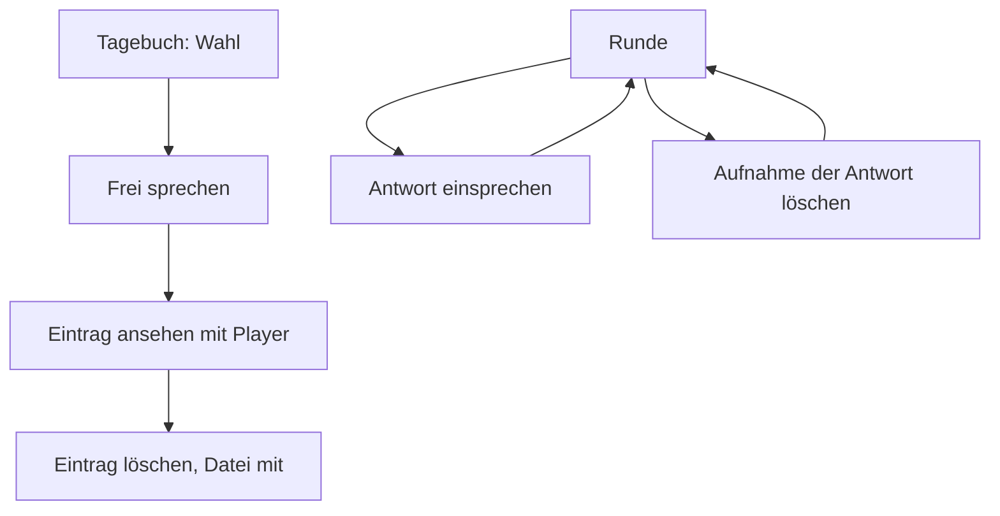
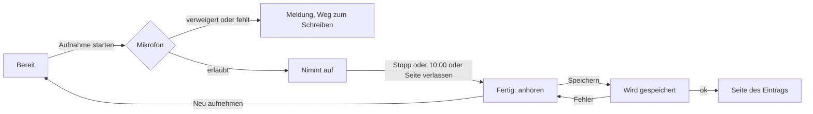

# Design: Sprachaufnahmen im Tagebuch und bei Fragen (#17)

Grundlage: [Anforderungen](../../anforderungen.md) (Abschnitte «Tagebuch», «Runden» (Soll: Antworten als Aufnahme), «Bewusst nicht gebaut»: keine Transkription), [ADR-001](../../adr/ADR-001-technik-pilot.md) (MediaRecorder, Format des Browsers, keine Umwandlung), [datenschutz.md](../../datenschutz.md) (`hinweis_aufnahme`, Prüfpunkt Metadaten), [loeschkonzept.md](../../loeschkonzept.md) («Die Datei der Aufnahme löscht die App»), [Design Anmeldung](2026-10-30-anmeldung-design.md) (#14: `braucht_lehrperson`, `braucht_auftraggeberin`, `pruefe_csrf`, fremde Objekte → 404, Routen-Inventar), [Design Eingabemaske](2026-10-30-eingabemaske-design.md) (#15: `lies_text`, `formatiert`, `hole_heute`), **[Design Lehrpersonen-Ansicht](2026-10-30-lehrpersonen-ansicht-design.md) (#16, verbindlich: Migration 003, `app/aufnahmen.py`-Grundstock, reservierte Adressen, Plätze in Templates, Löschen samt Datei)**, Hinweise aus den Reviews zu #14 (Upload-Grösse vor dem Parsen, 404-Handler für `RequestValidationError`, CSP und Permissions-Policy). Die Entscheidungen hier hat Claude getroffen (Projektregel «Fragen selbst beantworten»); wo es eine Alternative gab, steht die Begründung dabei.

## Zweck

Lehrpersonen sprechen Tagebucheinträge direkt im Browser ein, auf Handy und Computer: aufnehmen, anhören, bei Bedarf neu aufnehmen, speichern. Die Auftraggeberin hört die Aufnahmen an. Als Soll lassen sich auch Antworten auf Freitext-Fragen einer Runde einsprechen. Ziel Mo 16.11.; der Testlauf der Auftraggeberin (bis Fr 20.11.) prüft die Aufnahme auf einem Schulgerät.

## Ziele

- «Frei sprechen» ist im Tagebuch eine gleichwertige Wahl neben «Frei schreiben», mit `hinweis_tagebuch` und `hinweis_aufnahme` direkt über dem Aufnahmeknopf.
- Aufnahme und Wiedergabe gehen auf iPhone (Safari), Android (Chrome) und am Computer (Chrome, Edge, Safari, Firefox).
- Vor dem Speichern lässt sich die Aufnahme anhören und verwerfen. Gespeichert wird erst auf «Speichern».
- Eine Aufnahme ist höchstens 10 Minuten lang und höchstens 15 MiB gross; Browser und Server prüfen beides, der Server die Grösse, bevor er die Anfrage liest.
- Eine Aufnahme hört nur die Lehrperson, der sie gehört, und die Auftraggeberin. Für alle anderen gibt es sie nicht (404).
- Verweigert der Browser das Mikrofon oder kann er nicht aufnehmen, sieht die Lehrperson eine verständliche Meldung und den Weg zum Schreiben.
- Wer einen Eintrag (oder die Aufnahme einer Antwort) löscht, löscht auch die Datei.
- Keine Migration, keine neue Dependency.

## Nicht-Ziele

- Transkription, Umwandlung oder Kürzen von Aufnahmen auf dem Server (Anforderungen, ADR-001).
- Pause und Fortsetzen während einer Aufnahme, Schneiden, mehrere Aufnahmen pro Eintrag.
- Aufnahme eines bestehenden Tagebucheintrags ersetzen. Wer neu sprechen will, löscht den Eintrag und nimmt neu auf. (Bei Antworten auf Runden-Fragen geht Ersetzen, siehe unten, weil die Antwort sonst ihren Text verlöre.)
- Aufnahme für Skala-Fragen.
- Aufnahmen in der Gast-Ansicht und Vorschau (#19): dort ist «Frei sprechen» sichtbar, aber nicht bedienbar (siehe «Gast und Vorschau»).
- Ansicht der Auftraggeberin, Export und ZIP (#18). #17 liefert nur die Adresse `/verwaltung/aufnahmen/{id}`.
- Eine noch nicht gespeicherte Aufnahme über ein Neuladen der Seite retten (IndexedDB). Die Aufnahme lebt bis zum Speichern nur im Arbeitsspeicher des Tabs.

## Anti-Ziele

- Kein Inline-JavaScript, kein Inline-CSS. Ein Skript `app/static/js/aufnahme.js`, eingebunden nur auf den beiden Aufnahme-Seiten.
- Keine Bibliothek für Aufnahme oder Wiedergabe; nur `MediaRecorder`, `getUserMedia`, `<audio>`.
- Der Server vertraut weder dem Dateinamen noch dem `Content-Type` aus dem Browser. Name und Typ bestimmt er selbst.
- Eine `aufnahme_id` kommt nie aus einer Eingabe. Aufnahme und Verknüpfung entstehen in derselben Anfrage; so lässt sich keine fremde oder fremd hochgeladene Aufnahme an einen Eintrag hängen.
- Keine Inhalte, Benutzernamen, Dateinamen oder IP-Adressen in Log-Meldungen.

## Begriffe in der Oberfläche

| Im Code | In der Oberfläche |
|---|---|
| `art = aufnahme` | «Gesprochener Eintrag» (#16) |
| Aufnahme-Seite Tagebuch | «Frei sprechen» |
| Aufnahme an einer Antwort | «Antwort einsprechen», danach «Aufnahme ersetzen», «Aufnahme löschen» |
| Zustand bereit / nimmt auf / fertig | «Aufnahme starten» / «Stopp» mit Zeit «1:23 / 10:00» / Player, «Neu aufnehmen», «Speichern» |
| Upload läuft | «Wird gespeichert …» |
| `NotAllowedError` | «Das Mikrofon ist nicht freigegeben.» (siehe «Meldungen») |

Anrede «du», Knöpfe mit Verb, kein Mikrofon-Emoji (höchstens ein ruhiges SVG-Symbol wie in der Navigation).

## Adressen

Alle Routen in `app/routen/aufnahmen.py` (von #16 leer angelegt und schon eingebunden). Die Datei enthält zwei Unter-Router, die am Ende des Moduls in `router` eingehängt werden: `/lehrperson` mit `Depends(braucht_lehrperson)` und `/verwaltung` mit `Depends(braucht_auftraggeberin)`. Jede POST-Route hängt `pruefe_csrf` an, Upload-Routen davor `begrenze_upload` (siehe «Grenzen»).

| Methode, Pfad | Was | Prio |
|---|---|---|
| `GET /lehrperson/tagebuch/neu/aufnahme` | Seite «Frei sprechen» | Muss |
| `POST /lehrperson/tagebuch/neu/aufnahme` | Datei prüfen und ablegen, Tagebucheintrag `art = aufnahme` anlegen, 303 auf `/lehrperson/tagebuch/{eintrag_id}?erledigt=gespeichert` | Muss |
| `GET /lehrperson/aufnahmen/{aufnahme_id}` | Datei abspielen, nur eigene (sonst 404) | Muss |
| `GET /verwaltung/aufnahmen/{aufnahme_id}` | Datei abspielen für die Auftraggeberin (jede Aufnahme) | Muss |
| `GET /lehrperson/runden/{runde_id}/fragen/{frage_id}/aufnahme` | Seite «Antwort einsprechen» zu einer Freitext-Frage | Soll |
| `POST /lehrperson/runden/{runde_id}/fragen/{frage_id}/aufnahme` | Aufnahme an die Antwort hängen oder ersetzen, 303 auf `/lehrperson/runden/{runde_id}?erledigt=gespeichert#frage-{frage_id}` | Soll |
| `GET`, `POST /lehrperson/runden/{runde_id}/fragen/{frage_id}/aufnahme/loeschen` | Bestätigung, Aufnahme der Antwort löschen (Text und Skala bleiben), 303 zurück auf die Runde | Soll |

Pfad-IDs mit `Id` aus `app/typen.py`. Kein Pfad kollidiert mit #16 (`/tagebuch/{eintrag_id}` hat zwei Segmente, `/tagebuch/neu/aufnahme` drei; `…/{eintrag_id}/loeschen` unterscheidet sich im letzten Segment).

Für jede Route mit `runde_id`/`frage_id` gilt die Regel aus #16: Runde sichtbar am Stichtag `heute` (`sichtbare_runde`), Frage gehört zu dieser Runde und ist vom Typ `freitext`; sonst 404, bei GET und POST, und es wird nichts gespeichert oder gelöscht.

## Entscheidungen

### Aufnehmen im Browser

**Ablauf** (Zustände im Skript, Anzeige über `hidden`-Attribute, Texte stehen im Template, nicht im Skript):

- `getUserMedia({ audio: true })` erst beim Tipp auf «Aufnahme starten» (iOS verlangt eine Bedienung; ausserdem fragt der Browser so nicht schon beim Öffnen der Seite nach dem Mikrofon).
- `new MediaRecorder(stream, { mimeType, audioBitsPerSecond: 64000 })`, `start(1000)`: Teilstücke jede Sekunde, damit bei einer Unterbrechung das Bisherige erhalten bleibt. 64 kbit/s genügen für Sprache und halten 10 Minuten bei etwa 5 MB.
- Nach «Stopp» werden die Spuren des Mikrofons beendet (`track.stop()`), damit die Mikrofon-Anzeige des Geräts erlischt.
- **Anhören vor dem Speichern:** `<audio controls>` mit `URL.createObjectURL(blob)` (CSP erlaubt `media-src 'self' blob:`). «Neu aufnehmen» verwirft Blob und URL (`revokeObjectURL`) ohne Rückfrage und kehrt zu «Bereit» zurück; der Knopf ist als Zweitknopf deutlich von «Speichern» abgesetzt.
- **Zeit:** Anzeige «1:23 / 10:00», gemessen mit `performance.now()` zwischen den Ereignissen `start` und `stop`. Ab 9:00 der Satz «Noch eine Minute.», bei 10:00 stoppt das Skript selbst und zeigt «Die Aufnahme hat die Höchstdauer von 10 Minuten erreicht.». Die gemessene Dauer (ganze Sekunden, aufgerundet) geht im Feld `dauer_sekunden` mit.
- **Seite verlassen während der Aufnahme** (App-Wechsel, Bildschirm gesperrt, Anruf; Ereignis `visibilitychange` → `hidden`, oder `error`/vorzeitiges `stop` des Recorders): Aufnahme stoppen, Bisheriges als «Fertig» anbieten, Hinweis «Die Aufnahme wurde angehalten, weil die Seite verlassen wurde. Du kannst sie anhören und speichern oder neu aufnehmen.» Begründung: iOS hält die Aufnahme im Hintergrund ohnehin an; so ist der Zustand wenigstens klar.
- **Bildschirm bleibt an** (Soll): Während der Aufnahme `navigator.wakeLock.request("screen")`, falls vorhanden, nach dem Stopp freigeben. Sonst sperrt sich ein Handy nach 30 Sekunden ohne Berührung, und die Aufnahme bricht ab. Ohne Unterstützung im Browser geschieht nichts.
- **Barrierefreiheit:** Statuszeile mit `role="status"` (meldet Zustandswechsel, nicht jede Sekunde); Zeitanzeige ohne `aria-live`. Knöpfe mit Text.

### Format je Browser

Das Skript wählt das erste Format, das `MediaRecorder.isTypeSupported` bejaht:

1. `audio/mp4;codecs=mp4a.40.2` (AAC in MP4)
2. `audio/webm;codecs=opus`
3. `audio/mp4`
4. `audio/ogg;codecs=opus`
5. ohne Angabe (Standard des Browsers)

**Begründung:** AAC in MP4 spielen alle Browser und alle Betriebssysteme ab, auch ältere iPhones und der Standard-Player unter Windows beim ZIP-Export (#18). Die Auftraggeberin hört auf einem Gerät, das wir nicht kennen; ein Format, das überall läuft, ist dort wichtiger als die kleinste Datei. Safari nimmt ohnehin MP4/AAC auf; Chrome kann es auf Android, Windows und macOS in neueren Versionen. WebM/Opus ist die Rückfallstufe (Chrome ohne AAC-Encoder, Firefox). Das schlichte `audio/mp4` steht hinter WebM, weil Chrome darunter auch Opus in MP4 liefern kann, das nicht überall abspielt; ältere Safari-Versionen, die nur `audio/mp4` ohne Codec-Angabe bejahen, landen trotzdem dort, weil sie kein WebM aufnehmen. Welches Format tatsächlich entsteht, prüft die Prüfliste auf jedem Gerät.

**Auf dem Server** bestimmt `erkenne_format(anfang: bytes)` den Typ aus den ersten Bytes, nicht aus Angaben des Browsers:

| Erkennung | `mime_typ` | Endung |
|---|---|---|
| Bytes 4–7 = `ftyp` | `audio/mp4` | `.m4a` |
| beginnt mit `1A 45 DF A3` (EBML) | `audio/webm` | `.webm` |
| beginnt mit `OggS` | `audio/ogg` | `.ogg` |
| alles andere | abgewiesen, 400 | – |

Mehr prüft der Server nicht (kein Parsen des Containers, ADR-001). Eine Datei, die mit dem richtigen Anfang beginnt, aber Unsinn enthält, wird gespeichert und spielt nicht ab; sie gefährdet niemanden, weil sie nur mit festem Audio-Typ, `nosniff` und CSP ausgeliefert wird.

### Hochladen: ein POST mit `fetch` und `FormData`

**Entscheidung:** Die Seite enthält ein normales Formular (`method="post"`, `enctype="multipart/form-data"`) mit `csrf_feld`, `dauer_sekunden`, optional `text` und einem Dateifeld `aufnahme`. Mit JavaScript fängt das Skript das Absenden ab und schickt `new FormData(form)` plus den Blob als `aufnahme` (Dateiname `aufnahme.m4a` usw., nur zur Form; der Server ignoriert ihn) per `fetch(form.action, { method: "POST", body, credentials: "same-origin" })`. Der Server antwortet wie überall mit 303; `fetch` folgt, das Skript navigiert auf die Endadresse.

Auswertung der Antwort im Skript:

| Ergebnis | Erkennung | Reaktion, Aufnahme bleibt erhalten? |
|---|---|---|
| gespeichert | `ok`, Endadresse beginnt mit `/lehrperson/` und ist nicht `/` | `location.assign(antwort.url)` |
| nicht mehr angemeldet | Endadresse ist `/` | «Du bist nicht mehr angemeldet. Die Aufnahme lässt sich so nicht speichern. Bitte melde dich neu an.» (Aufnahme verloren; selten, «Angemeldet bleiben» ist Standard) |
| keine Verbindung | `fetch` wirft | «Keine Verbindung. Die Aufnahme ist noch da. Bitte nochmals auf ‹Speichern› tippen.» ja |
| 413 | Status | «Die Aufnahme ist zu gross.» ja (zum Anhören) |
| 400 | Status | «Diese Aufnahme liess sich nicht speichern. Bitte neu aufnehmen.» ja |
| 403 | Status | «Das Formular ist abgelaufen. Bitte die Seite neu laden.» |
| 5xx | Status | «Das Speichern hat gerade nicht geklappt. Bitte nochmals versuchen.» ja |

Während des Hochladens sind alle Knöpfe gesperrt, Statuszeile «Wird gespeichert …».

**Begründung gegen das klassische Absenden** (Blob per `DataTransfer` ins Dateifeld, Empfehlung aus #16): Bricht das Hochladen ab, weil das Schul-WLAN kurz weg ist, zeigt der Browser eine Fehlerseite, und eine fünfminütige Aufnahme ist verloren. Mit `fetch` bleibt sie im Tab und lässt sich nochmals senden. Die Empfehlung aus #16 bleibt im Kern erfüllt: **ein** POST für Datei und Eintrag, also keine Aufnahmen ohne Eintrag. `connect-src 'self'` erlaubt den Aufruf; das CSRF-Feld steckt im `FormData` (vorgesehen seit #14).

**Ohne JavaScript oder ohne Aufnahmefähigkeit** (kein `MediaRecorder`, kein `getUserMedia`, z. B. sehr alter Browser oder In-App-Browser): Das Dateifeld (`accept="audio/*"`) bleibt sichtbar, mit dem Satz «Dieser Browser kann hier nicht aufnehmen. Du kannst deinen Eintrag schreiben oder eine Aufnahme aus einer anderen App hochladen.» Das Formular geht dann klassisch an dieselbe Route; `dauer_sekunden` fehlt und wird `NULL`. Kostet nichts zusätzlich, weil die Route dieselbe ist; fällt bei Zeitnot als Erstes weg (dann nur Meldung und Link zum Schreiben).

### Grenzen für Länge und Grösse

| Grenze | Wert | Prüfung im Browser | Prüfung auf dem Server |
|---|---|---|---|
| Länge | 10 Minuten (`MAX_DAUER_SEKUNDEN = 600`) | Skript stoppt bei 10:00 | `dauer_sekunden` leer oder ganze Zahl 0 … 610 (10 s Toleranz für Messung und Rundung), sonst 400 |
| Dateigrösse | 15 MiB (`MAX_BYTES`) | `blob.size > MAX_BYTES` → Meldung «zu gross», nicht senden | `UploadFile.size` nach dem Parsen, sonst 413 |
| ganze Anfrage | 16 MiB (`MAX_ANFRAGE_BYTES`, Datei plus Felder plus Multipart-Rahmen) | – | `Content-Length` **vor dem Parsen**, sonst 413; fehlt der Header, 411 |
| freier Speicher | Reserve 50 MiB auf dem Volume | – | `shutil.disk_usage(aufnahmen_verzeichnis).free - groesse < RESERVE`, sonst 503 und Log-Ereignis «Aufnahme abgelehnt: Speicherplatz knapp» |

Die Werte stehen als Konstanten in `app/aufnahmen.py`; das Template gibt `MAX_DAUER_SEKUNDEN` und `MAX_BYTES` als `data-`-Attribute an das Skript weiter (eine Quelle). Den Zahlen liegt diese Rechnung zugrunde: 10 Minuten bei 64 kbit/s ergeben etwa 5 MB; Safari hält sich nicht immer an die gewünschte Bitrate und kann bei 128 kbit/s etwa 10 MB erreichen; 15 MiB lassen Luft. Das Volume hat 1 GB: Vier Lehrpersonen mit zwei langen Aufnahmen pro Woche über vier Wochen brauchen etwa 160–320 MB.

**Begründung 10 Minuten:** Das Tagebuch ist für kurze Gedanken direkt nach dem Unterricht gedacht (Frage im Prototyp: «z. B. direkt nach dem Unterricht»). 10 Minuten reichen dafür sicher, die Auftraggeberin muss alles anhören, und die Grösse bleibt auf dem Handy-Datenvolumen tragbar. Die Konstante lässt sich ändern, wenn die Auftraggeberin nach dem Testlauf mehr will.

**Grösse vor dem Parsen ohne Middleware:** FastAPI liest den Body nur dann vor den Abhängigkeiten, wenn die Route Formular- oder Datei-Parameter deklariert. Die Upload-Routen deklarieren deshalb **keine** `Form()`/`File()`-Parameter. Die Reihenfolge der Abhängigkeiten ist damit:

1. `braucht_lehrperson` (Router-Ebene): ohne Anmeldung 303, **bevor ein Byte des Bodys gelesen ist**.
2. `begrenze_upload` (Route): prüft `Content-Length` gegen `MAX_ANFRAGE_BYTES` und liest dann das Formular mit engen Grenzen, `await request.form(max_files=1, max_fields=5)`. Starlette merkt sich das Ergebnis.
3. `pruefe_csrf`: nutzt das gemerkte Formular.
4. Die Route liest Datei und Felder selbst aus `request.form()`.

`Content-Length` ist eine verlässliche Obergrenze: uvicorn liest nie mehr Bytes als angegeben. Browser senden den Header bei Formularen und `fetch` mit `FormData` immer; eine Anfrage ohne (chunked) wird abgewiesen. Dateien über 1 MB legt Starlette beim Parsen in eine anonyme temporäre Datei der Maschine (nicht auf dem Volume), die mit dem Ende der Anfrage verschwindet. Damit entfällt auch Hinweis (b) aus dem Review: Ohne deklarierte Formularfelder kann kein `RequestValidationError` aus dem Body entstehen; fehlende oder falsche Felder prüft die Route selbst (400 mit verständlicher Meldung).

**Verworfen:** eine eigene ASGI-Middleware für den Upload-Pfad (bräuchte eine Änderung an `main.py` und Pfad-Muster in einer zweiten Stelle; die Abhängigkeit leistet dasselbe, solange die Route keine Formular-Parameter hat; ein Test sichert genau das ab, siehe Prüfung).

### Ablage

- **Ort:** `einstellungen.aufnahmen_verzeichnis` (`/data/aufnahmen/` auf dem Volume), flach, ohne Unterordner. Den Ordner legt der Start schon an (#13).
- **Dateiname:** `secrets.token_hex(16)` plus Endung aus der Format-Erkennung, z. B. `3f9c…e1.m4a` (Konvention aus #16). Nie aus Eingaben gebildet.
- **Muster-Prüfung:** `DATEINAME = re.compile(r"[0-9a-f]{32}\.(webm|m4a|ogg)")` mit `fullmatch`. Jeder Zugriff auf eine Datei (Ausliefern, Löschen, Aufräumen) geht über `aufnahme_pfad`, das nur bei passendem Namen einen Pfad im Aufnahmen-Ordner liefert. Ein manipulierter Name in der Datenbank trifft so nie etwas ausserhalb.
- **Schreiben:** Datei in Blöcken (1 MiB) nach `{name}.teil` im selben Ordner kopieren, mit Rechten `0600`, dann `os.replace` auf den endgültigen Namen. Erst danach die Datenbank, in **einer** Transaktion (`BEGIN IMMEDIATE`): Zeile in `aufnahmen` (`konto_id`, `dateiname`, `mime_typ`, `groesse_bytes`, `dauer_sekunden`) und Tagebucheintrag bzw. Antwort. Scheitert die Datenbank, löscht die Route die Datei wieder.
- **Reihenfolge Datei vor Zeile** (beim Anlegen) und **Zeile vor Datei** (beim Löschen, #16): In beiden Fällen kann höchstens eine Datei ohne Zeile übrig bleiben, nie eine Zeile ohne Datei.
- **Aufräumen von Waisen** (Übergabe aus #16): `raeume_waisen(db, verzeichnis)` läuft nach jedem erfolgreichen Speichern einer Aufnahme. Es löscht reguläre Dateien im Aufnahmen-Ordner, deren Name nicht in `aufnahmen.dateiname` steht und die älter als eine Stunde sind (`.teil`-Reste eingeschlossen). Die Stunde schützt ein gleichzeitig laufendes Hochladen. **Verworfen:** Aufräumen beim Start der App (bräuchte eine Änderung am Lebenszyklus in `main.py`; bei fünf Personen und einem Ordner mit wenigen hundert Dateien kostet das Aufräumen beim Speichern nichts).

### Ausliefern und Abspielen

`GET /lehrperson/aufnahmen/{id}` lädt mit `WHERE id = ? AND konto_id = ?`, `GET /verwaltung/aufnahmen/{id}` mit `WHERE id = ?`. Keine Zeile, Name passt nicht zum Muster oder Datei fehlt → 404 (die Fehlerseite aus #14). Sonst `FileResponse`:

| Header | Wert | Begründung |
|---|---|---|
| `Content-Type` | `mime_typ` aus der Datenbank (nur die drei Werte oben) | nie vom Browser übernommen |
| `Content-Disposition` | `inline; filename="aufnahme-{id}.m4a"` | abspielen statt herunterladen, neutraler Name |
| `Accept-Ranges`, `Content-Range`, Status 206 | von Starlette `FileResponse` (Version 1.10 im Lock) | Safari auf dem iPhone spielt Audio nur mit Range-Anfragen ab; Spulen braucht sie überall |
| `Cache-Control` | `no-store` (setzt die Sicherheits-Middleware aus #13 für alle Pfade ausser `/static/`) | Stimme bleibt nicht im Cache eines gemeinsam genutzten Schulgeräts |
| `X-Content-Type-Options` | `nosniff` (Middleware) | kein Raten des Typs |
| `Cross-Origin-Resource-Policy` | `same-origin` | fremde Seiten können die Datei nicht einbetten (zusätzlich zu `SameSite=Lax`) |

**Risiko `no-store` und Safari:** Range-Anfragen funktionieren auch ohne Cache. Spielt Safari trotzdem nicht ab, ist die Ausweichlösung `Cache-Control: private, no-cache` nur für diese beiden Pfade (Änderung an `app/sicherheit.py`, dann als Befund an #16/Koschi). Die Prüfliste testet das auf dem iPhone zuerst.

**Gemeinsames Teil-Template `_aufnahme.html`** (aus #16, Parameter `aufnahme`, `url` bleiben): `<audio controls preload="none" src="{{ url }}">` und die Dauer («2 Min.»). `preload="none"`, damit Listen mit vielen Aufnahmen kein Datenvolumen verbrauchen. #17 ändert nur, falls nötig, das Innere (z. B. Klasse für die Breite).

**Bekannte Grenze von WebM:** Chrome und Firefox schreiben in WebM-Aufnahmen keine Gesamtdauer. Solche Dateien spielen ab, aber das Spulen geht erst, wenn die Datei ganz geladen ist. Darum steht MP4/AAC im Browser an erster Stelle; ohne Umwandlung auf dem Server (ADR-001) lässt sich das nicht weiter beheben. Die Auftraggeberin hat für die Interviews ausserdem die Dateien im ZIP-Export (#18).

### Mikrofon verweigert und andere Fehler

Alle Meldungen stehen als versteckte Elemente im Template (`data-meldung="verweigert"` usw.), das Skript zeigt das passende an. Jede Meldung endet mit dem Link «Stattdessen schreiben» (`/lehrperson/tagebuch/neu/frei` bzw. zurück zur Frage).

| Fall | Erkennung | Meldung (Vorschlag, Ton für den Umsetzer) |
|---|---|---|
| Freigabe verweigert | `NotAllowedError`, `SecurityError` | «Das Mikrofon ist nicht freigegeben.» Darunter aufklappbar (`
`) «So gibst du das Mikrofon frei»: iPhone: in Safari links in der Adresszeile auf «aA» tippen, «Website-Einstellungen», «Mikrofon: Erlauben», dann Seite neu laden. Android: auf das Symbol links neben der Adresse tippen, «Berechtigungen», «Mikrofon» erlauben. Computer: auf das Symbol links neben der Adresse klicken und das Mikrofon erlauben. |
| kein Mikrofon | `NotFoundError`, `OverconstrainedError` | «Es wurde kein Mikrofon gefunden.» |
| Mikrofon besetzt | `NotReadableError`, `AbortError` | «Das Mikrofon wird gerade von einer anderen App verwendet, zum Beispiel für einen Anruf. Schliesse sie und versuche es nochmals.» |
| Browser kann nicht aufnehmen | kein `navigator.mediaDevices?.getUserMedia` oder kein `MediaRecorder` | «Dieser Browser kann hier nicht aufnehmen. Öffne die Seite in Safari (iPhone) oder Chrome (Android, Computer). Wenn du den Link aus einer Nachricht geöffnet hast, wähle ‹Im Browser öffnen›.» |
| Aufnahme bricht ab | `error` am Recorder, Seite verlassen | siehe «Aufnehmen im Browser» |

Die Erkennung «kann nicht aufnehmen» läuft beim Laden der Seite (der Knopf «Aufnahme starten» erscheint dann gar nicht), die übrigen beim Tipp auf «Aufnahme starten». Die Permissions-Policy `microphone=(self)` und HTTPS (fly.io, lokal `localhost`) sind schon gegeben.

### Seite «Frei sprechen»

«‹ Tagebuch», `h1` «Frei sprechen», `hinweis_tagebuch` und `hinweis_aufnahme` (beide `lies_text | formatiert`, Klasse `hinweis`), darunter die Karte mit dem Aufnahmeteil (`lehrperson/_aufnehmen.html`, geteilt mit «Antwort einsprechen»), dann aufklappbar «Etwas dazuschreiben (freiwillig)» mit `<textarea name="text" rows="3" maxlength="20000">` (Schema: `text` ist bei `aufnahme` freiwillig; hilft der Auftraggeberin beim Einordnen), zuletzt «Speichern» (erst sichtbar im Zustand «Fertig»). `bereich = "tagebuch"`.

Der Server prüft beim Anlegen: Datei vorhanden, nicht leer, Format erkannt, Grössen, `dauer_sekunden`, `text` normalisiert wie in #16 (leer → `NULL`). Fehler → 400 mit Fehlerseite (ohne JavaScript) bzw. Meldung im Skript.

### Antworten auf Runden-Fragen (Soll)

- **Eigene Seite pro Frage** statt Aufnahme im Runden-Formular. Begründung: Das Runden-Formular von #16 bleibt ein einfaches Formular ohne Datei, Speichern-Logik und Grössengrenze von #16 bleiben unberührt, und eine Frage mit Aufnahme ist ein einzelner, klarer Schritt.
- **Platz in `runde.html`** (`{# #17: Antwort einsprechen #}`, unter jeder Freitext-Frage, nur bei `ansicht.speichert`): Gibt es schon eine Aufnahme, `_aufnahme.html` und die Links «Aufnahme ersetzen» und «Aufnahme löschen». Sonst ein kleiner Knopf «Antwort einsprechen». Der Knopf ist ein Submit-Knopf **des Runden-Formulars** mit `name="anker" value="aufnahme-{frage_id}"`: Er speichert zuerst alles Getippte (Logik von #16) und führt dann auf die Aufnahme-Seite (siehe «Bedarf an #16», Punkt 6). So geht kein ungespeicherter Text verloren.
- **Seite «Antwort einsprechen»:** «‹ Zurück zur Runde», Fragetext (reiner Text), `hinweis_tagebuch` und `hinweis_aufnahme`, Satz «Deine geschriebene Antwort bleibt erhalten.», Aufnahmeteil. Gibt es schon eine Aufnahme: «Die neue Aufnahme ersetzt die bisherige.» `bereich = "runden"`.
- **Speichern** in einer Transaktion: neue Zeile in `aufnahmen`; gibt es eine Antwort (`frage_id`, `konto_id`), `UPDATE antworten SET aufnahme_id = neu, geaendert = jetzt` und die alte Zeile in `aufnahmen` löschen; sonst `INSERT antworten (frage_id, konto_id, aufnahme_id)`. Nach dem `COMMIT` die alte Datei löschen (`loesche_dateien` aus #16).
- **Aufnahme löschen** (Bestätigung «Die Aufnahme zu dieser Frage löschen? Deine geschriebene Antwort bleibt.»): `aufnahme_id = NULL`, `geaendert = jetzt`; haben dann weder `text` noch `skalawert` einen Wert, wird die Antwortzeile gelöscht (Konvention aus #16: Zeile existiert genau dann, wenn Inhalt). Zeile in `aufnahmen` löschen, nach dem `COMMIT` die Datei. 303 auf die Runde mit `?erledigt=aufnahme_geloescht#frage-{id}`.
- Fremde Antworten sind ausgeschlossen, weil jede Abfrage nach `konto_id` des angemeldeten Kontos filtert; es gibt keine Antwort-ID in der Adresse.
- Eine Frage mit einer Antwort, die nur aus einer Aufnahme besteht, ist für die Auftraggeberin gegen Löschen gesperrt wie jede beantwortete Frage (#15, «jede Zeile in `antworten`»). Nichts zu tun.

### Gast und Vorschau

Die Wahlseite `tagebuch_wahl.html` ist mit #19 geteilt. #17 füllt den Platz `{# #17: Frei sprechen #}` so: bei `ansicht.speichert` eine Link-Karte «Frei sprechen» mit Unterzeile «Eintrag einsprechen, zum Beispiel direkt nach dem Unterricht.»; sonst dieselbe Karte ohne Link, gedämpft, mit der Unterzeile «In dieser Ansicht nicht verfügbar.» So sieht die Auftraggeberin in der Vorschau und der Gast, dass es die Möglichkeit gibt, und es entsteht keine Adresse `/gast/tagebuch/neu/aufnahme`. Der Knopf «Antwort einsprechen» in `runde.html` erscheint nur bei `ansicht.speichert`. #19 muss dafür nichts tun.

### Löschen

- Tagebucheintrag samt Aufnahme: erledigt #16 (`loesche_tagebucheintrag`). #17 ergänzt einen Test und einen E2E-Schritt mit echter Datei.
- Aufnahme einer Antwort: eigene Route (oben). Alle Antworten einer Runde löschen: erledigt #16 (`loesche_antworten_der_runde`, nimmt Aufnahmen mit).
- Zugang löschen: erledigt #14 (`loesche_konto`, löscht die Dateien des Kontos).
- Löschfehler bei der Datei (z. B. Rechte): nur als Ereignis loggen, ohne Dateinamen; die Waise räumt das nächste Speichern weg.

## Datenmodell (nur Nutzung)

Keine Migration. Genutzt wird, was Schema 001 und Migration 003 (#16) bereitstellen:

| Tabelle, Spalte | Nutzung in #17 |
|---|---|
| `aufnahmen.id`, `konto_id`, `dateiname` (`UNIQUE`), `mime_typ`, `groesse_bytes`, `erstellt` | eine Zeile pro gespeicherter Datei; `konto_id` = angemeldete Lehrperson |
| `aufnahmen.dauer_sekunden` (003) | gemessene Dauer aus dem Browser, `NULL` ohne JavaScript |
| `tagebucheintraege.aufnahme_id` mit eindeutigem Teilindex (003) | Eintrag `art = aufnahme`, `text` freiwillig, ohne Bezug |
| `antworten.aufnahme_id` mit eindeutigem Teilindex (003) | Aufnahme an einer Freitext-Antwort, höchstens eine |
| `idx_aufnahmen_konto` (003) | Zugriffsprüfung `WHERE id = ? AND konto_id = ?` |

Die eindeutigen Indizes fangen ab, dass eine Aufnahme an zwei Einträgen hinge; die App verknüpft ohnehin nur die Aufnahme, die sie in derselben Anfrage angelegt hat.

## Sicherheit und Datenschutz

- **Zugriff:** Hochladen nur als Lehrperson (Router-Abhängigkeit), Abspielen nur eigene (`konto_id` in SQL) bzw. als Auftraggeberin. Fremd, unbekannt, ungültige ID, fehlende Datei: alles 404 und nicht unterscheidbar. Auftraggeberin auf `/lehrperson/aufnahmen/…` und Lehrperson auf `/verwaltung/aufnahmen/…`: 403 (Rollenprüfung aus #14, wie bei allen Seiten).
- **CSRF:** Upload und Löschen mit `pruefe_csrf`; beim Upload steckt das Feld im `FormData`.
- **Uploads:** Typ aus den ersten Bytes, Name zufällig, Muster-Prüfung bei jedem Dateizugriff, Grösse vor dem Parsen begrenzt, enge Grenzen für Felder und Dateien im Multipart, Speicherreserve. Ausgeliefert nur mit festem Audio-Typ, `nosniff`, CSP; eine eingeschleuste HTML- oder Skriptdatei kann so nicht ausgeführt werden.
- **CSP und Permissions-Policy** (seit #13 gesetzt, unverändert): `script-src 'self'`, `media-src 'self' blob:`, `connect-src 'self'`, `microphone=(self)`.
- **Metadaten:** Prüfpunkt aus `docs/datenschutz.md`: Koschi prüft je eine Testaufnahme von iPhone, Android und Computer (z. B. `strings datei | grep -i -E "gps|lat|lon|iphone|model|serial"`, bei MP4 zusätzlich die Boxen `udta`/`meta`), Ergebnis kommt in die Tabelle «Prüfung der Datensparsamkeit». Erwartet: höchstens der Name der Aufnahme-Software und ein Erstellzeitpunkt, keine Orts- oder Geräteangaben. Werden doch welche gefunden, ist das ein Befund für Koschi (Entfernen ginge nur mit Umwandlung, ADR-001).
- **Neue Zeilen in `docs/datenschutz.md`, Tabelle «Welche Daten entstehen»:** «Zwischendatei beim Hochladen einer Aufnahme | temporärer Ordner der Maschine, nicht auf dem Volume | Verarbeitung der Anfrage | ja, Stimme; gelöscht am Ende der Anfrage» und «Noch nicht gespeicherte Aufnahme | Arbeitsspeicher des Browser-Tabs | Anhören vor dem Speichern | ja; weg beim Speichern, Neu aufnehmen, Neuladen oder Schliessen». In der Zeile «Sprachaufnahmen» die Dauer ergänzen.
- **Logs:** nur Ereignisse ohne Inhalt («Aufnahme abgelehnt: Speicherplatz knapp», «Aufnahme-Datei liess sich nicht löschen»), keine Dateinamen, keine Konto-IDs.
- **Löschkonzept:** keine Änderung. Stufe 1 löscht `/data/aufnahmen/` vollständig; das Aufräumen von Waisen ändert daran nichts.

## Prüfung

### pytest

Fixtures aus #14 (`client`, `lehrperson`, `zweite_lehrperson`, `auftraggeberin`, `anmelden`, `csrf_von`) und #16 (`db`, `heute_ist`, `tests/testdaten.py`). Testdateien: `tests/test_aufnahmen.py` (Logik), `tests/test_aufnahmen_routen.py` (Routen). Kleine Testdateien mit echtem Dateianfang (`b"\x1aE\xdf\xa3" + …`, `b"\x00\x00\x00\x18ftypM4A " + …`, `b"OggS" + …`); der Server parst nicht weiter.

- **Format-Erkennung:** WebM, MP4, Ogg → richtiger `mime_typ` und Endung; leer, 3 Bytes, `<html>`, `ID3` (MP3), `RIFF` (WAV), PNG → abgewiesen.
- **Dateiname:** gültige Namen passen auf das Muster; `../x.webm`, `x.webm`, Grossbuchstaben, `.mp3`, Name mit Pfadtrenner → `aufnahme_pfad` liefert nichts.
- **Upload Tagebuch:** gültige Datei → 303 auf den neuen Eintrag; Zeile in `aufnahmen` mit `konto_id` der Lehrperson, `groesse_bytes`, `dauer_sekunden`; Datei liegt mit denselben Bytes und passendem Namen im Ordner; Eintrag `art = aufnahme`, `text` wie eingegeben bzw. `NULL`. Dateiname und `Content-Type` aus der Anfrage haben keinen Einfluss (z. B. `bild.html`, `text/html`).
- **Ungültige Eingaben** (je 400, keine Zeile, keine Datei, auch keine `.teil`-Datei): kein Dateifeld, leere Datei, Dateifeld als Text, unbekanntes Format, `dauer_sekunden` = `abc`, `-1`, `611`, `99999999999999999999`, `text` über 20 000 Zeichen.
- **Grenzen:** Anfrage mit mehr als `MAX_ANFRAGE_BYTES` → 413; **vor dem Parsen**: `Request.form` per `monkeypatch` so ersetzen, dass ein Aufruf den Test scheitern lässt, dann ist die Antwort trotzdem 413. Datei über `MAX_BYTES`, Anfrage aber unter der Grenze → 413, keine Datei. Ohne Anmeldung → 303, ebenfalls ohne Parsen (gleicher Trick). Ohne CSRF → 403, keine Datei. Speicher knapp (`shutil.disk_usage` gepatcht) → 503, keine Datei.
- **Schutz der Route vor deklarierten Formularfeldern:** Ein Test prüft über `iter_route_contexts`, dass die Upload-Routen keinen Body-Parameter haben (`route.dependant.body_params` leer, auch in Unter-Abhängigkeiten). Sonst würde FastAPI den Body vor der Grössenprüfung lesen.
- **Fehler nach dem Schreiben:** `lege_tagebucheintrag_an` gepatcht, wirft → keine Datei, keine Zeile in `aufnahmen`.
- **Waisen:** Datei ohne Zeile, älter als eine Stunde (`os.utime`) → nach dem nächsten Upload gelöscht; jünger → bleibt; Dateien mit Zeile bleiben; Unterordner und Dateien mit fremdem Namen ausserhalb des Musters werden nur gelöscht, wenn sie reguläre Dateien im Ordner sind (kein Folgen von Links).
- **Ausliefern:** eigene Aufnahme → 200, `Content-Type` exakt, `Content-Disposition: inline; filename="aufnahme-{id}…"`, `Accept-Ranges: bytes`, `Cache-Control: no-store`, `X-Content-Type-Options: nosniff`, `Cross-Origin-Resource-Policy: same-origin`, Body gleich der Datei. `Range: bytes=0-3` → 206, `Content-Range: bytes 0-3/N`, 4 Bytes. `Range: bytes=N-` → 416.
- **Fremde Aufnahmen (Akzeptanzkriterium):** `zweite_lehrperson` ruft `/lehrperson/aufnahmen/{id}` einer Aufnahme der ersten auf → 404, Body enthält keine Bytes der Datei; auch mit `Range`. Unbekannte ID, `abc`, `0`, `-1`, `99999999999999999999` → 404. Zeile vorhanden, Datei fehlt → 404. Dateiname in der Datenbank auf `../reflexion.db` gesetzt → 404.
- **Auftraggeberin:** `/verwaltung/aufnahmen/{id}` → 200 für Aufnahmen beider Lehrpersonen; Lehrperson dort → 403; ohne Anmeldung → 303.
- **Antwort einsprechen (Soll):** neue Antwort nur mit Aufnahme; bestehende Textantwort erhält Aufnahme, Text bleibt, `geaendert` neu; ersetzen → alte Zeile und Datei weg, neue verknüpft; löschen → Text bleibt; löschen bei reiner Aufnahme → Antwortzeile weg; Skala-Frage, Frage einer anderen Runde, nicht freigeschaltete Runde → 404 bei GET und POST, nichts gespeichert; `zweite_lehrperson` löscht → 404, Aufnahme der ersten bleibt.
- **Löschen über #16 mit echter Datei:** Eintrag löschen → Zeile und Datei weg, Adresse 404.
- **Routen-Inventar (#14):** deckt die neuen Routen ohne Änderung ab (GET ohne Anmeldung → 303, POST ohne CSRF → 403, Rollen getrennt). Der Upload-POST mit leerem `data={}` erreicht `pruefe_csrf`, weil `Content-Length` klein ist.

### E2E (`tests/e2e-pilot.mjs`, Funktion `ablaufAufnahmen`, vorbereitet von #16)

Chrome mit künstlichem Mikrofon (siehe «Bedarf an #16», Punkt 2), 390 px hell und dunkel, einmal 1280 px. Auf jeder Seite: kein horizontales Scrollen, keine Konsolenfehler (insbesondere keine CSP-Verletzung).

1. Lehrperson: Tagebuch → Wahl zeigt «Frei sprechen» → Seite «Frei sprechen» mit beiden Hinweisen.
2. **Mikrofon verweigert (Akzeptanzkriterium):** Berechtigung per CDP `Browser.setPermission` (`microphone`, `denied`) setzen; «Aufnahme starten» → Meldung «Das Mikrofon ist nicht freigegeben.» sichtbar, Anleitung aufklappbar, Link «Stattdessen schreiben» führt zum Formular. Greift die Einstellung wegen des künstlichen Mikrofons nicht, ersetzt der Schritt `navigator.mediaDevices.getUserMedia` per `Runtime.evaluate` durch eine Funktion, die mit `NotAllowedError` scheitert. Danach Berechtigung zurücksetzen.
3. «Aufnahme starten» → Zeit läuft → nach 3 s «Stopp» → Player mit `blob:`-Quelle, `readyState ≥ 1` nach `load()`. «Neu aufnehmen» → Player weg. 2 s aufnehmen, «Stopp», «Speichern» → Seite des Eintrags mit «Gespeichert.» und Player.
4. `fetch(src, { headers: { Range: "bytes=0-1" } })` im Browser → 206, `content-type` beginnt mit `audio/`. Im Ordner `daten-pilot/aufnahmen/` liegt genau eine Datei mit passendem Namen (die verworfene erste Aufnahme wurde nie hochgeladen).
5. «Meine Einträge» zeigt «Gesprochener Eintrag» mit Dauer.
6. Runde 1 (Soll): Text in eine Freitext-Frage tippen, «Antwort einsprechen» → Aufnahme-Seite; 2 s aufnehmen, speichern → zurück an der Frage, Player da, getippter Text gespeichert. «Aufnahme löschen» → Bestätigung → Player weg, Text bleibt.
7. Zweite Lehrperson: `fetch` auf die Adresse der Aufnahme der ersten → 404.
8. Auftraggeberin: `fetch` auf `/verwaltung/aufnahmen/{id}` → 200.
9. Erste Lehrperson löscht den gesprochenen Eintrag → Adresse 404, Datei nicht mehr im Ordner.
10. Screenshots: Wahl, Bereit, Nimmt auf, Fertig (Player), Mikrofon verweigert, Eintrag mit Player (hell, dunkel, 1280 px), Frage mit Aufnahme.

### Manuelle Prüfliste auf echten Geräten (Koschi und Auftraggeberin)

Echte Mikrofone und Safari auf dem iPhone lassen sich nicht automatisch prüfen. Aufnahme braucht HTTPS, darum auf fly.io mit Testkonten (keine echten Inhalte). Danach die Testkonten löschen; das löscht ihre Aufnahmen mit. Ergebnis als Tabelle im Pull Request (Gerät, Betriebssystem- und Browserversion, Format laut Dateiendung, ok / Befund).

| Nr. | Schritt | Erwartet | iPhone Safari | Android Chrome | Computer (Chrome oder Edge) | Computer (Safari oder Firefox) |
|---|---|---|---|---|---|---|
| 1 | Tagebuch → «Frei sprechen» → «Aufnahme starten» | Browser fragt nach dem Mikrofon; nach «Erlauben» läuft die Zeit | ☐ | ☐ | ☐ | ☐ |
| 2 | 20 s sprechen, «Stopp», anhören | gut verständlich, Länge stimmt | ☐ | ☐ | ☐ | ☐ |
| 3 | «Neu aufnehmen», nochmals 10 s, anhören | erste Aufnahme weg, zweite hörbar | ☐ | ☐ | ☐ | ☐ |
| 4 | «Speichern» | Seite des Eintrags, «Gespeichert.», Player spielt ab, Spulen geht | ☐ | ☐ | ☐ | ☐ |
| 5 | «Meine Einträge» | «Gesprochener Eintrag», Dauer stimmt | ☐ | ☐ | ☐ | ☐ |
| 6 | Mikrofon für die Seite verweigern, «Aufnahme starten» | verständliche Meldung, Anleitung passt zum Gerät, «Stattdessen schreiben» führt weiter; nach Freigabe gemäss Anleitung klappt es | ☐ | ☐ | ☐ | ☐ |
| 7 | Während der Aufnahme in eine andere App wechseln oder Bildschirm sperren, zurückkehren | Aufnahme angehalten mit Hinweis, Bisheriges anhörbar und speicherbar | ☐ | ☐ | – | – |
| 8 | 2 Minuten aufnehmen, ohne den Bildschirm zu berühren | Bildschirm bleibt an, Aufnahme vollständig | ☐ | ☐ | – | – |
| 9 | Runde: Text tippen, «Antwort einsprechen», aufnehmen, speichern; danach ersetzen und löschen (Soll) | Text bleibt immer erhalten, Player an der Frage | ☐ | ☐ | ☐ | ☐ |
| 10 | Eintrag löschen, danach die alte Adresse der Aufnahme aus dem Verlauf öffnen | «Nicht gefunden» | ☐ | ☐ | ☐ | ☐ |
| 11 | Flugmodus kurz vor «Speichern» einschalten, dann wieder aus und nochmals «Speichern» | Meldung «Keine Verbindung …», Aufnahme bleibt, zweiter Versuch klappt | ☐ | ☐ | – | – |
| 12 | Link aus einer WhatsApp-Nachricht öffnen (In-App-Browser) | Aufnahme klappt oder verständliche Meldung mit Hinweis «Im Browser öffnen» | ☐ | ☐ | – | – |
| 13 | Hell und dunkel, Querformat | lesbar, kein seitliches Scrollen | ☐ | ☐ | ☐ | ☐ |

**Wiedergabe durch die Auftraggeberin:** Sie hört je eine Aufnahme vom iPhone, von Android und vom Computer auf jedem Gerät an, das sie selbst für das Anhören nutzen will (Handy und Computer), über `/verwaltung/aufnahmen/{id}` bzw. die Ansicht aus #18. Erwartet: alle spielen ab, Spulen geht (bei WebM erst nach vollständigem Laden).

**Einmalig auf einem Gerät:** eine Aufnahme bis 10:00 laufen lassen → stoppt selbst mit Hinweis, Speichern klappt.

**Schulgerät im Schul-WLAN:** Teil des Testlaufs der Auftraggeberin (bis Fr 20.11., steht schon im Zeitplan): Schritte 1–4 und 6 auf einem Schulgerät. Klappt das Mikrofon dort nicht, ist das ein Befund für Koschi und die Auftraggeberin (offener Punkt in den Anforderungen: Schreiben statt Sprechen).

**Metadaten:** Koschi prüft je eine Datei aus iPhone, Android und Computer (siehe «Sicherheit und Datenschutz») und trägt das Ergebnis in `docs/datenschutz.md` ein.

### Akzeptanzkriterien aus dem Issue

- «Aufnahme und Wiedergabe geprüft auf iPhone (Safari), Android (Chrome) und Computer»: manuelle Prüfliste (Tabelle im Pull Request) plus E2E am Computer (Chrome) in 390 px und 1280 px. **Erst mit ausgefüllter Prüfliste gilt das Issue als fertig**; bis dahin bleibt es nach dem Merge offen bzw. der Pull Request nennt die ausstehenden Geräte.
- «Test: Fremde Aufnahmen sind über die direkte Adresse nicht abrufbar»: pytest «Fremde Aufnahmen» und E2E Schritt 7.
- «Verweigert der Browser das Mikrofon, gibt es eine verständliche Meldung»: E2E Schritt 2, Prüfliste Nr. 6.
- Zusätzlich aus dem Umfang: Obergrenzen (pytest «Grenzen»), Löschen samt Datei (pytest, E2E Schritt 9), Anhören vor dem Speichern und neu aufnehmen (E2E Schritt 3, Prüfliste Nr. 2–3).

## Bedarf an #16

Was #17 braucht und nach Design #16 nicht (eindeutig) vorgesehen ist. Ohne diese Punkte müsste #17 Dateien von #16 ändern.

1. **Fehlertext für 413** in `FEHLERTEXTE` (`app/main.py`): `413: ("Zu gross", "Die Aufnahme ist zu gross. Bitte höchstens 10 Minuten aufnehmen.")`. Sonst zeigt die Fehlerseite «Das hat nicht geklappt». Falls #16 das nicht aufnimmt, ergänzt #17 diese eine Zeile selbst (kein anderes Issue ändert `main.py`).
2. **E2E-Gerüst:** In `starteChrome()` die Schalter `--use-fake-ui-for-media-stream` und `--use-fake-device-for-media-stream` ergänzen. Sie liefern ein künstliches Mikrofon (Piepton) und bestätigen die Freigabe; für die anderen Abläufe ohne Wirkung.
3. **Jinja-Filter `dauer`** in `app/vorlagen.py` (Sekunden → «45 Sek.», ab 60 s «2 Min.», auf ganze Minuten aufgerundet; `None` → leer), genutzt von «Meine Einträge» (#16: «Aufnahme, 2 Min.») und `_aufnahme.html`. Sonst müsste #17 `vorlagen.py` ändern, das auch #18 und #19 lesen.
4. **Transaktion des Aufrufers:** `lege_tagebucheintrag_an` (und jede Schreibfunktion in `app/eintraege.py`, die #17 aufruft) öffnet keine eigene Transaktion, wenn schon eine läuft (`db.in_transaction`), und macht dann auch kein `COMMIT`. #17 legt Aufnahme-Zeile und Eintrag in einer Transaktion an.
5. **Ändern eines gesprochenen Eintrags:** `aendere_tagebucheintrag` erlaubt bei `art = aufnahme` einen leeren Text (→ `NULL`) statt 400; `tagebuch_eintrag.html` beschriftet das Feld dann «Notiz zur Aufnahme (freiwillig)».
6. **«Speichern und einsprechen» (Soll):** `POST /lehrperson/runden/{runde_id}` akzeptiert `anker = aufnahme-{frage_id}` (Muster `aufnahme-\d{1,10}`). Gehört die Frage zur Runde und ist sie `freitext`, leitet die Route nach dem Speichern auf `/lehrperson/runden/{runde_id}/fragen/{frage_id}/aufnahme` statt auf die Runde. Sonst wie ohne Anker. Ohne diesen Punkt wird der Knopf ein einfacher Link, und getippter, noch nicht gespeicherter Text ist nur über den Entwurfsschutz gesichert.
7. **Meldungen per `?erledigt=` auf der Runden-Seite:** Die Runde zeigt Meldungen aus derselben Tabelle wie die übrigen Seiten; #17 braucht `gespeichert` («Gespeichert.») und neu `aufnahme_geloescht` («Die Aufnahme wurde gelöscht.»).
8. **Dateinamen-Muster im Grundstock `app/aufnahmen.py`:** `aufnahme_pfad` gibt `None` zurück, wenn der Name nicht auf `[0-9a-f]{32}\.(webm|m4a|ogg)` passt, und `loesche_dateien` überspringt solche Namen. Das schärft `Path(name).name` aus #16 nur nach; #17 baut Ausliefern und Aufräumen darauf.
9. **Testdaten:** `tests/testdaten.lege_aufnahme_an` vergibt den Dateinamen nach diesem Muster (`token_hex(16) + ".webm"`), schreibt einen gültigen Dateianfang (`b"\x1aE\xdf\xa3"` plus einige Bytes) und setzt `mime_typ = "audio/webm"`. Sonst liefern die Auslieferungs-Tests von #17 für Testdaten von #16 404.
10. **Einbinden des Routers:** `app.include_router(aufnahmen.router)` ohne `prefix`, weil die Datei Adressen unter `/lehrperson` und `/verwaltung` enthält.

## Dateien

| Datei | Änderung | Überschneidung |
|---|---|---|
| `app/aufnahmen.py` | erweitert: Konstanten, `erkenne_format`, `DATEINAME`, `speichere_datei`, `lege_aufnahme_an`, `aufnahme_als_tagebucheintrag`, `haenge_an_antwort`, `loesche_aufnahme_der_antwort`, `eigene_aufnahme`, `aufnahme`, `raeume_waisen` | #18 liest `aufnahme_pfad`; nur neue Funktionen, Grundstock-Signaturen bleiben |
| `app/routen/aufnahmen.py` | füllt (von #16 leer angelegt) | keine |
| `app/static/js/aufnahme.js` | neu | keine |
| `app/templates/lehrperson/aufnahme_tagebuch.html`, `aufnahme_antwort.html`, `_aufnehmen.html` | neu | keine |
| `app/templates/lehrperson/tagebuch_wahl.html`, `runde.html` | nur an den markierten Plätzen | mit #19 geteilt gerendert, aber #19 ändert sie nicht |
| `app/templates/lehrperson/tagebuch_eintrag.html` | höchstens am markierten Platz | keine |
| `app/templates/_aufnahme.html` | nur innen, falls nötig | #18 nutzt es; Parameter unverändert |
| Bestätigungsseite Löschen | nutzt `lehrperson/loeschen.html` aus #16, falls parametrisiert; sonst eigenes Template | keine |
| `app/static/css/style.css` | nur Abschnitt «Pilot: Aufnahmen (#17)» | vorbereitet, keine |
| `tests/test_aufnahmen.py`, `tests/test_aufnahmen_routen.py` | neu | keine |
| `tests/e2e-pilot.mjs` | nur Funktion `ablaufAufnahmen` | vorbereitet, keine (Gerüst-Schalter siehe Bedarf 2) |
| `docs/datenschutz.md` | zwei Zeilen «Welche Daten entstehen», Prüfpunkt Metadaten | keine |
| `app/main.py` | nur falls Bedarf 1 nicht in #16: eine Zeile in `FEHLERTEXTE` | gering, kein anderes Issue ändert die Datei |

Nicht angefasst: `app/eintraege.py`, `sichtbar.py`, `ansicht.py`, `seiten_lehrperson.py`, `zeit.py`, `vorlagen.py`, `routen/lehrperson.py`, `sicherheit.py`, `conftest.py`, `testdaten.py`, Migrationen.

## Reihenfolge der Umsetzung

1. `app/aufnahmen.py`: Format-Erkennung, Muster, Speichern, Waisen, mit Tests.
2. Routen Ausliefern (Lehrperson, Verwaltung) mit den Zugriffstests, Range und Headern.
3. Upload Tagebuch: `begrenze_upload`, Route, Tests für Grenzen und Fehler.
4. `aufnahme.js` und Seite «Frei sprechen», Platz in `tagebuch_wahl.html`, E2E Schritte 1–5, 7–9.
5. Soll: Antwort einsprechen, ersetzen, löschen, Plätze in `runde.html`, E2E Schritt 6.
6. Deploy auf fly.io, manuelle Prüfliste mit Testkonten, Metadaten-Prüfung, `docs/datenschutz.md`.

Bei Zeitnot fallen weg, in dieser Reihenfolge: das Dateifeld als Rückfall ohne Aufnahmefähigkeit (dann nur Meldung und Link zum Schreiben), der Wake Lock, die Antworten auf Runden-Fragen (Soll). Muss bleibt: Tagebuch einsprechen, anhören, neu aufnehmen, speichern, abspielen nur für Berechtigte, Grenzen, Meldung bei verweigertem Mikrofon.

## Befunde ausserhalb des Scopes (für `docs/beobachtungen.md`)

- **Keine Grössengrenze für Formulare ausserhalb der Upload-Routen.** Routen mit deklarierten `Form()`-Parametern (z. B. `POST /anmelden`, ohne Anmeldung erreichbar) lesen den ganzen Body vor jeder Prüfung; uvicorn begrenzt die Grösse nicht, Starlette nur pro Feld (1 MB) bei bis zu 1000 Feldern. Auf einer Maschine mit 256 MB Arbeitsspeicher könnte eine grosse Anfrage die App zum Absturz bringen. Erste Einschätzung: geringe Wahrscheinlichkeit im Pilot; Abhilfe wäre eine kleine ASGI-Middleware mit einer Grenze von etwa 1 MiB für alle Anfragen ausser den Upload-Pfaden.

## Dem Umsetzer überlassen

Genaue Texte der Meldungen und Hilfen (im Ton oben, für die Anleitung «Mikrofon freigeben» die aktuellen Menünamen auf den Testgeräten prüfen), Gestaltung von Aufnahmeknopf, Zeitanzeige und Pegel (ein Pegel ist nicht verlangt), ob ein SVG-Symbol am Knopf steht, Aufteilung von `aufnahme.js` in Funktionen, Namen der Funktionen in `app/aufnahmen.py` (Verhalten wie oben), ob die Bestätigung «Aufnahme löschen» das Template von #16 nutzt, Aufteilung der Tests auf Dateien, ob das Kopieren der Datei in einem Thread läuft.

## Klärungen nach dem Builder-Check (Claude)

Geprüft gegen `main` (Stand nach #15), Design und Plan von #16 (inklusive «Änderungen nach den Designs #17–#19») sowie die Designs #18 und #19. Diese Punkte gehen den Abschnitten oben vor.

- **Grössengrenze: Middleware von #16 plus `begrenze_upload`.** `MAX_ANFRAGE_BYTES` ist `groesse.GRENZE_UPLOAD` (importiert, eine Quelle). `begrenze_upload` prüft trotz Middleware selbst: ohne `Content-Length` 411, `Content-Length` nicht nur aus Ziffern oder grösser als `MAX_ANFRAGE_BYTES` → `raise groesse.ZuGross()` (413), erst dann `await request.form(max_files=1, max_fields=5)`. Begründung: Nur so ist «vor dem Parsen» unabhängig von der Reihenfolge der Middlewares garantiert und mit gepatchtem `Request.form` testbar. `UPLOAD_PFADE` in `app/groesse.py` deckt beide Upload-Adressen schon ab; `…/aufnahme/loeschen` ist kein Upload. #17 ändert `app/groesse.py` nicht.
- **413-Text:** Kommt aus #16 (`FEHLERTEXTE[413]`, Text von #16, nicht der Vorschlag aus «Bedarf an #16», Punkt 1). #17 ändert `app/main.py` nicht.
- **Fehler beim Hochladen:** `AufnahmeFehler(status, meldung)` in `app/aufnahmen.py`. Bei 400 (Datei fehlt, leer, unbekanntes Format, `dauer_sekunden` ungültig, Text zu lang) zeigt die Route die Aufnahme-Seite erneut mit der Meldung oben und Status 400, statt der allgemeinen Fehlerseite («Das hat nicht geklappt» passt nicht, wenn die Datei falsch ist). 413 und 503 gehen als `HTTPException` an die Fehlerseite. Das Skript wertet nur den Status aus (Tabelle oben), der Inhalt der Antwort ist ihm gleich.
- **Reihenfolge der Prüfungen beim Speichern:** Felder (`dauer_sekunden`, Text über `eintraege.lies_tagebuchtext(text, pflicht=False)`) werden geprüft, **bevor** eine Datei entsteht; dann Grösse (Dateizeiger ans Ende, 0 → 400, über `MAX_BYTES` → 413), Speicherreserve (503), Format aus den ersten 12 Bytes (400), erst danach Kopieren. So hinterlässt keine abgewiesene Anfrage eine Datei. `UploadFile.size` wird nicht gebraucht.
- **`dauer_sekunden`:** leer → `NULL`; sonst nur ASCII-Ziffern, höchstens 6 Stellen, 0 … 610. Alles andere (auch `" 5"`, `"5.0"`, `"٣"`) → 400.
- **Kopieren ohne Thread:** `schreibe_datei` läuft synchron in der Route. Höchstens 15 MiB von der temporären Datei auf das Volume dauern Millisekunden; bei fünf Personen lohnt `run_in_threadpool` nicht.
- **Waisen nur mit passendem Namen:** `raeume_waisen` löscht nur reguläre Dateien (keine Links, keine Ordner), deren Name auf `DATEINAME` oder `DATEINAME` plus `.teil` passt, die in `aufnahmen.dateiname` fehlen und älter als eine Stunde sind. Andere Dateien bleiben liegen. Ersetzt den Satz zu «Dateien mit fremdem Namen» unter «Prüfung». Begründung: Zeigte `aufnahmen_verzeichnis` durch einen Konfigurationsfehler auf den Datenordner, würde ein Aufräumen ohne Muster die Datenbank löschen.
- **Fehler nach dem Schreiben:** `app/aufnahmen.py` ruft `eintraege.lege_tagebucheintrag_an` über das Modul auf (nicht per `from … import`), damit der Test es ersetzen kann. Wirft das Anlegen, löscht die Route die eben geschriebene Datei (`loesche_dateien`) und gibt den Fehler weiter.
- **Antwort-Aufnahme in eigener Transaktion:** `haenge_an_antwort` und `loesche_aufnahme_der_antwort` arbeiten wie die Löschfunktionen von #16: eigene Transaktion, alte Datei erst nach dem `COMMIT` löschen, in einer laufenden Transaktion `RuntimeError`.
- **Rahmen der Seiten:** Die beiden Aufnahme-Seiten erweitern `lehrperson/_rahmen.html` (#16) mit `ansicht` aus `Depends(hole_ansicht_lehrperson)` und `bereich` (`"tagebuch"` bzw. `"runden"`). Das Skript bindet die Seite selbst ein: `` am Ende ihres Blocks `inhalt`. `basis.html` und `_rahmen.html` bleiben unverändert.
- **Anker nach dem Speichern per `fetch`:** `Response.url` enthält kein Fragment; das `#frage-{id}` aus der Weiterleitung ginge verloren. Das Formular der Antwort-Seite trägt `data-anker="frage-{frage_id}"`, das Skript hängt es bei Erfolg an `antwort.url`. Ohne JavaScript bleibt die Weiterleitung des Servers mit Fragment.
- **Ohne JavaScript bzw. ohne Aufnahmefähigkeit:** Der Teil «Aufnahme starten» steht mit `hidden` im HTML und wird vom Skript eingeblendet, wenn der Browser aufnehmen kann; Dateifeld (`accept="audio/*"`) und «Speichern» sind ohne JavaScript sichtbar. Kann der Browser nicht aufnehmen, zeigt das Skript die Meldung und lässt das Dateifeld stehen.
- **Bestätigung «Aufnahme löschen»:** nutzt `lehrperson/loeschen.html` aus #16 (Kontext `frage_text`, `aktion`, `zurueck`, dazu `ansicht`, `bereich`).
- **Platz in `tagebuch_eintrag.html`:** bleibt ohne Inhalt (Ersetzen beim Tagebuch ist ein Nicht-Ziel). #17 entfernt die Kommentarzeile `{# #17: Aufnahme ersetzen oder löschen #}`, damit kein verwaister Platz bleibt.
- **Platz in `runde.html`:** braucht pro Freitext-Frage die Aufnahme der Antwort (`aufnahme_id`, `aufnahme_dauer_sekunden`). Liefert #16 das nicht im Kontext von `kontext_runde` (siehe Bericht an den Orchestrator), zeigt der Platz den Player über `<audio controls preload="none">` ohne Dauer; `seiten_lehrperson.py` ändert #17 nicht.
- **`_aufnahme.html` bleibt unverändert;** die Breite des Players setzt der CSS-Abschnitt von #17 (`.aufnahme audio { width: 100% }` bzw. passend zur Klasse von #16).
- **Wahl-Karte im Gast-Modus und in der Vorschau:** `<li class="karte karte--ruhend">` (Klasse aus #14) ohne `href`, ohne `/aufnahme` im HTML; erfüllt den Test von #19 «kein `/aufnahmen/` in einer Gast-Seite».
- **E2E:** `ablaufAufnahmen` legt eigene Zugänge an (`lp.e2e.aufnahme1` «Ada Aufnahme», `lp.e2e.aufnahme2` «Ben Beispiel») über `legeZugangAn` aus #16, statt Passwörter aus `ablaufLehrperson` zu übernehmen. Der Aufnahmen-Ordner im E2E ist `${DATEN}aufnahmen/` (`tests/.e2e/daten-pilot/aufnahmen/`). Geprüft wird die Zahl **neuer** Dateien (genau eine nach dem ersten Speichern), nicht die absolute Zahl. Welches Format Headless-Chrome liefert, hängt von der Chrome-Version ab; der E2E akzeptiert `audio/mp4`, `audio/webm` und `audio/ogg` und gibt das Format aus.
- **416 bei ungültigem Bereich** liefert Starlette als kurze Textantwort, nicht als Fehlerseite der App. Genügt: Nur Player senden `Range`.
- **Ausweichlösung `Cache-Control` für Safari:** Wird sie nötig, ändert sie `app/sicherheit.py`, das auch #19 ändert (`X-Robots-Tag`). Dann erst nach dem Merge von #19 und als eigener kleiner Pull Request.
- **Test «Link aus der Tabelle spielt ab» (#18):** Ist #18 vor #17 gemergt, ergänzt #17 ihn in der letzten Task (`tests/test_aufnahmen_routen.py`, Link aus `GET /verwaltung/eintraege/tabelle.csv` als Auftraggeberin → 200 mit den Bytes der Datei).
- **Befund «keine Grössengrenze für Formulare»** (Abschnitt oben) ist mit `app/groesse.py` aus #16 erledigt und kommt nicht nach `docs/beobachtungen.md`.
